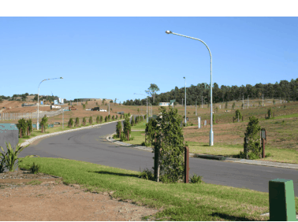
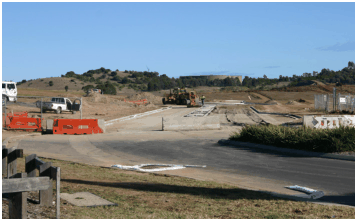
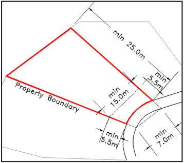

#### 3.8.1 General Requirements

#### Design Requirements

a)

a)	 Subdivision shall have appropriate

Subdivision shall have appropriate

Development controls under the plan are in addition to

regard to orientation, slope, aspect and

regard to orientation, slope, aspect and solar access.

solar access.

the development standards requirements under the CLEP.

#### Zone Acronyms

R2 Low Density Residential: R2

R3 Medium Density Residential: R3

b)	 Subdivision design shall comply with the requirements specified in Council’s Engineering Design Guide  for Development, available from Council’s website at www.campbelltown.nsw.gov. au

R4 High Density Residential: R4

R5 Large Lot Residential: R5

c)	 Where relevant, roads shall be designed to provide satisfactory level of services for the evacuation of occupants in the event of emergency.

d)	 Subdivision shall promote through street access and minimise the number of cul-de-sacs.

e)	 Roads/access handles shall be provided

to separate allotments from any park,

to separate allotments from any park, reserve, waterway and the like.

reserve, waterway and the like.

#### Residential

#### Subdivision

f)

f) All allotments within a subdivision that

All allotments within a subdivision that are located adjacent to the intersection

are located adjacent to the intersection of local public roads (existing or

of local public roads (existing or proposed) shall provide a splay in

proposed) shall provide a splay in accordance with

accordance with Council’s

Council’s Engineering

Engineering

Design Guide for Development

Design Guide for Development (available from Council’s website at

(available from Council’s website at (www.campbelltown.nsw.gov.au)

(www.campbelltown.nsw.gov.au) to

to

ensure adequate sight distances and

ensure adequate sight distances and maintain footpath widths.

maintain footpath widths. Note: All splays shall be dedicated to

Note: All splays shall be dedicated to Council at no cost to Council.

Council at no cost to Council.

> [Picture on page 66: a picture, saved as a picture (images/vol-1-part-03-low-and-medium-density-residential-page-66-35.gif, 150 dpi).]

Figure 3.8.1 – Example of Greenfield residential subdivision

Note: In the case of an RMS road the size

Note: In the case of an RMS road the size of the splay shall be in accordance with the

of the splay shall be in accordance with the RMS’s requirements.

RMS’s requirements. g)

g)	 Residential subdivision shall be designed

Residential subdivision shall be designed to address the public domain.

to address the public domain. h)

h)	 Wherever possible, subdivision design

Wherever possible, subdivision design shall avoid the creation of allotments

shall avoid the creation of allotments that have rear boundaries (and fencing)

that have rear boundaries (and fencing) that adjoin the public domain.

that adjoin the public domain.

#### Note:

i)

i) For the purpose of calculating the

For the purpose of calculating the minimum allotment size and dimensions

minimum allotment size and dimensions under the Plan, any land that is  part of

under the Plan, any land that is  part of an environmental corridor as specified

an environmental corridor as specified

Refer to Part 4 Principal Development Standards of the CLEP for the minimum subdivision standards for Torrens Tile subdivision (Clause 4.1 of the CLEP).

#### Note:

by the

by the Office of Environment and

Office of Environment and

Heritage

Heritage or any other government

or any other government

agency shall not be included within

agency shall not be included within the calculated area of land

the calculated area of land unless the

unless the

relevant public agency  is satisfied that

relevant public agency  is satisfied that that part of the allotment is capable of

that part of the allotment is capable of being developed.

being developed.

Numerical development standards for the minimum subdivision for each type of residential development are provided under the CLEP.

j)

j) For the purpose of calculating

For the purpose of calculating the minimum  allotment size  and

the minimum  allotment size  and dimensions under the Plan, any land

dimensions under the Plan, any land that is subject to bushfire, flooding or

that is subject to bushfire, flooding or other risk (excluding mine subsidence)

other risk (excluding mine subsidence) shall not be included within the

shall not be included within the calculated area of land unless it is

calculated area of land unless it is demonstrated to Council’s satisfaction

demonstrated to Council’s satisfaction that the site can be appropriately

that the site can be appropriately managed in a manner that retains the

managed in a manner that retains the

ability to be developed for the purpose

ability to be developed for the purpose to which it is intended under the zone.

to which it is intended under the zone.

#### Residential

#### Subdivision

k)

k)	 Access to residential subdivisions shall

Access to residential subdivisions shall not be permitted to any classified road

not be permitted to any classified road where alternative access can be made

where alternative access can be made available via the non–classified road

available via the non–classified road network.

network.

> [Picture on page 67: a picture, saved as a picture (images/vol-1-part-03-low-and-medium-density-residential-page-67-18.gif, 150 dpi).]

Figure 3.8.2 – Example of residential subdivision under construction.

> [Picture on page 67: a picture, saved as a picture (images/vol-1-part-03-low-and-medium-density-residential-page-67-21.gif, 150 dpi).]

l)

l) Extensive use of battleaxe configuration

Extensive use of battleaxe configuration in the subdivision of new areas shall be

in the subdivision of new areas shall be avoided, where possible.

avoided, where possible.
