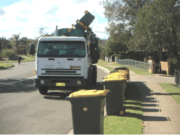

#### 3.8.3 Residential Torrens Title

#### 3.8.3 Residential Torrens Title Subdivision for

Subdivision for the Purpose of Dwelling

the Purpose of Dwelling

Houses Development

Houses Development - Zone R5

#### - Zone R5

#### Note:

#### Design Requirements

#### Design Requirements

Clause 4(A) of the CLEP States:

a)

a)	 Any residential allotment created by

Any residential allotment created by Torrens Title subdivision for the purpose

Torrens Title subdivision for the purpose of a dwelling house development

of a dwelling house development in areas zoned R5

in areas zoned R5 shall satisfy the

shall satisfy the

following standards:

following standards:

(4A)  If a lot is a battle-axe lot or other lot with an access handle, the area of the access handle is not to be included in calculating the lot size.

i)

i)	 a minimum width of 20 metres

a minimum width of 20 metres measured along the side boundaries

measured along the side boundaries at a distance of 5.5 metres from the

at a distance of 5.5 metres from the front property boundary;

front property boundary; ii)

ii)	 a minimum width of 10 metres

a minimum width of 10 metres measured between the extended

measured between the extended property side boundaries where they

property side boundaries where they intersect with the kerb line; and

intersect with the kerb line; and iii)

iii)	a minimum depth of 25 metres.

a minimum depth of 25 metres.

b)

b)	 Any  battle axe shaped allotment

Any  battle axe shaped allotment created by subdivision for the purpose

created by subdivision for the purpose of a dwelling house development

of a dwelling house development in areas zoned R5

in areas zoned R5 shall satisfy the

shall satisfy the

following standards:

following standards: i)

i)	 a minimum depth of 25 metres

a minimum depth of 25 metres excluding the length of the access

excluding the length of the access handle;

handle; ii)

ii)	 no more than one allotment shall be

no more than one allotment shall be accessed via a battle axe handle;

accessed via a battle axe handle; iii)

iii)	a minimum access handle width of

a minimum access handle width of

3.5 metres;

3.5 metres; iv)

iv)	 a maximum access handle length of

a maximum access handle length of

35 metres;

35 metres;

#### Residential

#### Subdivision

v)

v)	 no encroachment/s or right of

no encroachment/s or right of carriage way shall impinge into land

carriage way shall impinge into land within the access handle;

within the access handle; vi)

vi)	the provision of an adequately

the provision of an adequately dimensioned vehicle manoeuvring

dimensioned vehicle manoeuvring area, located behind the access

area, located behind the access handle; and

handle; and vii)

vii)	the provision of a minimum 0.5

the provision of a minimum 0.5 metre wide landscape strip along

metre wide landscape strip along the length of the access handle,

the length of the access handle, where it adjoins the boundary/fence

where it adjoins the boundary/fence of the neighbouring property.

of the neighbouring property.

> [Picture on page 69: a picture, saved as a picture (images/vol-1-part-03-low-and-medium-density-residential-page-69-32.gif, 150 dpi).]

Figure 3.8.3     – Residential subdivision allowing adequate accessibility for waste collection vehicles.
