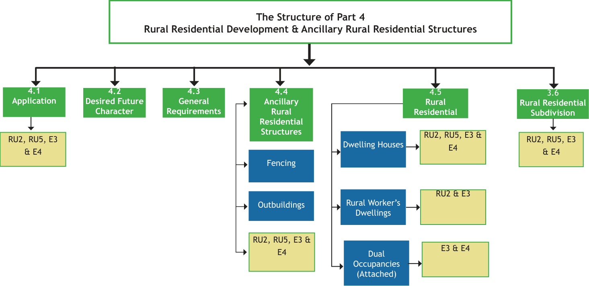

## Part 4 Rural Residential Development and  Ancillary Rural Residential Structures

### 4.1 Application

#### Application

Part 4 sets out the following:

– General Requirements for rural residential development;

– Development controls for the following rural residential structures:

• fencing; and

• outbuildings;

– Development controls for the following  rural residential development:

• dwelling houses;

• rural workers’ dwelling; and

• dual occupancies (attached);and

– Development controls for rural residential subdivision on areas zoned RU2, RU5,

E3 and E4.

The design requirements contained within Part 4 complement the provisions contained in Part 2, Volume 1.

| Note: | Zone Acronyms |
|---|---|
| For the purpose of this part, rural residential development means | RU2 Rural Landscape: RU2 |
| any of the following: | RU5 Village: RU5 |
| • • dwelling dwelling houses houses in in areas areas | E3 Environmental Management: E3 |
| zoned zoned RU2, RU5, E3 and |  |
| E4; | E4 Environmental Living: E4 |
| • • rural rural workers’ workers’ dwelling dwelling in in | Note: |
| areas areas zoned zoned RU2 and E3; | Proposed residential development |
| • • dual dual occupancies occupancies attached attached | within Bush Fire Prone Lands shall |
| in in areas areas zoned zoned E3 and E4; | comply with the requirements of |
| • • outbuildings outbuildings on on areas areas | Planning for Bush Fire Protection |
| zoned zoned RU2, RU5, E3 and | 2006 (as amended), prepared by |
| E4; and | NSW Rural Fire Service. |
| • fencing in areas zoned | Note: Planning for Bushfire |
| RU2, RU5, E3 and E4. | Protection 2006 Document is available for view/download from the NSW Rural Fire Service |
| Note: Qualifying lot sizes for rural | website at www.rfs.nsw.gov.au |
| residential development are |  |
| included under the CLEP. |  |

> [Picture on page 3: a map, saved as a picture (images/vol-1-part-04-rural-residential-development-page-3-1.gif, 150 dpi); the street names and other small labels are on the picture.]
> Words printed on the picture (title and legend, copied from the PDF):
> RU2, RU5, E3 &
> RU2, RU5, E3
> RU2, RU5, E3
> RU2 & E3
> RU2, RU5, E3 &
> E3 & E4

#### The Structure of Part 4

#### Rural Residential Development & Ancillary Rural Residential Structures

#### Application

#### Desired Future

#### Ancillary

#### Rural Residential

#### Character

#### General

#### Requirements

#### Rural

#### Residential

#### Subdivision

#### Rural

#### Residential

#### Structures
