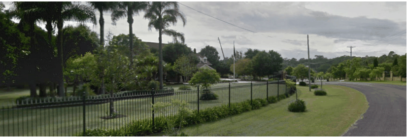
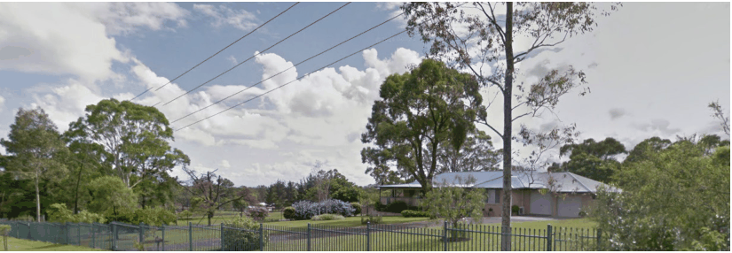

### 4.2 Desired Future Character for Rural Residential Areas Zoned RU2,

#### RU5, E3 and E4

#### Desired

The areas zoned  RU2, RU5, E3 and E4 shall continue to be characterised by:

#### Future

#### Character

• rural landscape where dwelling houses are designed to blend with the natural environment;

#### Rural

#### Residential

• dwelling houses with a scale and bulk that are not visually dominant;

• buildings that are setback a generous distance from the primary street frontage to maintain the rural character of existing streets/landscape;

• buildings that are strategically sited on the least environmental sensitive part of the site having regard to site constraints such as slope, bushfire, drainage, on site effluent disposal, vegetation, threatened species and flooding constraints; and

• rural open fencing that respects the environmental and scenic quality of the rural landscape.

#### Note:

Numerical Development Standards for building heights and minimum subdivision standards are provided under the CLEP.

> [Picture on page 4: a picture, saved as a picture (images/vol-1-part-04-rural-residential-development-page-4-22.gif, 150 dpi).]

> [Picture on page 4: a picture, saved as a picture (images/vol-1-part-04-rural-residential-development-page-4-23.gif, 150 dpi).]

Figure 4.2.1 - Examples of streetscapes/views within existing rural residential areas within the Campbelltown LGA.
