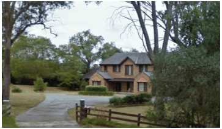

#### 4.3.1 Building Form and Character

#### Objectives:

#### 4.3.1

#### Building Form

#### and Character

■ Ensure that the aesthetic and environmental values of rural lands are appropriately conserved.

■ Ensure that the massing, scale, form, colour and appearance of new development are complementary to the existing and desired rural residential character of the neighbourhood.

■ Ensure that buildings are designed to enhance the existing character of the rural areas by encouraging innovative and quality designs that fit harmoniously with their surroundings.

■ Ensure that parking areas, garages and driveways are appropriately sited, designed and constructed so that they do not detract from the appearance of the development or character and landscape qualities of the area.

> [Picture on page 5: a picture, saved as a picture (images/vol-1-part-04-rural-residential-development-page-5-26.gif, 150 dpi).]

#### 4.3.1.1 Siting & Streetscape

a)

a)	 Developments shall be designed to fit

Developments shall be designed to fit the existing contours and landform of

the existing contours and landform of the site and to minimise the amount of

the site and to minimise the amount of cut and fill.

cut and fill.

b)	 Materials, colours and finishes of roofing, walls, driveways and fencing shall:

i)	 not be obtrusive;

ii)	 not be highly reflective and/or

Figure 4.3.1.1 - A rural residential dwelling.

include bright colours;

iii)	complement or be recessive to the landscape setting in which the building is to be situated;and

iv)	be submitted to Council as part of the development application.

c)

c)	 Garages and outbuildings shall be

Garages and outbuildings shall be designed and located so that they do not

designed and located so that they do not dominate the primary street frontage of

dominate the primary street frontage of the building as viewed from the street

the building as viewed from the street and prominent public places.

and prominent public places. d)

d)	 Garage doors facing public streets shall

Garage doors facing public streets shall

be no wider than 50% of the width of

be no wider than 50% of the width of the main dwelling (at its street fronting

the main dwelling (at its street fronting facade).

facade).

#### General

#### Requirements

e)

e)	 Highly reflective materials and bright

Highly reflective materials and bright colours for roofing shall not be allowed.

colours for roofing shall not be allowed.

#### for Rural

#### Residential

#### Development f)

f) Building shall not be sited downstream

Building shall not be sited downstream from existing dams in order to reduce

from existing dams in order to reduce the potential for inundation of the

the potential for inundation of the buildings if the dam fails or overtops.

buildings if the dam fails or overtops.

#### 4.3.1

#### Building Form

#### and Character

#### 4.3.1.2 Building Height

#### Design Requirements

#### Note:

For development controls landscaping, weed management, erosion and sediment controls, cut and fill, water cycle management and retaining walls refer to Sections 2.5 to 2.13 of Part 2 of Volume 1 of the Plan.

a)

a)	 The height of development shall not

The height of development shall not result in any significant loss of amenity

result in any significant loss of amenity (including loss of solar access and

(including loss of solar access and visual and acoustic privacy) to adjacent

visual and acoustic privacy) to adjacent properties.

properties.
