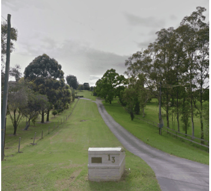
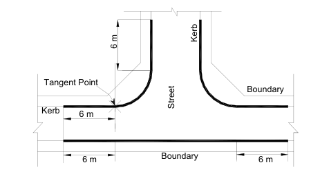

#### 4.3.2 Car Parking and Access

#### Objectives:

#### General

#### Requirements

■ Ensure efficient and safe vehicle and pedestrian movement within, into and out of development.

#### for Rural

#### Residential

#### Development

■ Ensure that the location and design of driveways, parking, service areas and access areas are practical, easily maintained, convenient, safe, suitably landscaped and respect the broader landscape context.

#### 4.3.2

#### Car Parking

#### and Access

■ Promote the use of electric vehicles across the Local Government Area.

■ Encourage the installation of electric vehicle charging infrastructure.

> [Picture on page 7: a picture, saved as a picture (images/vol-1-part-04-rural-residential-development-page-7-18.gif, 150 dpi).]

#### Design Requirements

a)

a)	 The minimum  dimensions  of any

The minimum  dimensions  of any required parking space shall be 2.5 x 5.5

required parking space shall be 2.5 x 5.5 metres.

metres. b)

b)	 The minimum internal dimensions of

The minimum internal dimensions of an enclosed garage shall be 3.0 x 6.0

an enclosed garage shall be 3.0 x 6.0 metres.

metres. c)

c)	 Transitional grades shall comply with

Transitional grades shall comply with

AS2890.1 (as amended) Parking Facilities

AS2890.1 (as amended) Parking Facilities

- Off-Street Car Parking.

- Off-Street Car Parking. d)

d)	 Driveways shall meet the following

Driveways shall meet the following criteria:

criteria:

Figure 4.3.2.1 - An example of a driveway that is constructed to a standard that allows for all weather access.

i)

i)	 constructed to a standard that allows

constructed to a standard that allows for all weather access;

for all weather access; ii)

ii)	 designed and located to follow

designed and located to follow contours to avoid excessive site works,

contours to avoid excessive site works, erosion and sedimentation run off;

erosion and sedimentation run off; iii)

iii)	have a minimum width of

have a minimum width of 2.5 metres

metres

and a maximum width of 5.0 metres;

and a maximum width of 5.0 metres; iv)

iv)	allow for entry to and exit from the

allow for entry to and exit from the property in a forward direction;

property in a forward direction; v)

v)	 located to minimise the impact on

located to minimise the impact on vegetation and the removal of mature

vegetation and the removal of mature trees; and

trees; and vi)

vi)	one (1) driveway access is permitted

one (1) driveway access is permitted per property, in addition to any

per property, in addition to any access required by the NSW Rural Fire

access required by the NSW Rural Fire

Service, where relevant.

Service, where relevant.

#### General

#### Requirements

e)

e)	 Driveways shall be located a minimum

Driveways shall be located a minimum distance of (six) 6 metres from the

distance of (six) 6 metres from the tangent point of any unsignalised

tangent point of any unsignalised intersection (refer to Figure 4.3.2.2).

intersection (refer to Figure 4.3.2.2).

#### for Rural

#### Residential

#### Development 4.3.2

#### Car Parking

f)

f) Driveways shall be designed and

Driveways shall be designed and constructed so that they do not

constructed so that they do not divert stormwater from the adjoining

divert stormwater from the adjoining road onto the property.

road onto the property.

#### and Access

g)

g)	 Electric vehicle charging stations

Electric vehicle charging stations must be located behind the building

must be located behind the building line.

line.

> [Picture on page 8: a picture, saved as a picture (images/vol-1-part-04-rural-residential-development-page-8-36.gif, 150 dpi).]
> Words printed on the picture (title and legend, copied from the PDF):
> Kerb
> 6 m
> Tangent Point
> Boundary
> Street
> Kerb 6 m
> 6 m
> 6 m
> Boundary

Figure 4.3.2.2 – Inappropriate locations of a driveway entry as shown by heavy edged lines.

Note: In circumstances where an intersection is controlled by traffic signals, a roundabout or the like, applicants are requested to contact Council for specific requirements. Note: For additional technical

Note: For additional technical specifications relating to gradient of

specifications relating to gradient of driveway refer to

driveway refer to Council’s Engineering Design for Development available from Council’s website at: www.campbelltown. nsw.gov.au

#### Ancillary Rural
