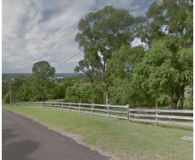
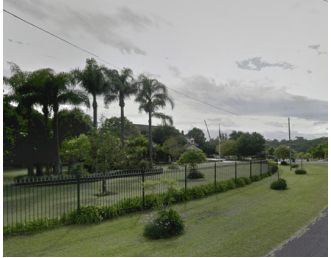

#### 4.4.1  Fencing - Rural Residential

#### 4.4.1 Fencing

#### Objectives:

#### Rural Residential

■ To ensure that fencing fronting the primary and secondary streets are of a material, colour, design and height that do not adversely impact on the scenic and environmental quality of the rural areas.

a)	 Fencing shall:

#### Note:

For the purpose of this part,

i)	 be a maximum of 1.8 metres in height;

ii)	 be of an open style for any part of the

ancillary rural residential structures means outbuildings, fencing, and the like.

> [Picture on page 9: a picture, saved as a picture (images/vol-1-part-04-rural-residential-development-page-9-25.gif, 150 dpi).]

> [Picture on page 9: a picture, saved as a picture (images/vol-1-part-04-rural-residential-development-page-9-26.gif, 150 dpi).]

fence that is higher than  0.6 metres, except for the parts of the fence that are pillars or columns (refer to Figure 4.4.1);

iii)	not be constructed of solid metal sheeting unless required by a Bush fire Risk Management Plan prepared by a qualified person; and

iv)	complement the design of the development.

b)

b)	 Despite 4.4.1a) above, entry gates to rural

Despite 4.4.1a) above, entry gates to rural properties  and fence pillars/columns

properties  and fence pillars/columns shall be permitted to be constructed of

shall be permitted to be constructed of solid materials such as brick and the like.

solid materials such as brick and the like. c)

c)	 Fencing shall not obstruct power,

Fencing shall not obstruct power, water, sewer, gas or telephone services,

water, sewer, gas or telephone services, drainage systems, (including overland

drainage systems, (including overland flow paths) or any easements or rights of

flow paths) or any easements or rights of way.

way. d)

d)	 Fencing on corner allotments shall not

Fencing on corner allotments shall not obstruct the sight distance of traffic

obstruct the sight distance of traffic entering or within an intersection or

entering or within an intersection or roundabout.

roundabout.

Figure 4.4.1 - Examples of fencing

- rural residential properties.

e)

e)	 Details of fencing shall be submitted

Details of fencing shall be submitted with the development application for the

with the development application for the Principal dwelling.

Principal dwelling.

#### Ancillary Rural

f)

f) If the land on which a fence is to be

If the land on which a fence is to be erected is bush fire prone land, the fence

erected is bush fire prone land, the fence or retaining wall shall be constructed

or retaining wall shall be constructed from non-combustible materials.

from non-combustible materials.

#### Residential

#### Structures g)

g)	 A fence shall not be constructed so as to

A fence shall not be constructed so as to redirect the overflow of surface water

redirect the overflow of surface water onto adjoining properties.

onto adjoining properties.
