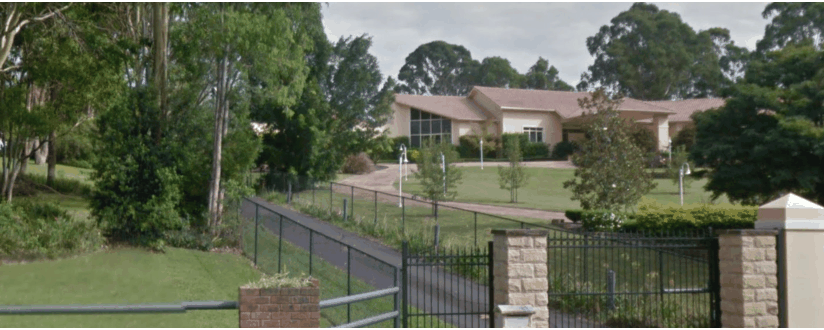
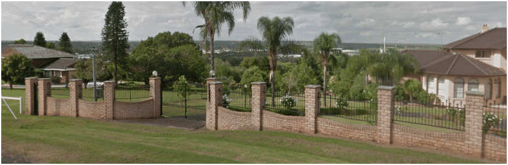
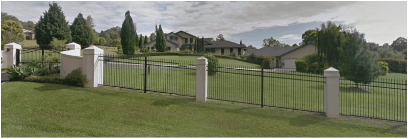

### 4.5 Rural Residential Development - Zones  RU2, RU5, ..

#### .  E3 and E4

This Section applies to the following rural  residential development:

#### Rural

#### Residential

#### Development

• dwelling houses in areas zoned RU2, RU5, E3 and E4;

• rural workers’ dwelling in areas zoned RU2 and  E3;and

• dual occupancies (attached) in areas zoned E3 and E4.

Note: Numerical Development Standards for building heights, minimum lot sizes, ownership, and subdivision for rural residential development are provided under the CLEP.

> [Picture on page 12: a picture, saved as a picture (images/vol-1-part-04-rural-residential-development-page-12-13.gif, 150 dpi).]

> [Picture on page 12: a picture, saved as a picture (images/vol-1-part-04-rural-residential-development-page-12-14.gif, 150 dpi).]

> [Picture on page 12: a picture, saved as a picture (images/vol-1-part-04-rural-residential-development-page-12-15.gif, 150 dpi).]

Figure 4.5.1. Examples of existing rural residential development within the Campbelltown LGA.
