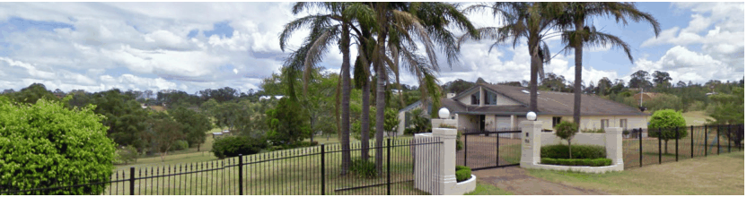

#### 4.5.1 Dwelling Houses - Rural Residential - Zones RU2, RU5, E3 and E4

#### Objectives:

#### Rural

#### Residential

#### Development

■ Encourage quality-designed dwelling houses that are generally recessive and make a positive contribution to the streetscape and the rural character of the locality.

#### 4.5.1

#### Dwelling

#### Note:

#### Houses

a)

a)	 The minimum setbacks for a  dwelling

The minimum setbacks for a  dwelling house shall be in accordance with the

house shall be in accordance with the setback requirements for dwelling houses

setback requirements for dwelling houses shown in Table 4.5.1.

shown in Table 4.5.1.

Dwelling house (as defined under the CLEP) means a building containing only one dwelling.

#### Note:

To find out whether your site has a sufficient area to  qualify for a dwelling house type development, refer to the CLEP.

#### Note:

For Provision of Services (water, electricity and waste water treatment requirements), refer to Section 2.16 Provision of Services under Part 2 of the Plan.

#### Note:

For development controls  relating to landscaping, weed management, erosion and sediment controls, cut and fill, water cycle management and retaining walls refer to Sections 2.5 to 2.13 of Part 2 of Volume 1 of the Plan.

#### Note:

The CLEP includes a number of requirements relation to rural areas and rural subdivision under Part 4 Principal development standards.

Table 4.5.1 Setbacks for Dwelling Houses - Rural Residential

| Lot Size in hectares (ha) | Primary Street Setback in metres (m) |  | Side, Rear and Secondary Street Setbacks in metres (m) |
|---|---|---|---|
|  | Single Storey | Double Storey |  |
| Less than or equal to 1 ha | 15 m | 20 m | 10 m |
| Greater than 1 ha | 35 m | 50 m | 10 m |

> [Picture on page 13: a picture, saved as a picture (images/vol-1-part-04-rural-residential-development-page-13-51.gif, 150 dpi).]

Figure 4.5.1.1 An example of a rural dwelling house in the Campbelltown LGA.
