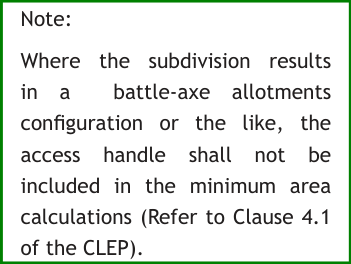

### 4.6 Rural Residential Subdivision

This Section applies to the rural residential subdivision of areas zoned RU2, RU5, E3 and E4.

#### Rural

#### Residential

#### Subdivision

#### Objective:

#### 4.6.1

#### Subdivision

■ Ensure that land once subdivided, contributes positively to the desired character of the locality and provides for the safe and attractive integration of existing and new development.

of

#### Allotments

■ Ensure that subdivision responds to the physical characteristics of the land, its landscape setting, orientation, landmarks and key vistas to and from that land.

■ Ensure that subdivision provides safe connections with and extension of existing street patterns, as well as any pedestrian, cycleway and public open space networks.

■ Encourage subdivision that will result in the creation of allotments that are orientated, and of such dimension and configuration to facilitate the siting, design and construction of development resulting in the conservation of non-renewable resources and the environmental attributes of the land.

> [Picture on page 16: a picture, saved as a picture (images/vol-1-part-04-rural-residential-development-page-16-24.gif, 150 dpi).]
