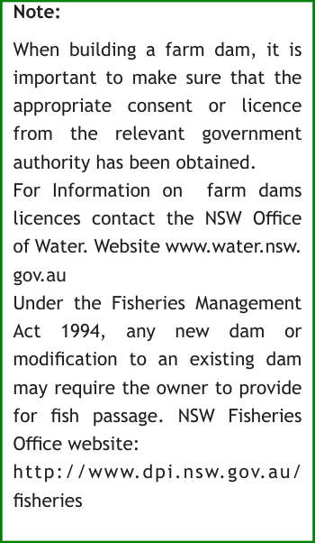

#### 4.6.3 Construction of Farm Dams

#### Design Requirements

#### Residential

#### Subdivision

#### of Non-Urban

#### Land

a)

a)	 A development application shall be

A development application shall be lodged with Council for any proposal that

lodged with Council for any proposal that involves the construction of a new farm

involves the construction of a new farm dam or modification to an existing dam.

dam or modification to an existing dam.

> [Picture on page 19: a picture, saved as a picture (images/vol-1-part-04-rural-residential-development-page-19-16.gif, 150 dpi).]

#### Note:

#### 4.6.3

#### Construction

of

#### Farm Dams

b)

b)	 Dam construction shall comply with the

Dam construction shall comply with the requirements of NSW Office of Water

requirements of NSW Office of Water Guidelines.

Guidelines. c)

c)	 All development applications for any

All development applications for any proposal that involves the construction of

proposal that involves the construction of a new dam or modification to an existing

a new dam or modification to an existing dam shall be accompanied by:

dam shall be accompanied by: i)

i)	 all licences required by the  NSW

all licences required by the  NSW Office of Water or NSW Department

Office of Water or NSW Department of Investment and Industries where

of Investment and Industries where relevant;

relevant; ii)

ii)	 a geotechnical report prepared by a

a geotechnical report prepared by a suitably qualified person; and

suitably qualified person; and iii)

iii)	as assessment by a suitably qualified

as assessment by a suitably qualified person of the changes to local

person of the changes to local hydrology that the dam may create.

hydrology that the dam may create.

When building a farm dam, it is important to make sure that the appropriate consent or licence from the relevant government authority has been obtained. For Information on  farm dams licences contact the NSW Office of Water. Website www.water.nsw. gov.au Under the Fisheries Management Act 1994, any new dam or modification to an existing dam may require the owner to provide for fish passage. NSW Fisheries Office website: http://www.dpi.nsw.gov.au/ fisheries

d)

d)	 Any farm dam that is proposed to be

Any farm dam that is proposed to be located upstream of an existing or

located upstream of an existing or proposed dwelling shall be referred

proposed dwelling shall be referred by Council to the NSW Dams Safety

by Council to the NSW Dams Safety Committee for concurrence.

Committee for concurrence.

### This page is intentionally left

### blank.
