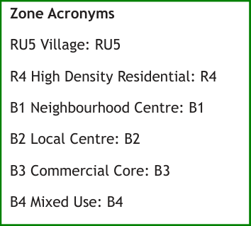
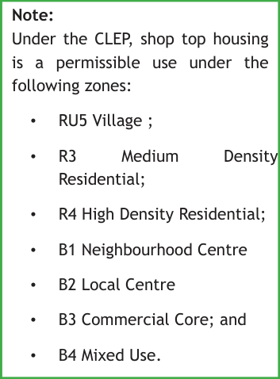
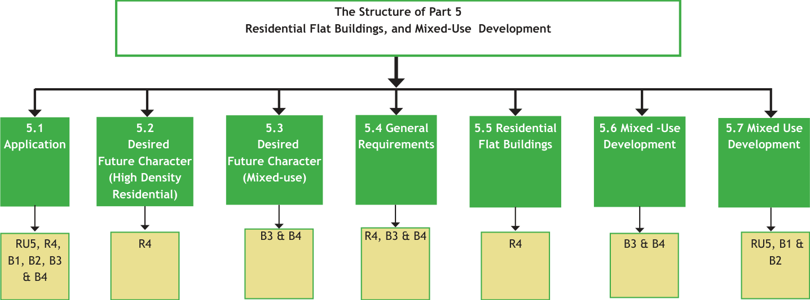

## Part 5 Residential Flat Buildings and Mixed-Use Development

### 5.1 Application

#### Application

Part 5 sets out the following:

– Desired future character for high density residential neighbourhoods in areas zoned R4.

– Desired future character for mixed use precincts in areas zoned B3 and B4.

– General Requirements for residential flat buildings and mixed use development in areas zoned R4, B3 and B4 zones.

– Development controls for:

• residential flat buildings in areas zoned R4;

• mixed use development in areas zoned  B3 and B4; and

• mixed use development in areas zoned RU5, B1 and B2.

The design requirements contained within this part complement the provisions contained

> [Picture on page 2: a picture, saved as a picture (images/vol-1-part-05-residential-flat-buildings-and-mixed-use-devel-page-2-14.gif, 150 dpi).]

in Part 2 of Volume 1.

#### Zone Acronyms

RU5 Village: RU5

R4 High Density Residential: R4

B1 Neighbourhood Centre: B1

B2 Local Centre: B2

B3 Commercial Core: B3

#### Note:

For the purposes of this part, mixed use development is development which includes residential uses (such as shop top housing where relevant) in conjunction with one or more uses such as, business premises, commercial offices, retail shops, community facilities and medical centres.

B4 Mixed Use: B4

> [Picture on page 2: a picture, saved as a picture (images/vol-1-part-05-residential-flat-buildings-and-mixed-use-devel-page-2-33.gif, 150 dpi).]
> Words printed on the picture (title and legend, copied from the PDF):
> • RU5 Village ;
> • R3 Medium Density
> Residential;
> • R4 High Density Residential;
> • B1 Neighbourhood Centre
> • B2 Local Centre
> • B3 Commercial Core; and
> • B4 Mixed Use.

#### Note:

Under the CLEP, shop top housing is a permissible use under the following zones:

#### Note:

Numerical Development Standards for building heights, qualifying site areas and minimum subdivision are provided under the CLEP.

#### Note:

Clause 7.13 Design Excellence of the CLEP applies to areas zoned R3, R4, B2, B3 and B4 and aims to deliver the highest standard of architectural and urban design, as part of the built environment.

> [Picture on page 3: a map, saved as a picture (images/vol-1-part-05-residential-flat-buildings-and-mixed-use-devel-page-3-1.gif, 150 dpi); the street names and other small labels are on the picture.]
> Words printed on the picture (title and legend, copied from the PDF):
> R4, B3 & B4
> B3 & B4
> RU5, B1 &
> B3 & B4
> B1, B2, B3

#### The Structure of Part 5

#### Residential Flat Buildings, and Mixed-Use  Development
