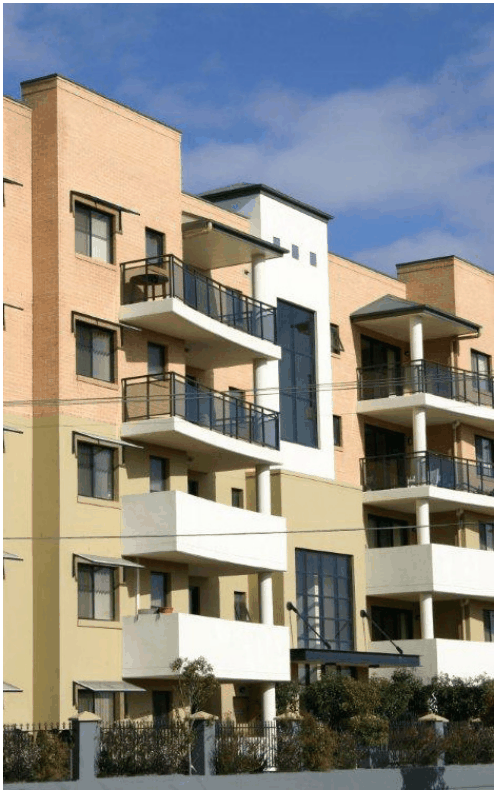

### 5.2 Desired Future Character for High Density Residential

#### Neighbourhoods (R4)

High density residential neighbourhoods shall be characterised by:

#### Desired

#### Future

#### Character

• building forms that have a high level of architectural merit and make a positive contribution to the local area;

• a diversity if high density residential forms;

for

#### High Density

• residential forms that provide high quality residential living environments;

#### Residential

#### Neighbourhoods

• integration with high intensity public transport forms and fine grained pedestrian/ cycleway networks;

#### (Zone R4)

• access to a sage and high quality public domain;

• articulated front facades with balconies and deep soil planting and landscaping of street frontages.

> [Picture on page 4: a picture, saved as a picture (images/vol-1-part-05-residential-flat-buildings-and-mixed-use-devel-page-4-21.gif, 150 dpi).]

Figure 5.2.1 - An example of high density residential development.
