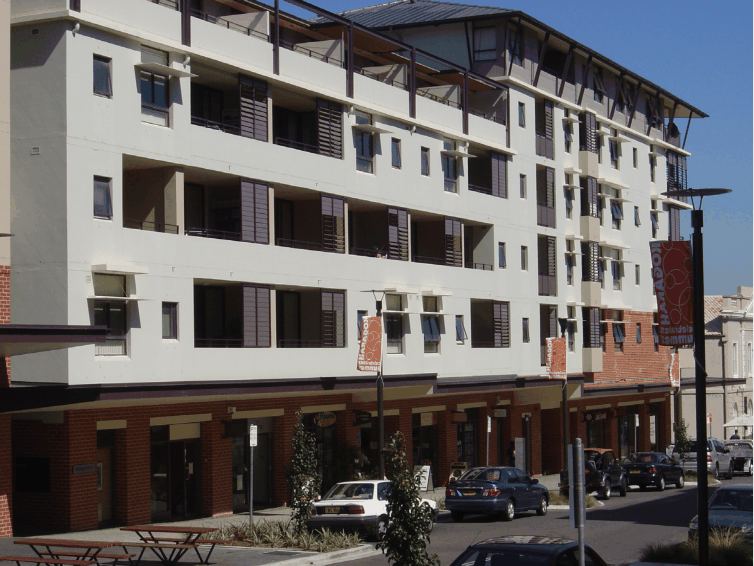

### 5.3 Desired Future Character for Mixed Use Precinct (B3 and B4)

#### Desired

The areas  shall be characterised by:

#### Future

#### Character

• buildings with a high level of architectural merit in which residential dwellings are located on higher levels;

for

#### Mixed Use

• articulated front facades with balconies and podiums fronting the streets;

#### Precincts (Zones B3 &

• active street frontages  in which buildings at street level are used primarily for the purpose of retail and commercial uses;

#### B4)

• an accessible, attractive, vibrant and safe public domain;

• built forms that provide high quality residential living environments and considered integration of commercial/retail activities with the residential elements;

• mixed use development supported by a significant local and visitor population;

• integration with high intensity public transport forms and fine grained pedestrian/ cycleway networks.

> [Picture on page 5: a picture, saved as a picture (images/vol-1-part-05-residential-flat-buildings-and-mixed-use-devel-page-5-22.gif, 150 dpi).]

Figure 5.3.1 - An example of a mixed use development.
