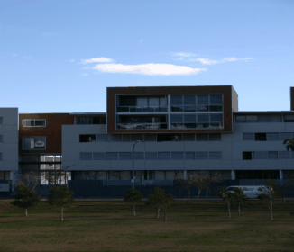
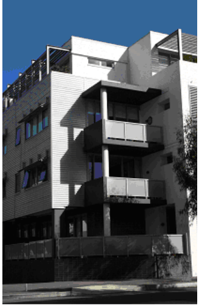
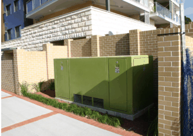
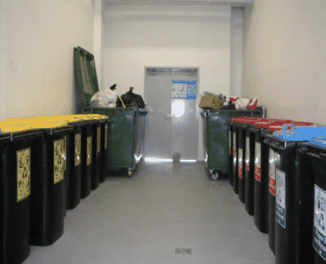

### 5.4 General Requirements for Residential Flat Buildings and Mixed

#### Use Development

#### General

Requirements This section sets out general development controls relating to residential flat buildings

and  mixed use development within areas zoned R4, B3 and B4.

#### for Residential

#### Objective:

#### Flat Buildings & Mixed Use

■ Ensure that residential flat buildings and mixed use development, offer a high level of residential amenity and make a positive contribution to the creation of new, high quality and contemporary urban streetscapes by:

#### Development

### • achieving well articulated building forms that avoid a plain bulky

and monolithic appearance;

#### (Zones R4,B3

• adopting appropriate building scale, massing and proportions that best reflect the desired future character of the area; and

#### & B4)

### • demonstrating high architectural value.

■ Ensure that residential dwellings within mixed use development include design measures that minimise the impact of the normal operation of non-residential activities on the amenity of the occupants of the residential dwellings. ■ Ensure that non-residential components of the building (i.e lower level retail and commercial) include design measures and are to minimise noise, odour, light spill, and air pollution impacts upon residential properties.

> [Picture on page 6: a picture, saved as a picture (images/vol-1-part-05-residential-flat-buildings-and-mixed-use-devel-page-6-28.gif, 150 dpi).]

#### 5.4.1 Relationship of the Plan to SEPP ........65 Design Quality of Residential ........Flat Development

a)	 In addition to satisfying  the requirements

Figure 5.4.1 Example of contemporary residential flat building.

of  the Plan, all residential flat buildings,and mixed use development having a height greater than 12 metres or 4 or more self-contained dwellings (whether or not the building includes uses for other purposes, such as  shops) shall satisfy all the standards within State Environmental Planning Policy No. 65 - Design Quality of Residential Flat Development (SEPP 65) and Apartment Design Guide (Published by the NSW Department of Planning and Environment, July 2015).

#### 5.4.2 Building Form and Character

#### Design Requirements:

#### General

a)	 Building design shall consider foremost

#### Requirements for Residential Flat Buildings

the qualities (both natural and built) and the desired future character of the areas including the significance of any heritage item on the land.

#### &

#### Note:

Clause 7.18 Design Excellence of the CLEP applies to zones R4, B2, B3 and B4 and aims to deliver the highest standard of architectural and urban design, as part of the built environment.

> [Picture on page 7: a picture, saved as a picture (images/vol-1-part-05-residential-flat-buildings-and-mixed-use-devel-page-7-21.gif, 150 dpi).]

#### Mixed Use Development

b)	 Building design shall incorporate the following features to assist in the achievement of high quality architectural outcomes:

#### (Zones R4, B3 & B4)

i)	 incorporation of appropriate facade treatments that help the development properly address the respective street frontages, key vistas and to add visual interest to the skyline;

ii)	 incorporation of articulation in walls, roof lines, variety of roof pitch, individualised architectural features (balconies, columns, porches, colours, materials etc) into the facade of the building;

iii)	variation in the vertical planes of exterior walls in depth and/or direction;

iv)	variation in the vertical and horizontal planes of the building so that the building appears to be divided into distinct base, middle and top massing elements;

v)	 articulation of  building facade

Figure 5.4.2 Example of external facade treatment that provide variety and articulation through use of varying material types and variation of building vertical height elements.

(including rear and side elevations visible from a public place) by appropriate use of colour, arrangement of facade elements, and variation in the types of materials used;

vi)	utilisation of landscaping and interesting architectural detailing at the ground level; and

vii)	avoidance of blank walls at ground and lower levels.

| 5.4 | c) Building design shall demonstrate to Council’s satisfaction that the |
|---|---|
| General | development will: |
| Requirements | i) facilitate casual surveillance and |
| for Residential | active interaction with the street; |
| Flat Buildings | ii) be sufficiently setback from the property boundary to enable the |
| & | planting of vegetation to soften the |
| Mixed Use | visual impact of the building at street level; and |
| Development | iii) maximise cross flow ventilation, therefore minimising the need for air |
| (Zones R4,B3 | conditioning. |
| & B4) | d) Building colours, materials and finishes shall generally achieve subtle contrast. The use of highly reflective or gloss materials or colours shall be minimised to feature and highlight element only. e) Building materials shall be high quality, durable and low maintenance. 5.4.3 Site Services Design Requirements: a) The location, design and construction of utility services shall satisfy requirements of the relevant servicing authority and Council. b) Development shall ensure that adequate provision has been made for all essential services (i.e water, sewerage, electricity, gas, telephone, internet and stormwater drainage). c) All roof-mounted air conditioning or heating equipment, vents or ducts, lift wells and the like shall not be visible from any public place and shall be integrated into the design of the development. d) All communication dishes, antennae and the like shall be located or integrated into the built form so as to minimise visual prominence. e) An external lighting plan shall be prepared by a suitably qualified person and submitted with the development |

application.

#### General Requirements for Residential

f) All site services areas including any associated equipment and storage structures  shall be incorporated into the design of the building and screened from public view.

#### Flat Buildings & Mixed Use

g)	 An on-going waste management plan shall be prepared by a suitably qualified person and submitted with the development application.

#### Development

h)	 Any development applications involving

#### (Zones R4,B3

new construction work with a value of $30 million or greater shall undertake the following at the developer’s expense:

#### & B4)

i)

i)	 Any existing above ground power

Any existing above ground power lines which traverse the property’s

lines which traverse the property’s frontage, must be relocated

frontage, must be relocated underground; and

underground; and

> [Picture on page 9: a picture, saved as a picture (images/vol-1-part-05-residential-flat-buildings-and-mixed-use-devel-page-9-34.gif, 150 dpi).]

Figure 5.4.3 – Location of site services for a residential flat building.

ii)

ii)	 Installation of any required electrical

Installation of any required electrical substation within the development

substation within the development basement level.

basement level.

Note: To facilitate this requirement, the applicant must liaise with the relevant power authority requesting to install a conduit within the adjacent footpath (road reserve) area for the provision of an underground power supply and extension of the conduit up to the wall of any proposed building. It must also be demonstrated that ready connection to the building(s) can be made when the overhead connection is replaced with a new underground line during the construction phase of the development. Where possible, above ground electricity utilities shall be located in a way to minimise impacts on landscaping and be placed/ oriented to minimise the percentage they occupy within the front portion of the site. i)

i) The developer must allocate/set aside

The developer must allocate/set aside adequate space within the development

adequate space within the development to install a grease trap and mechanical

to install a grease trap and mechanical ventilation, for any proposed food

ventilation, for any proposed food premises, in accordance with the Local

premises, in accordance with the Local Water Authorities recommendations

Water Authorities recommendations

and the following Australian Standards:

and the following Australian Standards:

#### General

Mechanical ventilation (for any proposed food premises) must comply with:

#### Requirements for Residential

i)

i)	 Australian Standard (AS) 1668.2-

Australian Standard (AS) 1668.2- 2012: The use of ventilation and air

2012: The use of ventilation and air conditioning in buildings:

conditioning in buildings:

#### Flat Buildings &

ii)

ii)	 Part 2: Mechanical ventilation in

Part 2: Mechanical ventilation in buildings; and (where applicable);

buildings; and (where applicable); and

and

#### Mixed Use Development

#### (Zones R4,B3

iii)

iii)	Australian Standard 1668.1-1998:

Australian Standard 1668.1-1998: The use of ventilation and air

The use of ventilation and air conditioning in buildings - Fire and

conditioning in buildings - Fire and smoke control in multi-compartment

smoke control in multi-compartment buildings.

buildings.

#### & B4)

> [Picture on page 10: a picture, saved as a picture (images/vol-1-part-05-residential-flat-buildings-and-mixed-use-devel-page-10-39.gif, 150 dpi).]

Figure 5.4.4 - Example of a garbage and recycling collection room (Internal view).

All mechanical ventilation must be installed within the building during construction and is not permitted on any external building surfaces. All required grease traps must be located and serviced on private land as no permission will be granted to install such a facility on public or Council land.

#### 5.4.4 Acoustic Privacy

a)	 Residential flat buildings, and the residential component of a mixed-use development shall provide noise mitigation measures to ensure that the following LAeq levels are not exceeded:

i)	 in any bedroom in the building—35 dBA ,

ii)	 anywhere else in the building (other than a garage, kitchen, bathroom or hallway)—40 dBA.

b)	 Residential flat buildings, and the residential component of a mixed-use development near railway corridors and major roads shall demonstrate to Council’s satisfaction  compliance with the requirements under the Guidelines entitled Development Near Rail Corridors and Busy Roads – Interim

Guideline, 2008)

#### General Requirements

Note: This Guide is available for view/ download from the NSW Department of Planning & Environment website at: www. planning.nsw.gov.au.

#### for Residential Flat Buildings & Mixed Use Development

#### (Zones R4,B3

Note: Noise mitigation measures for residential flat buildings and the residential component of a mixed use development may include insulating building elements such as doors, walls, windows, floors, roof and ceilings. Options for window design include sealing air gaps around windows and doors, laminated or thick glass, and double-glazing.

#### & B4)

#### 5.4.5 Vehicular Access

a)	 Residential flat buildings and   mixed-use developments shall only be permitted where Council is satisfied that existing road networks are capable of providing safe and efficient vehicle access  to and from the proposed development.

#### 5.4.6 Stormwater Drainage

a)	 Residential flat buildings and   mixed-use developments shall only be permitted where Council is satisfied that sufficient provisions made for the management of stormwater. All necessary upgrades to existing public and private stormwater infrastructure shall be addressed as part of the proposed development and shall be in accordance with Council’s Engineering Design Guide for Development (available from Council’s website at www.campbelltown.nsw. gov.au)

#### 5.4.7 Thermal Comfort

a)	 Residential flat buildings and mixed-use developments shall be designed to maximise natural thermal comfort for occupants through the use of appropriate building materials. Examples include the use of energy

efficient glazing and/or shading devices for windows and the like.

#### General

#### 5.4.8  Waste Management

#### Requirements

#### 5.4.8.1 Number of Bins

#### for Residential

a)	 All buildings shall be provided with

#### Flat Buildings household garbage bins at the following

rates:

#### &

i)	 one (1) x 240 litre bin per 2.5

#### Mixed Use

dwellings/ week for household garbage; or

#### Development

ii)	 one (1) x 1100 litre bulk bin per 10

#### (Zones R4,B3 & B4)

dwellings or part thereof, but only if the bulk bin is stored and located within the property where the waste collection truck is able to enter and exit the property in a forward-in forward-out arrangement with a maximum three point turning path.

b)	 All buildings shall be designed with provision for recyclable bins at a ratio of one (1) x 240 litre bin per 2.5 dwellings per fortnight.

c)	 A caretaker shall be available for all sites where bins are shared between occupants, to ensure bins are correctly presented for collection and returned to the designated bin storage area when emptied.

#### 5.4.8.2 Waste Service Rooms, Garbage Chutes and Provision for Recyclables Bins

a)	 All buildings with a rise of four (4) storeys or more  (including the ground floor) shall make provision for a Waste Service Room on each section of each residential floor which is accessible  for all residents.

b)	 All Waste Service Rooms shall have chutes to enable residents to dispose of garbage. Waste chutes must:

i)	 not be located adjacent to bedrooms

or living rooms unless they are outside the sound transmission barrier surrounding each unit.

#### General

ii)	 Not open into any habitable or

#### Requirements for Residential

public space and doors must have an effective self-sealing system;

#### Flat Buildings

iii)	Feed into appropriately sized bins

#### & Mixed Use Development

located in the bin storage room. During collection periods, empty bins must be placed under the chute outlet to maintain continuity of access to the chute system for residents;

#### (Zones R4,B3

iv)	Be completely enclosed in a fire-

#### & B4)

rated shaft construction of an approved material and be fitted with sprinklers;

v)	 Comply with the BCA;

vi)	Be accessible to anyone with a disability and comply with AS1428 Design for access and mobility; and

vii)	Include signage that explains the correct use of the system and which materials are able to be placed in the chute, and which must go in the recycling bin.

c)	 The outlet area, in which the chute outlets and mechanical collection devices are located, shall be secured to prevent access by unauthorised persons.

d)	 Mechanical devices are permitted in order to assist with waste collection

(eg. carousel).

e)	 Compaction is NOT permitted for either garbage or recyclables.

f) Each Waste Service Room shall make provision for a sufficient number of 240-litre mobile recycling bins for residents on each floor to dispose of recyclables. Chute systems for recyclables are not permitted.

#### 5.4.8.3 Bin Storage Room

| General | Design Requirements |
|---|---|
| Requirements | a) The development shall make provision for an appropriately sized bin storage |
| for Residential | room(s) that provides convenient |
| Flat Buildings | access for all residents, maintenance and waste collection staff . The bin |
| & | storage room shall: |
| Mixed Use | i) be located behind the primary and |
| Development | secondary building alignment; ii) be located to restrict or deter access by non-residents; |
| (Zones R4,B3 | iii) have a non-slip floor constructed |
| & B4) | of concrete or other approved impervious material at least 75mm thick and be provided with a ramp to the doorway (where necessary); iv) be graded and drained to a Sydney Water approved drainage fitting; v) have coving at all wall and floor intersections; vi) be finished with a smooth faced, non-absorbent material(s) in a light colour and capable of being easily cleaned; vii) be provided with an adequate supply of hot and cold water mixed through a centralised mixing valve with hose cock; and viii) have a self-closing door openable from within the room with a door width of at least 1.5m (or 2.5m if bulk bins are proposed); and ix) allow access and manoeuvrability of the largest bin and any required waste handling equipment. b) Bin storage rooms shall have sufficient capacity to allow for: i) Access, manoeuvring, cleaning and maintaining all bins by providing an |

extra 30% of the footprint of each waste container to the overall size of the storage area;

#### General

ii)	 Spacing of at least 50cm between all

#### Requirements

bins allocated for the development;

#### for Residential

iii)	All bins to be arranged side by side

#### Flat Buildings

within the bin storage room (no stacking);

#### &

iv)	A minimum 1.5m aisle between

#### Mixed Use Development

rows of bins to minimise potential obstructions; and

v)	 Future modifications of services,

#### (Zones R4,B3 & B4)

bin sizes and/or configurations by minimising the installation of fixed structures within bin storage areas.

c)	 Bin storage rooms shall be ventilated by:

i)	 a mechanical exhaust ventilation system; or

ii)	 	permanent, unobstructed natural ventilation openings having direct access to external air, and a total area of not less than one-twentieth (1/20th) of the floor area of the room.

d)	 Exterior doors of bin storage rooms shall be:

i)	 consistent with the overall design of the building;

ii)	 at least 1.5m wide (or 2.5m where bulk bins are proposed);

iii)	located away from the frontage of the building; and

iv)	fitted with a Council compatible keyed locking system that provides access to the room or activates the electronic opening and closing of the door (if collection service is to be carried out by Council).

e)	 All bin storage rooms and Waste Service

#### Note:

Rooms shall be constructed in such a manner to prevent the entry of vermin.

#### General Requirements

f) All bin storage rooms must be located in an area where bins can be easily moved to  the waste collection point.

#### for Residential

g)	 Any bin travel path must be free of

#### Flat Buildings

steps or kerbs and have a maximum gradient of 1V:8H.

#### &

Net frontage is calculated as the total lot frontage, minus the total of all distances occupied by trees (canopy width at maturity), driveways, street furniture, bus stops, street lights, power poles or any other fixed item that would obstruct access to the kerbside or servicing of bins.

#### Mixed Use Development

h)	 Where waste collection personnel are required to enter the premises to service bins, the collection point shall be no further than five (5) metres from the collection vehicle.

#### (Zones R4,B3 & B4)

i) Where residents have access to bin storage rooms, signage on the correct use of the waste management system shall be displayed in all  bin storage rooms.

#### 5.4.8.4 Bulky Waste Storage

a)	 Developments must make provision for the storage of bulky waste (kerbside clean-up) materials, ensuring that:

i)	 a minimum  area of ten (10) square metres per building is provided;

ii)	 the area is secure and caged for visibility into the enclosure;

iii)	the area is accessible to all residents and has a minimum doorway width of 1.5m; and

iv)	the area is not more than ten (10) metres from the waste collection point.

#### 5.4.8.5 On-site Waste  Collection

a)	 Any development:

• containing 20 or more dwellings, and/ or

• when the number of bins proposed cannot be accommodated within 50% of the development’s net frontage width on collection day, shall be designed to accommodate forward-

in, forward-out, drive-on vehicular collection for on-site servicing.

#### General

b)	 Where on-site waste and recycling

#### Requirements for Residential

collection is proposed, the site plan and layout shall consider how waste and recycling vehicles can access and move around the development.

#### Flat Buildings

c)	 The area designated for on-site servicing

#### &

must meet the following requirements:

#### Mixed Use Development

i)	 there shall be a minimum unobstructed height clearance of 5.2 metres;

ii)	 there shall be provision for a waste

#### (Zones R4,B3 & B4)

collection vehicle to empty bins on the vehicle’s left side, allowing for a width of 3.8 metres from the right hand side of the vehicle to the collection point;

iii)	where the waste collection vehicle is required to turn around on site, there must be provision for a heavy rigid vehicle of 10.4 metres length (refer to indicative vehicle dimensions at Table 2.15.2) to negotiate a maximum three-point turn allowing the waste collection truck to enter and leave the property in a forward direction;

iv)	the maximum grade of any path of travel for collection vehicle shall be 1V:20H for the first 6 metres from the street, and 1V:12H thereafter;

v)	 the minimum driveway width for a collection vehicle shall be 3.6 metres wide, with sufficient area provided for another vehicle to pass; and

vi)	access driveway and servicing area to be constructed to withstand the loaded mass of the waste collection vehicle of 24 tonnes.

vii)	buildings and other structures must not extend over roads or corners where they may be struck by waste collection vehicles.

| 5.4 | d) d) | The The distance distance between between any any dwelling dwelling and and the the waste waste disposal disposal point point shall shall be be |
|---|---|---|
| General |  | a a maximum maximum of of 40 40 metres metres (excluding (excluding |
| Requirements |  | distance distance travelled travelled in in a a lift). lift). |
| for Residential | e) | Where on-site waste collection is required, the development must |
| Flat Buildings |  | be designed and constructed to |
| & |  | accommodate the above requirements, regardless of whether Council will be |
| Mixed Use |  | engaged to provide waste services or |
| Development |  | not. |
|  | f) | Where on-site collection is required, |
|  |  | Council and its collection contractor |
| (Zones R4,B3 |  | must be indemnified against any loss |
| & B4) |  | or damages that may arise during the course of waste collection services. |
|  | 5.4.8.6 Mixed Use Developments |  |
|  | a) | In addition to the above requirements, |
|  |  | mixed use developments must ensure |
|  |  | that: |
|  |  | i) separate and lockable bin storage |
|  |  | rooms are provided to service |
|  |  | residential and commercial sections |
|  |  | of the development. |
|  |  | ii) the commercial bin room is identified |
|  |  | with its own signage clearly indicating |
|  |  | its use (‘For Commercial Tenancies |
|  |  | Only’) and likewise, the residential |
|  |  | bin room is identified with its own |
|  |  | signage clearly indicating its use |
|  |  | (‘For Residential Tenancies Only’). |
|  | 5.4.9 Strata Subdivision |  |
|  | a) | No more than 50% of the required car |
|  |  | parking within a strata title subdivision |
|  |  | shall be allocated to individual |
|  |  | commercial units within the mixed-use |
|  |  | development. |
|  | b) | All car parking spaces that are allocated |
|  |  | to individual units shall be proportioned |
|  |  | in number to the size of the units. |
|  | c) | No car parking spaces shall be created |
|  |  | as a separate allotment. |
|  | d) | No internal or outdoor storage space |

shall be created as a separate allotment.

#### 5.4.10  Car Parking

#### 5.4.10  Car Parking

#### General

a)	 Car parking provided for the residential

#### Requirements for Residential

dwellings shall be secured, separated from  commercial car parking (where relevant) and have a separate access.

#### Flat Buildings

b)	 The design of car parking spaces

#### & Mixed Use Development

shall take into consideration the principles of Crime Prevention Through Environmental Design (CPTED) to minimise opportunities for crime and enhance security.

#### (Zones R4,B3

#### 5.4.11  Access for People with

#### 5.4.11  Access for People with Disabilities

#### Disabilities

#### & B4)

#### Design Requirements

a) Residential flat buildings and mixed use development  shall comply with the minimum access requirements contained within  the BCA , the Disability (Access to Premises — Buildings) Standards 2010 and Australian Standard 1428 – Design for Access and Mobility (as amended).

#### 5.4.12 Advertising Material

a)

a)	 As part of the letter box design for

As part of the letter box design for residential flat buildings and mixed

residential flat buildings and mixed use development a special container

use development a special container shall be provided for the placement of

shall be provided for the placement of advertising and newspaper materials.

advertising and newspaper materials. Such container shall be located behind

Such container shall be located behind the building line and designed to be

the building line and designed to be part of the letter box arrangement for

part of the letter box arrangement for the development.

the development. b)

b)	 The newspaper / advertisement

The newspaper / advertisement container shall be regularly emptied by

container shall be regularly emptied by the manager/caretaker of the building.

the manager/caretaker of the building.
