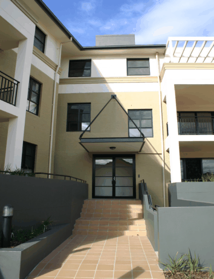
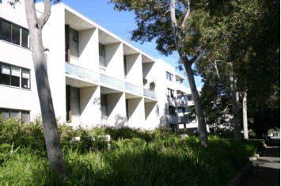
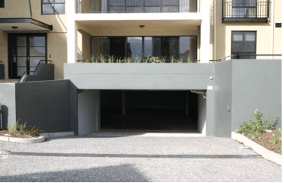
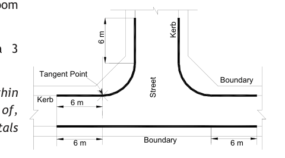
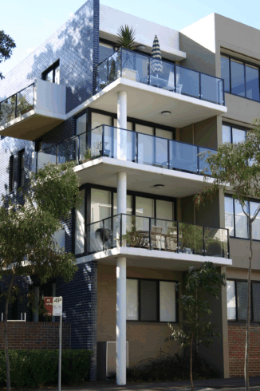
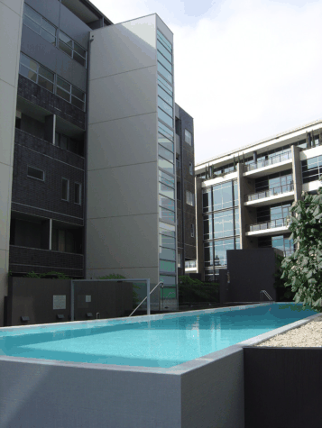
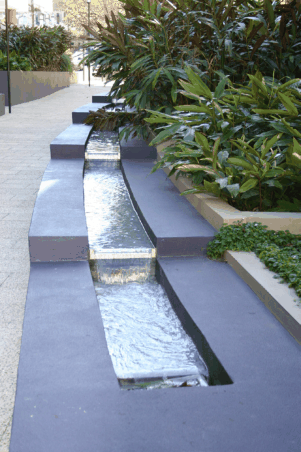

### 5.5  Residential Flat Buildings (Zone R4)

#### Residential

This section sets out controls relating to residential flat buildings in areas zoned R4.

#### Flat

#### Objectives:

#### Buildings

■ Encourage high quality, high-density residential flat development which is innovative and responsive to the site’s environmental characteristics and setting.

#### (Zone R4 )

■ Ensure a high level of amenity for the occupants of residential flat buildings and adjoining occupants of residential flat buildings.

#### Note:

#### 5.5.1 Site  Requirements for Residential Flat Buildings

#### Design Requirements

a)	 Residential flat buildings shall only be

Under the CLEP (Clause 7.9) Residential flat buildings within zones B3 and B4 are only permissible as part of a mixed use development and are not to be located on ground floor.

> [Picture on page 20: a picture, saved as a picture (images/vol-1-part-05-residential-flat-buildings-and-mixed-use-devel-page-20-23.gif, 150 dpi).]

permitted on an allotment having a minimum width of 30 metres measured at the front property boundary.

b)	 Sites shall be amalgamated where required, to achieve the minimum site area and width requirement applicable to the proposed development.

c)	 Development shall not result in an “isolated allotment” adjoining the development site.

d)	 For the purpose of Clause  5.5.1c)

Figure 5.5.1 – Entry to residential flat building.

above, an “isolated allotment” is an allotment that has a site area of less than 1200 square metres and/or a width at the front property boundary of less than 30 metres that has no immediate potential for amalgamation with any other adjoining allotments to achieve a minimum site area of 1200 square metres and a width at the front property boundary of 30 metres.

#### Note:

#### 5.5.2 Building Setbacks for Residential Flat Buildings

#### Design Requirements

Refer to Section 4.1C of the CLEP for the minimum qualifying site area for residential flat buildings.

a)	 Residential flat buildings shall be setback a minimum of:

i)	 5.5 metres from any street boundary; and

ii)	 6 metres from any other boundary.

#### 5.5.3 General Requirements for Residential Flat Buildings

#### Residential

#### Design Requirements

#### Flat

a)	 A minimum of 5% of the total number

#### Buildings

of dwellings within a residential flat building shall be one (1) bedroom flat(s) or a studio(s).

#### (Zone R4 )

b)	 A minimum of 10% of the total number of dwellings within a residential flat building shall be adaptable dwelling(s).

c)	 The floor space occupied by each dwelling within a residential flat building shall not be less than:

i)	 35sqm in the case of a studio flat;

ii)	 50sqm in case of a 1 bedroom flat;

iii)	70sqm in case of a 2 bedroom flat;

iv)	90sqm in case of a 3 bedroom flat or more.

d)	 For the purpose of clause 5.5.3 c), the floor space includes only one bathroom. Additional bathrooms shall increase the minimum floor space of each dwelling by 5sqm for each additional bathroom.

#### Note:

Clause 7.13 Design Excellence of the CLEP applies to areas zoned R3, R4, B2, B3 and B4 and aims to deliver the highest standard of architectural and urban design, as part of the built environment.

e)	 A fourth bedroom and further additional bedrooms shall increase the minimum internal area by 12sqm for each additional bedroom.

f) Each apartment building shall include a study/nook area that is capable of accommodating a desk for working/ studying from home purposes. Such area shall be shown furnished on the proposed plans and shall have a minimum width 1.6 m.

g)	 The main entry to each apartment building shall be designed to include an entrance nook for privacy purposes.

h)	 A maximum of 8 dwellings shall be accessible from a common lobby area or corridor on each level of a residential flat building.

i) All residential flat buildings shall

#### Residential Flat Buildings

contain at least one (1) lift for access from the basement to the upper most storey that provide access to a dwelling space.  Further, the lift(s) shall extend to provide access to the roof space if the roof is intended for use by occupants of the building as a roof terrace.

#### (Zone R4 )

j) A maximum of fifty (50) dwellings shall be  accessible from a single common lift.

k)	 Access to lifts shall be direct and well illuminated.

> [Picture on page 22: a picture, saved as a picture (images/vol-1-part-05-residential-flat-buildings-and-mixed-use-devel-page-22-17.gif, 150 dpi).]

Figure 5.5.2 The provision of 20% of the site for deep soil planting can aid the aesthetics of the development.

> [Picture on page 22: a picture, saved as a picture (images/vol-1-part-05-residential-flat-buildings-and-mixed-use-devel-page-22-22.gif, 150 dpi).]

l) A minimum of 25% of the  required open space area, or 15% of the total site area, whichever is the greater, shall be available for deep soil planting.

m)	 Each flat shall be provided with an ‘incidentals’ storage facility within the unit and/or the basement, which shall be available for personal use of the occupants of each dwelling, and designed and constructed of materials to Council’s satisfaction. Such storage facility shall have a storage capacity of not less than the following:

i)	 4 cubic metres in the case of a studio flat;

Figure 5.5.3 – Example of an unobtrusive basement parking access point.

> [Picture on page 22: a picture, saved as a picture (images/vol-1-part-05-residential-flat-buildings-and-mixed-use-devel-page-22-41.gif, 150 dpi).]
> Words printed on the picture (title and legend, copied from the PDF):
> Kerb
> 6 m
> Tangent Point
> Boundary
> Street
> Kerb
> 6 m
> 6 m
> 6 m
> Boundary

ii)	 6 cubic metres  in case of a 1 bedroom flat;

l)l)

iii)	8 cubic metres in case of a 2 bedroom flat;and

iv)	10 cubic metres in case of a 3 bedroom flat or more.

Note: A suspended storage facility within the basement may be included as part of, or the whole of, the required incidentals storage facility.

j) The incidentals storage facility shall not be created as a separate (strata) allotment to the unit it services.

Figure 5.5.4 – Restricted locations of driveways entry as shown  heavy edged lines.

#### 5.5.4 Car Parking and Access

#### Design Requirements

a)	 All car parking and access for vehicles,

#### Residential

including disabled access spaces, shall be in accordance with AS2890 parts 1 and 2 (as amended), except as otherwise specified in the Plan.

#### Flat Buildings

#### (Zone R4 )

b)	 The minimum dimensions of any parking space shall be 2.5 x 5.5 metres. The minimum width of any car parking space shall be increased by 300mm for each side that adjoins a vertical edge.

c)	 Driveways shall be located a minimum distance of 6 metres from the splay of any unsignalled intersection (refer to Figure 5.5.4). Note: In circumstances where an intersection is controlled by lights, a roundabout or the like, applicants are requested to contact Council for specific requirements.

d)	 For development incorporating 20 or more dwellings, the DA shall be accompanied by a ‘Traffic Impact Assessment Report’. Note: For requirements relating to the preparation of a ‘Traffic Impact Assessment Report’ refer to Appendix 12.

> [Picture on page 23: a picture, saved as a picture (images/vol-1-part-05-residential-flat-buildings-and-mixed-use-devel-page-23-29.gif, 150 dpi).]

Figure 5.5.5 Example of balconies in a residential flat building.

e)	 Where existing, vehicular entry points shall be located at the rear or side streets.

f) Development containing 3 or more storeys shall provide all required car parking at basement level.

g)	 Parking provided at ground level shall be appropriately screened from public view. Note: For additional technical specifications relating to the location gradient, driveway widths  and basement car park refer to Council’s Engineering Design Guidelines for Development available from Council’s website at www.campbelltown.nsw.gov.au.

h)	 Each dwelling shall be provided with a minimum of one car parking space, and:

i)	 an additional car parking space for every 4 dwellings (or part thereof);

and

ii)	 an additional visitor car parking

#### Residential

space for every 10 dwellings (or part thereof).

#### Flat

Buildings i) No required car parking space shall be in

a stacked configuration.

#### (Zone R4 )

j) Each development shall make provision for bicycle storage at a rate of 1 space per 5 dwellings within common property.

k)	 Electric vehicle charging stations must be located behind the building line.

#### 5.5.5 Solar Access

a)	 Buildings shall be orientated and sited to maximise northern sunlight to internal living and open spaces.

b)	 A minimum 20sqm area of the required private open space on adjoining land, (having a minimum width of 3 metres), shall receive three (3) hours of continuous direct solar access on  21 June, between 9.00am and 3.00pm, measured at ground level.

> [Picture on page 24: a picture, saved as a picture (images/vol-1-part-05-residential-flat-buildings-and-mixed-use-devel-page-24-26.gif, 150 dpi).]

Figure 5.5.6 - Example of a residential flat building provided with communal recreation facilities (in the form of a lap pool).

c)	 Living rooms and private open spaces of at least 70% of dwellings within a residential flat building shall receive a minimum of 2 hours direct sunlight between 9:00am and 3:00pm at mid winter.

d)	 Council expects that with innovative and thoughtful design, all dwellings should receive some direct sunlight, however, when it can be shown that providing sunlight to every dwelling is unachievable, Council may allow a design solution that result in up to 15% of the dwelling receiving no direct sunlight between 9:00am and 3:00pm at mid winter.

#### 5.5.6 Balconies and Ground Level Courtyards

#### Design Requirements

a)	 Dwellings shall be provided with a private courtyard and/or balcony.

b)	 Courtyards/balconies shall be:

i)	 not less than 8sqm in area and have

#### Residential

a minimum depth of 2 metres;

#### Flat

ii)	 clearly defined and screened   for private use;

#### Buildings

iii)	oriented to achieve comfortable year round use; and

#### (Zone R4 )

iv)		accessible from a main living area of the flat.

#### 5.5.7 Privacy

#### Design Requirements

a)	 Ground level dwellings incorporating a courtyard shall be provided with a privacy screen.

> [Picture on page 25: a picture, saved as a picture (images/vol-1-part-05-residential-flat-buildings-and-mixed-use-devel-page-25-19.gif, 150 dpi).]

Figure 5.5.7 – Example of landcaping treatment in a residential flat building.

b)	 No window of a habitable room or balcony shall be directly face a window of another habitable room, balcony or private courtyard of another dwelling located within 9 metres of the proposed window or balcony.

c)	 Notwithstanding 5.5.7(b) a window of a habitable room may be permitted only where it:

i)	 is offset by 2 metres to limit views between windows, or

ii)	 has a sill height 1.7 metres above the floor level; or

iii)	is splayed to avoid direct views between windows; or

iv)	has a fixed translucent glazing in any part of the window within 1.7 metres of the floor level; or

v)	 is otherwise appropriately screened.

d)	 Notwithstanding 5.5.7(b), a balcony will be considered where the private open space area of any adjacent dwelling is

screened from view.

#### 5.5.8 Communal Recreation Facilities

#### Residential

#### Design Requirements

#### Flat

a)	 Each residential flat building shall be

#### Buildings

provided with communal recreation facilities for the use of all the occupants of the building comprising:

#### (Zone R4 )

i)	 a recreation room with a minimum area of a 50sqm per 50 dwellings (or part thereof); and

ii)	 a bbq/outdoor dining area with a minimum area of 50sqm per 50 dwellings (or part thereof).

b)	 Communal recreation facilities shall not be located within the primary or secondary street boundary setback.

c)	 All communal recreational facilities shall be provided on the same land as the residential flat building.

d)	 Communal open space provided on the roof of a building shall not be included as part of the required communal open space.

e)	 All required communal and recreational facilities are required to be constructed prior to the issue of an interim  occupation certificate for any residential units within a staged development.
