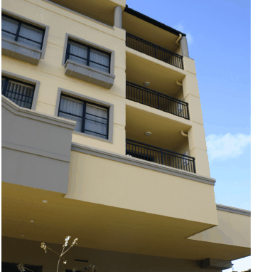
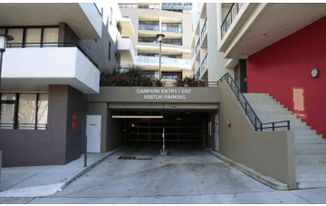

### 5.6 Mixed Use Development (Zones B3 & B4)

#### This section sets out controls relating to mixed use development in areas zoned B3 & B4. Mixed Use

#### Development

#### Objectives:

■ To encourage high quality, mixed-use development, which is innovative and responsive to the site’s environmental characteristics and setting.

#### (Zones B3 & B4)

■ To ensure a high level of amenity for the occupants of mixed-use development, and adjoining occupants of residential buildings.

#### 5.6.1 General Requirements for Mixed-use Development in areas zoned B3 & B4

#### Design Requirements

a)	 The requirements for mixed-use development shall be consistent with the requirements for residential flat buildings (Section 5.5 except as specified in this section).

#### Note:

For the purposes of this part, mixed use development is development which includes residential uses (including shop top housing where relevant) in conjunction with one or more uses such as, business premises, commercial offices, retail shops, community facilities and medical centres.

b)	 Mixed-use developments on areas zoned B3 and B4 shall only be occupied at ground level by retail and/or commercial office or like uses, subject to land use permissibility under the CLEP;

#### Note:

c)	 No ground floor level on areas zoned B3 & B4 shall be occupied by a residential use.

d)	 Any mixed-use buildings that are

Refer to Clause 7.9 Mixed Use Development in Zone B3 and Zone

B4 under the CLEP for additional development standards for mixed use development.

designed to accommodate the preparation of food from a commercial tenancy, shall provide ventilation facilities to ensure that no odour is emitted in a manner that adversely impacts upon any residents or other occupants using the building.

#### 5.6.2 Site requirements and Building Envelope  for Mixed-use Development in areas zoned B3 & B4

#### Note:

Clause 7.13 Design Excellence of the CLEP applies to areas zoned R3, R4, B2, B3 and B4 and aims to deliver the highest standard of architectural and urban design, as part of the built environment.

#### Design Requirements

a)	 Council may consider a mixed-use development on land with an area less than 1,200 square metres and a width

less than 30 metres.

b)	 Mixed use buildings shall be setback a

#### Mixed Use

minimum of:

#### Development

i)	 zero metres from any street boundary; and

ii)	 6 metres from any other boundary

#### (Zones B3 & B4)

for any residential component of the building.

#### 5.6.3 Car Parking and Access in areas zoned B3 & B4

#### Design Requirements

a)	 In addition to residential car parking rates (section 5.5.4), the development shall provide one (1) car parking space per 25sqm of leasable floor space at ground level and one (1) car parking space per 35sqm of floor space at upper levels for all commercial/retail parts of the building.

> [Picture on page 28: a picture, saved as a picture (images/vol-1-part-05-residential-flat-buildings-and-mixed-use-devel-page-28-24.gif, 150 dpi).]

Figure 5.6.1 – Example of mixed-use development.

> [Picture on page 28: a picture, saved as a picture (images/vol-1-part-05-residential-flat-buildings-and-mixed-use-devel-page-28-27.gif, 150 dpi).]

b)	 Pedestrian access to residential flats shall be separated from the commercial/retail uses.

c)	 The development shall provide adequate space for the on-site parking, loading and unloading of all delivery/ service vehicles as detailed in Part

6.4.2 of this Plan.

#### 5.6.4 Roof Terraces

#### Design Requirements

a)	 Consideration will only be given to

Figure 5.6.2 – Example of vehicle access point for a mixed-use development.

the provision of a roof top terrace as part of communal open space, subject to appropriate landscaping treatment and recreation facilities provided; and satisfying the respective provisions of the RFDC.

#### 5.6.5 Mixed-use Development and Waste Management

#### Design Requirements

a)	 Self contained and lockable areas shall be provided for commercial and

residential waste.

b)	 Areas for commercial and residential

#### Mixed Use

waste shall be kept separate.

#### Development

#### (Zones B3 & B4)
