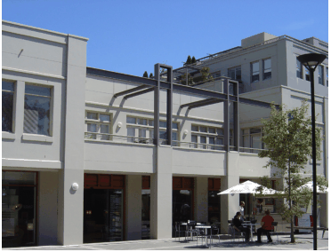

### 5.7 Mixed Use Development (Zones RU5, B1 & B2)

#### Mixed Use

This section applies to mixed use development in areas zoned RU5, B1 and B2.

#### Development

#### Objective:

(Zones RU5,

#### B1& B2)

■ Encourage high quality, mixed-use development within the local and neighbourhood centres, which is innovative and responsive to the site’s environmental characteristics and setting. ■ Encourage quality designed mixed use development that makes a positive contribution to the streetscape and the locality. ■ To ensure a high level of amenity for the occupants of mixed-use development, and adjoining occupants of dwellings.

#### 5.7.1 General Requirements (areas zoned RU5,  B1 and B2

#### Design Requirements

a)	 Mixed-use developments shall only be occupied at ground level by retail and/or commercial office or like uses, subject to land use permissibility under the CLEP;

#### Note:

For the purposes of this part, mixed use development is development which includes residential uses (including shop top housing where relevant) in conjunction with one or more uses such as, business premises, commercial offices, retail shops, community facilities and medical centres; subject to land use permissibility under the CLEP.

b)	 Any mixed-use development that are designed to accommodate the preparation of food from a commercial tenancy, shall provide ventilation facilities to ensure that no odour is emitted in a manner that adversely impacts upon any residents or other occupants using the building.

c)	 Entries to the residential dwellings shall be separate to  commercial entries.

#### Note:

Shop top housing means one or more dwellings located above ground floor retail premises or business premises.

d)	 Each residential dwelling within a mixed use development shall have  an identifiable address.

e)	 Advertising shall not be permitted  on any part of the residential dwellings.

f) Balconies for residential dwellings  shall address the street and any adjacent open space.

#### Note:

Clause 7.13 Design Excellence of the CLEP applies to areas zoned R3, R4, B2, B3 and B4 and aims to deliver the highest standard of architectural and urban design, as part of the built environment.

g)	 Exterior lighting should be of low intensity and shielded so that light does not spill out onto the residential

dwellings or project above the horizontal plane.

h)	 Lighting shall be static and shall not

#### Mixed Use Development

strobe, flash, oscillate, be of unusually high intensity of brightness, or uncovered.

(Zones RU5,

i) Stairs providing access to residential dwellings shall be enclosed.

#### B1 & B2)

j) Building facades shall be articulated and blank walls shall be avoided.

k)	 Building design shall consider foremost the qualities (both natural and built) and the desired future character of the areas including the significance of any heritage item on the land.

l) Building design shall incorporate the following features to assist in the achievement of high quality architectural outcomes:

> [Picture on page 31: a picture, saved as a picture (images/vol-1-part-05-residential-flat-buildings-and-mixed-use-devel-page-31-24.gif, 150 dpi).]

Figure 5.7.1 – Example of mixed-use development.

i)	 incorporation of appropriate facade treatments that help the development properly address the respective street frontages, key vistas and to add visual interest to the skyline;

ii)	 incorporation of articulation in walls, roof lines, variety of roof pitch, individualised architectural features (balconies, columns, porches, colours, materials etc) into the facade of the building;

iii)	variation in the vertical planes of exterior walls in depth and/or direction;

iv)	variation in the vertical and horizontal planes of the building so that the building appears to be divided into distinct base, middle and top massing elements;

v)	 utilisation of landscaping and interesting architectural detailing at the ground level; and

m)	 Building design shall demonstrate to Council’s satisfaction that the

development will:

i)	 facilitate casual surveillance and active interaction with the street;

#### Mixed Use

ii)	 be sufficiently setback from the

#### Development

(Zones RU5,

property boundary to enable the planting of vegetation to soften the visual impact of the building at street level; and

#### B1 & B2)

iii)	maximise cross flow ventilation, therefore minimising the need for air conditioning.

n)	 Building colours, materials and finishes shall generally achieve subtle contrast. The use of highly reflective or gloss materials or colours shall be minimised to feature and highlight element only.

o)	 Building materials shall be high quality, durable and low maintenance.

#### 5.7.2 Solar Access (areas zoned RU5, B1 and B2)

#### Design Requirements

a)	 Buildings shall be orientated and sited to maximise northern sunlight to internal living and open spaces.

b)	 A minimum 20sqm area of the required private open space on adjoining land, (having a minimum width of 3 metres), shall receive three (3) hours of continuous direct solar access on  21 June, between 9.00am and 3.00pm, measured at ground level.

#### 5.7.3 Setbacks (areas zoned RU5, B1 and B2)

#### Design Requirements

a)	 Mixed use  development shall be setback a minimum of:

i)	 zero metres from the primary street boundary;

ii)	 3 metres from the secondary street boundary;

iii)	3 metres from any side boundary where it adjoins residential

properties or public open space;

iv)	0.9 metres from the side boundary in any other case;

#### Mixed Use

v)	 6 metres from the rear boundary

#### Development

where it adjoins residential properties or public open space;

(Zones RU5,

vi)	 3 metres  from the rear boundary in any other case.

#### B1 & B2)

b)	 Despite clause 5.7.3 a) iv) above, mixed use development shall be permitted to be built on the side boundary where in Council’s opinion the proposed development is considered a continuation of an adjacent development within the same section of the streetscape.

c)	 Despite clause 5.7.3 a) vi), reduced rear setbacks shall be considered on merits.

#### 5.7.4 Car Parking and Access (areas zoned RU5, B1 and B2)

#### Design Requirements

a)	 Each residential dwelling shall be provided with a minimum of one car parking space.

b)	 Private car parking for the residential component of a mixed use development/ shop top housing shall be clearly identified and separated from regular business/retail car parking.

c)	 In addition to the required residential car parking rates (section 5.7.4 a) above, the development shall provide one (1) car parking space per 25sqm of leasable floor space at ground level and one (1) car parking space per 35sqm of floor space at upper levels for all commercial/retail parts of the building.

d)	 Pedestrian access to residential dwellings shall be separated from the commercial/retail uses.

e)	 The development shall provide adequate space for the on-site parking, loading and unloading of all delivery/

service vehicles as detailed in Part

6.5.2 of this Plan.

f) Electric vehicle charging stations must be located behind the building line.

#### 5.7.5 Balconies and Ground Level Courtyards

#### Design Requirements

a)	 Dwellings shall be provided with a private courtyard and/or balcony.

b)	 Courtyards/balconies shall be:

i)	 not less than 8sqm in area and have a minimum depth of 2 metres;

ii)	 clearly defined and screened for private use and secured so as not to impact on privacy of adjoining residential properties or properties that can be directly viewed from the balcony.

iii)		accessible from a main living area of the dwelling.

#### 5.7.6 Mixed-use Development and Waste Management (areas zoned RU5, B1 and B2)

#### Design Requirements

a)	 In addition to the above requirements, mixed use developments must ensure that:

i)	 separate and lockable bin storage rooms are provided to service residential and commercial sections of the development.

ii)	 the commercial bin room is identified with its own signage clearly indicating its use (‘For Commercial Tenancies Only’) and likewise, the residential bin room is identified with its own signage clearly indicating its use (‘For Residential Tenancies Only’).

#### 5.7.7  Access for People with Disabilities

#### 5.7.7  Access for People with Disabilities

#### Design Requirements

a)

a)	 Mixed use development shall comply

Mixed use development shall comply with the minimum access requirements

with the minimum access requirements contained within  the BCA , the Disability

contained within  the BCA , the Disability (Access to Premises — Buildings)

(Access to Premises — Buildings) Standards 2010 and

Standards 2010 and Australian Standard

Australian Standard

1428 – Design for Access and Mobility

1428 – Design for Access and Mobility (as amended).

(as amended).
