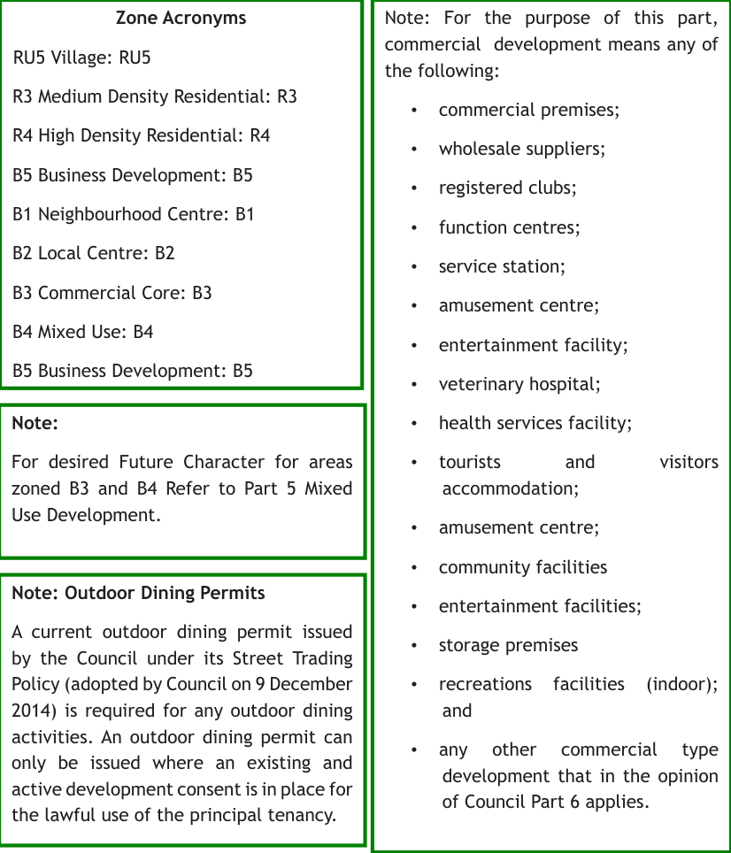
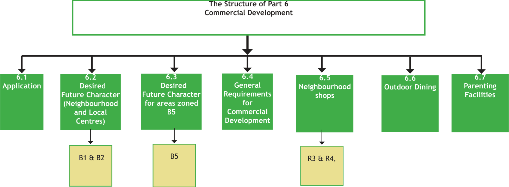

## Part 6 Commercial Development

### 6.1 Application

Parts 6  sets out the following:

#### Application

– Desired future character for neighbourhood and local centres;

– Desired Future Character for areas zoned B5;

– General requirements for commercial development;

– Development controls for commercial subdivision;

– Development controls for neighbourhood shops in areas zoned R3 and R4;

– Development control for outdoor dining; and

– Development control for parenting facilities.

> [Picture on page 2: a map, saved as a picture (images/vol-1-part-06-commercial-development-page-2-11.gif, 150 dpi); the street names and other small labels are on the picture.]
> Words printed on the picture (title and legend, copied from the PDF):
> RU5 Village: RU5
> • commercial premises;
> • wholesale suppliers;
> • registered clubs;
> • function centres;
> • service station;
> • amusement centre;
> • entertainment facility;
> • veterinary hospital;
> • health services facility;
> • tourists and visitors
> • amusement centre;
> • community facilities
> • entertainment facilities;
> • storage premises
> • recreations facilities (indoor);
> • any other commercial type

#### Zone Acronyms

Note: For the purpose of this part, commercial  development means any of the following:

R3 Medium Density Residential: R3

R4 High Density Residential: R4

B5 Business Development: B5

B1 Neighbourhood Centre: B1

B2 Local Centre: B2

B3 Commercial Core: B3

B4 Mixed Use: B4

B5 Business Development: B5

#### Note:

For desired Future Character for areas zoned B3 and B4 Refer to Part 5 Mixed Use Development.

#### Note: Outdoor Dining Permits

development that in the opinion of Council Part 6 applies.

A current outdoor dining permit issued by the Council under its Street Trading Policy (adopted by Council on 9 December

2014\) is required for any outdoor dining activities. An outdoor dining permit can only be issued where an existing and active development consent is in place for the lawful use of the principal tenancy.

> [Picture on page 3: a map, saved as a picture (images/vol-1-part-06-commercial-development-page-3-1.gif, 150 dpi); the street names and other small labels are on the picture.]
> Words printed on the picture (title and legend, copied from the PDF):
> R3 & R4,
> B1 & B2

#### The Structure of Part 6

#### Commercial Development

#### Parenting

#### Neighbourhood

#### Outdoor Dining

#### Application

#### General

#### Requirements

#### Desired

#### Future Character

#### Desired

#### Future Character

#### Facilities

shops

for areas zoned

(Neighbourhood and Local

#### Commercial

#### Development

#### Centres)
