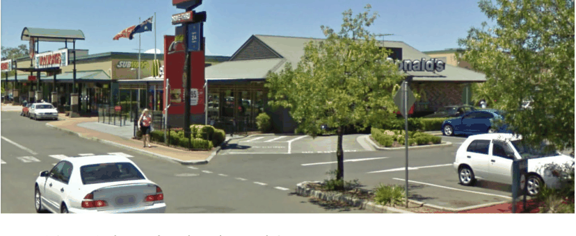
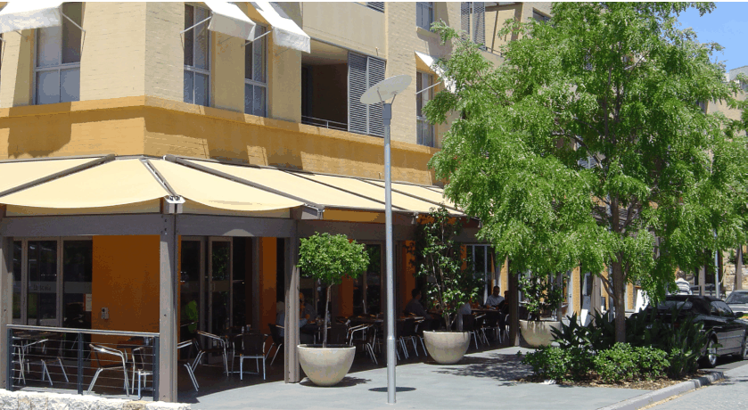

### 6.2 Desired Future Character for neighbourhood and local centres (Areas

#### Zoned B1 & B2 )

Neighbourhood and local centres within the Campbelltown LGA shall be characterised by:

#### Desired Future

#### Character

• Buildings that are well designed with articulated facade treatments;

#### Areas Zoned

• Shops, restaurants, cafés and businesses with active street frontages and land uses that service the  day to day needs of nearby residents;

#### B1&B2

• Landscaping that soften the car parking areas and enhance the streetscape;

• Uniform awnings that enhance the visual appearance of the buildings and provide weather protection for the users;

• Attractive buildings that have been harmoniously designed to complement each other and contribute to the overall architectural design quality of the neighbourhood and local centres.

Note: Table 6.2.1 provides a list of the local and neighbourhoods centres within the Campbelltown LGA.

> [Picture on page 4: a picture, saved as a picture (images/vol-1-part-06-commercial-development-page-4-19.gif, 150 dpi).]

Figure 6.2.1 -  A photo of Eagle Vale Local Centre

> [Picture on page 4: a picture, saved as a picture (images/vol-1-part-06-commercial-development-page-4-21.gif, 150 dpi).]

Figure 6.2.2 -  An example of a mixed use development within a neighbourhood centre with an active street frontage.

Table 6.2.1 Lists of Neighbourhood Centres within Campbelltown LGA

| Glen Alpine Shopping Centre | Heritage Way, Glen Alpine |
|---|---|
| Kearns | Kearns Avenue, Kearns |
| Raby | Thunderbolt Drive, Raby |
| Raby Shopping Centre | Raby Shopping Centre, 2 Hurricane Drive, Raby |
| St Andrews Shopping Centre | Ballantrae Drive, St Andrews |
| Minto | Minto Road, Minto |
| Minto | Benham Road, Minto |
| Ingleburn | Lagonda Drive, Ingleburn |
| Ruse Village Shopping Centre, | Junction Road, Ruse |
| Blairmount | Clydesdale Drive, Blairmount |
| Blair Athol | The Kraal Drive, Blair Athol |
| Campbelltown | Cnr Chamberlain Street & Lindesay Street Campbelltown |
| Campbelltown (1) | Waminda Avenue, Campbelltown |
| Campbelltown (2) | Waminda Avenue, Campbelltown |
| Bradbury | Hoddle Avenue Shopping Centre 3 Hoddle Avenue, Bradbury |
| Ambarvale Shopping Centre | 45 Woodhouse Drive, Ambarvale |
| Airds Shopping Centre | Riverside Drive, Airds |
| Bradbury Shopping Centre | The Parkway, Bradbury |
| St Helens Park | Kellerman Drive, St Helens Park |
| St Helens Park | Woodland Road, St Helens Park |
| Rosemeadow Shopping Centre | Thomas Rose Drive, Rosemeadow |
| Macquarie Fields | Saywell Road, Macquarie Fields |
| Macquarie Fields Neighbourhood | Evelyn Street, Macquarie Fields |
| Woodbine Neighbourhood Centre | North Steyne Road, Woodbine |
| Leumeah | Bradfield Street, Leumeah |
| Leumeah | 54 Parkhill Avenue, Leumeah |

#### Desired Future

#### Character Areas Zoned

#### B1&B2

Table 6.2.2 Lists of Local Centres within Campbelltown LGA

| Eagle Vale | Eagle Vale Centre, Emerald Drive, |
|---|---|
| Minto | Minto Marketplace, Brookfield Road, Minto |
| Leumeah | O’Sullivan Road, Leumeah |
| Macquarie Fields | Glenquarie Shopping Centre, 60 Harold Street, Macquarie Fields |

#### Desired Future

#### Character Areas Zoned

#### B1&B2
