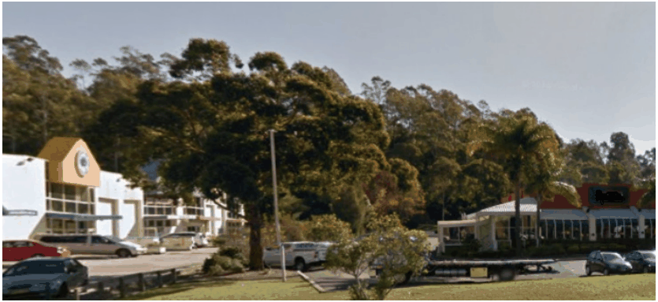
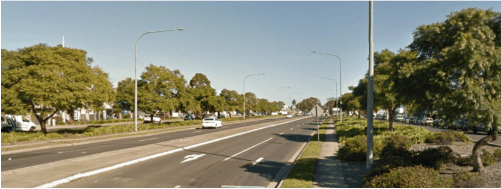

### 6.3 Desired Future Character for (Areas Zoned B5 )

The areas zoned  B5 shall be characterised by:

#### Desired Future

#### Character

• well designed and articulated facade treatments addressing the primary streets.

• buildings with active street level frontages.

#### Areas Zoned

#### B5

• well designed signage that does not distract from the character of the locality.

• easily accessible loading dock facilities that are designed to operate separately to any public/retail function.

• landscaping that softens car parking areas and enhances the streetscape.

• street trees.

> [Picture on page 7: a picture, saved as a picture (images/vol-1-part-06-commercial-development-page-7-14.gif, 150 dpi).]

> [Picture on page 7: a picture, saved as a picture (images/vol-1-part-06-commercial-development-page-7-15.gif, 150 dpi).]

Figure 6.3.1 - Examples of streetscapes within existing areas zoned B5 within Campbelltown.
