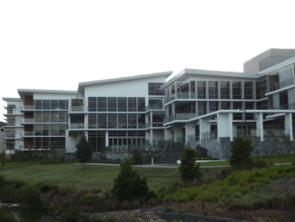
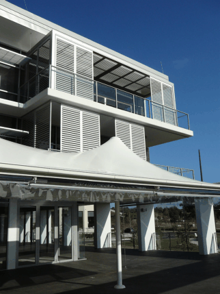
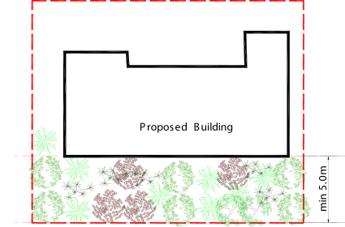
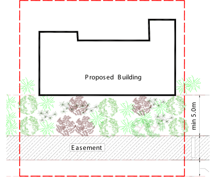

#### 6.4.1  Building Form and Character

for

#### Commercial

#### Development

#### Objectives:

#### 6.4.1

#### Building Form

■ Ensure that the massing and scale of new development are complementary to the desired future character of business centres.

and

#### Character

■ Ensure that buildings are designed to enhance the existing and future desired built form by encouraging innovative and quality designs that fit harmoniously with their surroundings, and the public domain. ■ Ensure that car parking areas and entries to commercial development are appropriately sited, designed and constructed so that they do not detract from the appearance of the development or the streetscape. ■ Ensure that advertising is undertaken in a manner that reduces clutter and does not impact on the overall visual quality  of the buildings.

#### Design Requirements

a)	 All building facades, including rear and

#### Note:

side elevations visible from a    public place or adjacent to residential areas, shall be architecturally treated to enhance the quality of the streetscape.

b)	 Large buildings shall incorporate the following elements to assist in achieving a high quality architectural outcome:

Numerical Development Standards for building heights and minimum subdivision  are provided under the CLEP.

i)	 the provision of vertical and/or horizontal offsets in the wall surfaces at regular intervals, including columns, projections, and recesses; variation to the height of the building so that the building appears to be divided into distinct massing elements;

ii)	 articulation of the different parts of a building’s facade by use of colour, arrangement of facade elements, or by varying the types of materials used; and

iii)	maximising the interior and exterior

interactions at the ground level.

c)	 The main entry to the building shall be easily identifiable from the street and directly accessible through the front of the building.

#### General

#### Requirements

d)	 Large expansive blank walls on ground

for

#### Commercial

#### Development

floor levels or side and rear boundaries shall not be permitted unless abutting a building on an adjoining allotment.

#### 6.4.1

#### Building Form

and

#### Character

> [Picture on page 9: a picture, saved as a picture (images/vol-1-part-06-commercial-development-page-9-19.gif, 150 dpi).]

Figure 6.4.1.1 An example of a well articulated commercial building.

e)	 Roof mounted plant rooms, air conditioning units and other services and equipment shall be effectively screened from view using integrated roof structures and architectural elements.

f) Solid opaque roller doors/shutters over windows and entry doors shall not be permitted on any building that has frontages to a street or a public place.

g)	 Buildings shall not incorporate highly reflective glass.

h)	 A schedule of proposed colours, materials and finishes shall accompany all development applications for new buildings.

i) Development on corner sites shall incorporate splays, curves, building entries and other architectural elements to reinforce the corner as a land mark feature of the street.

j) Except in the case of an outdoor cafe, the design of the development shall not provide for outdoor display and/or storage.

k)	 Commercial development shall be designed to address both primary and secondary street setbacks.

l) Infill development shall respect and maintain consistency with the established setbacks of existing shopfronts.

m)	 For applications involving new construction work with a value of $30 million or greater, any existing above

ground power lines, traversing the property’s frontage, shall be relocated underground at the developers expense.

#### General

#### Requirements

for

#### Commercial

#### Development 6.4.1

#### Building Form

and

#### Character

Note: To facilitate this requirement, the applicant must liaise with the relevant power authority requesting to install a conduit within the adjacent footpath (road reserve) area for the provision of an underground power supply and extension of the conduit up to the wall of any proposed building. It must also be demonstrated that ready connection to the building(s) can be made when the overhead connection is replaced with a new underground line during the construction phase of the development.

> [Picture on page 10: a picture, saved as a picture (images/vol-1-part-06-commercial-development-page-10-25.gif, 150 dpi).]

Figure 6.4.1.2 An example of a well articulated commercial building.

Where possible, above ground electricity utilities shall be located in a way to minimise impacts on landscaping and be placed/ oriented to minimise the percentage they occupy within the front portion of the site.

n)	 The developer must allocate/set aside adequate space within the development to install a grease trap and mechanical ventilation, for any proposed food premises, in accordance with the Local Water Authorities recommendations and the following Australian Standards: Mechanical ventilation (for any proposed food premises) must comply with:

i)	 Australian Standard (AS) 1668.2- 2012: The use of ventilation and air conditioning in buildings:

ii)	 Part 2: Mechanical ventilation in buildings; and (where applicable); and

iii)	Australian Standard 1668.1-1998: The use of ventilation and air conditioning in buildings - Fire and smoke control in multi-compartment buildings. All mechanical ventilation must be installed within the building during construction and is not permitted on any external building surfaces. All required grease traps must be located

and serviced on private land as no permission will be granted to install such a facility on public or Council land.

#### 6.4.1.1 Commercial Development Floor Area

#### General

#### Requirements

#### Design Requirements:

a)	 The maximum gross floor area of any single

for

#### Commercial

#### Development 6.4.1

#### Building Form

and

#### Character

retail premises within any business in areas zoned B1 ,B2 and B5 shall not exceed 500 square metres unless the proposal has been supported by an economic impact assessment, prepared by a suitably qualified person. In this regard, the economic impact assessment shall demonstrate that the economic impacts of the proposed development on the retail hierarchy of affected business areas in the Campbelltown Local Government Area are acceptable, and shall include an assessment of:

i)	 	the trade area of the proposed development;

ii)	 	market demand within the trade area to justify the proposal; and

iii)		economic impacts on comparative retail outlets in the trade area.

b)	 Despite Clause 6.4.1.1 a) bulky goods premises shall:

i)	 	have a minimum gross floor area of 200 square metres; and

ii)	 	be permitted to have a	 gross floor area greater than 500 square metres.

#### 6.4.1.2 Building Setbacks

#### Design Requirements:

a)	 All commercial development  outside areas zoned B3 and B4 shall be setback from property boundaries in accordance with this section.

b)	 Development shall be setback a minimum of :

i)	 30 metres to:

– the main southern railway corridor,

ii)	 30 metres to:

– the South Western Freeway corridor,

– Ben Lomond Road between Pembroke Road and the Main Southern Railway Corridor,

– Campbelltown Road,

#### General

#### Requirements

– Henderson Road,

– Pembroke Road,

for

#### Commercial

#### Development

– Rose Payten Drive; and

– Williamson Road.

#### 6.4.1

#### Building Form

iii)	15 metres to:

and

#### Character

– Airds Road,

– Badgally Road,

– Ben Lomond Road between Campbelltown Road and the Main Southern Railway Corridor,

– Blaxland   Road between Campbelltown Road and Rose Street,

– the south eastern side of Blaxland Road between Rose Street and Lot 5 DP 538258,

– Blaxland Road between Lot 5 DP 538258 and Narellan Road,

– Devon Road,

– Grange Road,

– Plough Inn Road between Campbelltown Road, and Hollylea Road,

– Sussex Street and

– Swaffham Road.

iv)	10 metres from any other primary street frontage. exclusive of any required road widening.

c)	 Despite Clause 6.4.2.1. b) i)  Council may consider a reduction of the rear setback from the southern railway corridor from 30 metres to 5 metres providing that:

i)	 a vegetated screen/landscape area of a minimum width of 5 metres is constructed along the full width of the property between the railway corridor  and the buildings;

ii)	 the vegetated  area is free of any easements

or site constraints (refer to Figure 6.4.1.3);

iii)	the vegetated area is densely landscaped

#### General

#### Requirements

with trees and plants selected from the Campbelltown Native Gardening Guide, available from Council’s website at www. campbelltown.nsw.gov.au;

iv)	Council is satisfied that the proposed

for

#### Commercial

#### Development

vegetation is sufficient to screen the buildings from the southern railway corridor.

#### 6.4.1

#### Building Form

and

#### Character

Note: All reduced setback proposals from the railway corridor shall be subject to the approval of the relevant public authorities.

Property Boundary

> [Picture on page 13: a picture, saved as a picture (images/vol-1-part-06-commercial-development-page-13-24.gif, 150 dpi).]
> Words printed on the picture (title and legend, copied from the PDF):
> Proposed  Building
> min 5.0m

S outhern R ailway Line Boundary

Property Boundary

> [Picture on page 13: a picture, saved as a picture (images/vol-1-part-06-commercial-development-page-13-27.gif, 150 dpi).]
> Words printed on the picture (title and legend, copied from the PDF):
> Proposed  Building
> min 5.0m
> E asement

S outhern R ailway Line Boundary

less than 5.0m

Figure 6.4.1.3 Illustration of the reduced set backs requirements from the southern railway corridor

#### 6.4.1.3 Fencing

a)	 Commercial fencing shall be a maximum 2.4 metres in height.

#### General

#### Requirements

b)	 The use of sheet metal fencing is not  permitted.

c)	 Fencing on corner allotments shall

for

#### Commercial

#### Development

not obstruct the sight distance of traffic entering or within an intersection or roundabout.

#### 6.4.1

#### Building Form

d)	 Fencing shall not obstruct power,

and

#### Character

water, sewer, gas or telephone services, drainage systems, (including overland flow paths) or any easements or rights of way.

e)	 Details for fencing shall be submitted with the development application.
