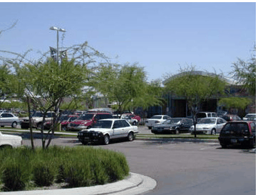

#### 6.4.2 Car Parking and Access

Objectives:

#### General

#### Requirements

■ Ensure that sufficient car parking is accommodated on site to meet the traffic demand generated by the development.

#### 6.4.2

#### Car Parking

■ Ensure that the layout of car parking spaces is safe, functional and maintains the free flow of traffic into and out of the site.

#### and Access

■ Minimise parking demand through integration of land use and transport. ■ Ensure consistency with desired future character of the area. ■ To ensure that new development does not compromise the effective and ongoing operation of the Queen Street commercial core; and ■ To prevent or reduce the potential impact of traffic on any commercial development adjacent to Queen Street. ■ Promote the use of electric vehicles across the Local Government Area. ■ Encourage the installation of electric vehicle charging infrastructure.

#### 6.4.2.1 General Requirements

#### Design Requirements

a)	 Off street parking and loading shall be designed in accordance with Australian Standards 2890.1 and 2 (as amended), except as otherwise provided by this Plan.

b)	 The minimum car parking rates shall be provided in accordance with Table 6.4.2.1. If in the opinion of Council, additional car parking spaces are required due to the constraints of the site and or the nature of the use, additional car parking spaces shall be provided as part of the development.

c)	 All car parking spaces that are required under clause 6.4.2.1 b) shall not be locked off, obstructed, reserved or separately allocated to any individual use at any time.

d)	 Commercial development shall be designed to accommodate all related vehicle movements on site such that:

i)	 all vehicles shall enter and exit the

site in a forward direction;

ii)	 the area for manoeuvring of delivery

#### General

#### Requirements

and service vehicles is separate from vehicle parking areas, and preferably accessed via a rear service lane;

iii)	cause minimal interference to the

#### 6.4.2

#### Car Parking

flow of traffic within the surrounding road network; and

#### and Access

iv)	safe and convenient access is provided for pedestrians.

e)	 A Traffic Impact Assessment Report shall be prepared by a suitably qualified person and  submitted as part of a development application addressing the following criteria if the development exceeds the relevant thresholds within SEPP (Infrastructure) 2007:

i)	 the existing traffic environment;

ii)	 anticipated traffic generation from the proposed development;

iii)	the potential cumulative impact in the locality;

iv)	the need for traffic improvements in the locality;

> [Picture on page 16: a picture, saved as a picture (images/vol-1-part-06-commercial-development-page-16-30.gif, 150 dpi).]

> [Picture on page 16: a picture, saved as a picture (images/vol-1-part-06-commercial-development-page-16-31.gif, 150 dpi).]

Figure 6.4.2.1 Examples   of a well landscaped car park

v)	 traffic egress/ingress to arterial/sub arterial roads; and

vi)	sight distance and other safety issues.

f) Each site shall have a:

i)	 maximum of one ingress and one egress for heavy vehicles (combined or separated); and

ii)	 each site may have an additional ingress/egress for cars (and other light vehicles).

g)	 No car parking spaces shall be designed in  a stacked configuration.

h)	 No required car parking spaces shall be created as a separate Strata or Torrens Title allotment.

#### General

#### Requirements

i) Above ground multi- level  car parking structures shall be designed so as to integrate with the surrounding built form , incorporate design methods and architectural form that compliments and adds value to the character of the local area.

#### 6.4.2

#### Car Parking

#### and Access

j) Carparks must be developed with the infrastructure required for electric vehicle charging.

k)	 On-site car parking is to be provided to support a range of vehicles, including small cars, hybrid cars and fully electric cars in multi space car parks.

l) Spaces allocated to environmental vehicles should be marked and managed according to the specific vehicle type targeted.

Note: Council may consider the use of mechanical turntables and/or vertical stacking devices as part of the car parking arrangements.

#### 6.4.2.2 Loading and Unloading

#### Design Requirements

a)	 Where practicable, loading bays shall be separated from parking and pedestrian access.

b)	 All loading and unloading shall take place wholly within the site.

c)	 No loading or unloading shall be carried out across parking spaces, landscaped areas pedestrian aisles or on roadways.

d)	 Parking and loading bays shall be provided and clearly identified on site.

e)	 Required manoeuvring areas for heavy vehicles shall not conflict with car parking.

f) Each new commercial building/unit having a gross floor area:

i)	 up to 200 square metres shall provide a loading area to allow for a small rigid vehicle to manoeuvre

on site;

ii)	 more than 200 square metres, but up to

#### General

#### Requirements

1500 square metres shall provide an area to allow for a medium rigid vehicle to manoeuvre on site; and

iii)	more than 1500 square metres shall provide

#### 6.4.2

#### Car Parking

#### and Access

a loading area to allow for a heavy rigid vehicle to manoeuvre on site.

g)	 Loading docks and service areas shall not be visible from any public place and shall be suitably screened from adjacent properties. Screening may be achieved by locating such areas behind the buildings, by fencing, landscaping, mounding or a combination of these, or by other means to Council’s satisfaction.

#### 6.4.2.3 Access for People with Disabilities

#### Design Requirements

a)	 Commercial development shall comply with the minimum access requirements contained within  the BCA , the Disability (Access to Premises — Buildings) Standards 2010 and Australian Standard 1428 – Design for Access and Mobility (as amended).

b)	 Notwithstanding Clause 6.4.2.2 a) the required percentage of car parking spaces for people with disabilities within retail/commercial development shall be:

i)	 one car space per development; plus

ii)	 one for every 20 car parking spaces;

iii)	and shall be designed in accordance with AS No 2890.6 (as amended).

#### 6.4.2.4 Vehicular Access along the Queen Street, Campbelltown Commercial Core

#### Design Requirements

a)	 Consent must not be granted to the development of land that has a frontage to Queen Street unless Council is satisfied that:

i)	 where practicable, vehicular access to the land is provided by a road other than Queen Street; and

#### Table 6.4.2.1 Car Parking Rates

#### Commercial Premises

| • | Office Premises | Ground floor - 1 space for every 25m² of the GFA |
|---|---|---|
| • | Business Premises | Upper levels-1 space per 35 m2 of GFA |

#### General

#### Requirements 6.4.2

#### Car Parking

#### and Access

#### Health Services Facility

| • | Health Consulting Room | 1 space for every 35m² of the GFA |
|---|---|---|
| • | Hospital | Transport Assessment Study required |
| • | Medical Centre | 1 space for every 35m² of the GFA |
| • | Other health services e.g community health services facilities | On merits, consideration will be given to scale and location of the proposed facility |

| Recreation Facilities |  |
|---|---|
| • Recreation facility Indoor – (A squash court, indoor swimming pool, gymnasium, table tennis centre, health studio, bowling alley, ice rink or any other building or place of a like character used for indoor recreation. | 3 spaces per court/alley (where relevant); or 1 space per 25m² GFA |
| • Recreation Facility Outdoor – A golf course, golf driving range, mini-golf centre, tennis court, paint-ball centre, lawn bowling green, outdoor swimming pool, equestrian centre, skate board ramp, go-kart track, rifle range, water-ski centre or any other building or place of a like character used for outdoor recreation. | 3 spaces per court/alley (where relevant); or 1 space per 50m² of site area |
| • Recreation Facility (major) | Transport Assessment Study required |

#### General

#### Requirements 6.4.2

#### Car Parking

#### and Access

| Tourist and Visitor Accommodation |  |
|---|---|
| • Backpackers’ accommodation | 1 space per 10 beds or 1 space per 5 bedrooms (which ever is the greater) plus 1 space per 2 staff |
| • Bed and breakfast accommodation | 1 space for guest use (plus the required parking for the dwelling) |
| • Hotel or motel accommodation | 1.5 space per 10sqm, plus 1 space per 2 employee |
| • Farm stay accommodation | 1 space for guest use (plus the required parking for the dwelling) |
| • Serviced apartments | I space per 4 apartments; and 1 space per manager/caretaker |

| Other Commercial Uses |  |
|---|---|
| • Vehicle body repair workshop or vehicle repair station | 1 space per 25m² GFA, plus 3 spaces per work bay (for vehicle servicing facilities |
| • Highway service centre | Transport Assessment Study required |
| • Service station | 1 space per 25m² GFA plus 5 spaces per work bay(for vehicle servicing facilities) |
| • Truck depot | Transport Assessment Study required |
| • Transport depot | Transport Assessment Study required |
| • Entertainment facility; – theatre, cinema, music hall, concert hall, dance hall and the like | for indoor facilities: – 1 space per 25m² GFA for outdoor facilities: – 1 space per 50m² of site area |
| • Registered club | 1.5 spaces per 10m² GFA |
| • Eco-tourist facility | 1 space per 25m² GFA |
| • Environmental facility | 1 space per 25m² GFA |

#### Retail Premises

| – Bulky goods premises | 1 space per 60m² GFA |  |
|---|---|---|
| – Cellar door premise | 10 spaces |  |
| – Food and drink premises |  |  |
| • a restaurant or cafe | 1.5 spaces per 10m² GFA |  |
| • take away food and drink premises | 1.5 spaces per 20m² GFA |  |
| • a small bar | 1 spaces per 10m² GFA |  |
| – Garden centres | 15 spaces; Plus 0.5 spaces per 100 m² of site area |  |
| – Hardware and building supplies | 15 spaces; Plus 0.5 spaces per 100 m² of site area |  |
| – Kiosks | Nil |  |
| – Landscaping material supplies | 15 spaces; plus 0.5 spaces per 100 m² of site area |  |
| – Markets | 1 space for every 15m²of GFA occupied by the market or 3.5 places for every stall provided whichever is greater |  |
| – Plant nurseries | 15 spaces; plus 0.5 spaces per 100 m² of site area |  |
| – Rural supplies | 15 spaces; plus 0.5 spaces per 100 m² of site area |  |
| – Shops – (Neighbourhood shops) | Ground level Upper level(s) | 1 space per 25m² GFA 1 space per 35m² GFA |
| – Timber yards | 10 spaces |  |
| – Vehicle sales or hire premises | 1 space per 100m² site area, plus 5 spaces per work bay (for vehicle servicing facilities) |  |

#### General

#### Requirements 6.4.2

#### Car Parking

#### and Access

ii)	 The safety, efficiency and ongoing operation of Queen Street must not be adversely affected by the proposed development as a result of:

– The design of the vehicular access to the land, or

– The nature, volume or frequency of vehicles using Queen Street to gain access to the land.

b)	 Any vehicular access must take into account the existing services within the Queen Street road reserve, such as power poles, drainage pits and existing street trees.

#### General

#### Requirements 6.4.2

#### Car Parking

c)	 If adjacent to an existing residential development, a minimum 1.5m setback must be provided from the relevant side property boundary.

#### and Access

d)	 Vehicular access shall be designed to:

i)	 minimise any potential impact on Queen Street, the site layout and building façade design; and

ii)	 if located off the Queen Street frontage, be integrated into the building design; and

iii)	enable all vehicle to enter the site and leave in a forward direction without the need to make more than a three point turn.

e)	 Access ways to underground parking should not be located adjacent to doors or windows of any habitable rooms which form part of a residential development.

#### 6.4.2.5 Shopping Trolleys

a)	 All newly proposed supermarkets that operate 10 or more shopping trolleys to include a smart technology or ‘a coin mechanism’ to ensure that shoppers will not be able to leave the site with the shopping trollies.

#### 6.4.2.6 Public Carparks

a)	 A minimum 10 per cent of parking spaces are to be designed and labelled for small & environmental vehicles in commercial, office or shopping centre developments wherever 10 or more spaces are required.

b)	 The design of car parking spaces shall take into consideration the principles of Crime Prevention Through Environmental Design (CPTED) to minimise opportunities for crime and enhance security.
