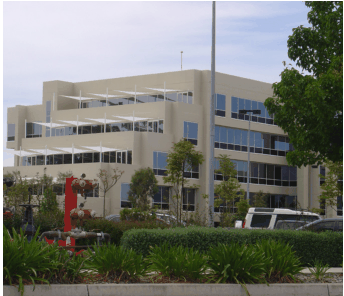

### 6.4 6.4.5 Residential Interface

#### Objectives:

#### General

#### Requirements

■ To ensure that commercial development does not have adverse impacts on the amenity of adjoining and nearby residential development.

#### 6.4.5

#### Residential ■ To ensure that commercial buildings are appropriately setback from nearby

residential development.

#### Interface

■ To ensure that heavy vehicles associated with commercial development do not adversely impact upon residential amenity. ■ To provide a visually attractive relationship with residential development.

> [Picture on page 25: a picture, saved as a picture (images/vol-1-part-06-commercial-development-page-25-14.gif, 150 dpi).]

#### Design Requirements

a)	 Buildings adjoining residential zones and/or open space shall be setback a minimum of 3 metres from that property boundary.

b)	 Loading areas, driveways, waste storage areas and roof top equipment shall not be located adjacent to residential development.

Figure 6.4.5.1 - An example of a commercial building, where upper storeys are  stepped back to minimise bulk of the building.

c)	 Any commercial buildings that are designed to accommodate the preparation of food from a commercial tenancy, shall provide ventilation facilities to ensure that no odour is emitted in a manner that adversely impacts upon any residential premises.

d)	 External lighting shall be positioned to avoid light spillage to adjoining residential development.

e)	 An acoustic report may be required to be  prepared as part of a  development application where the proposed development is adjacent to residential or other sensitive uses, such as places of worship and  child care centres. Note: Enquiries should be made with Council’s Development Services Section as to whether an acoustic report is required in respect to a particular development application.
