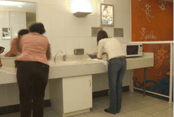

#### 6.8.1 Development Applications to which this Section Applies

#### Design Requirements

A parenting facility is a room which is equipped with facilities  for

a)	 Parenting facilities shall be incorporated

feeding (including breast feeding) and caring of babies/infants.

> [Picture on page 31: a picture, saved as a picture (images/vol-1-part-06-commercial-development-page-31-18.gif, 150 dpi).]

in all new buildings and alterations/ refurbishment of existing buildings for regional and district shopping centres, major sporting facilities, swimming centres, community facilities, libraries, hospitals, theatres, cinemas, department stores, and any other building where in Council’s opinion such facilities should be provided.
