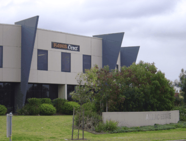
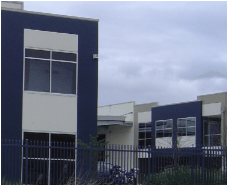
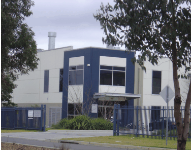
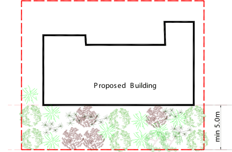
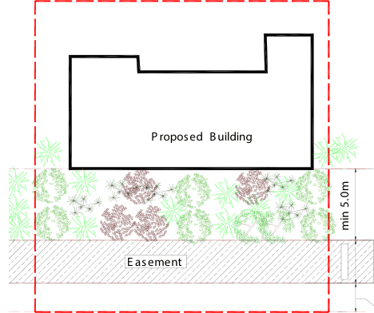
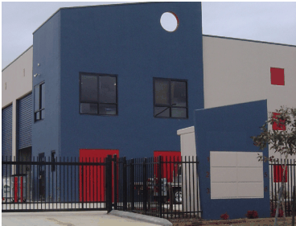

### 7.2 Building Form and Character

#### Objectives:

■ Ensure that industrial development is both functional and attractive in the context of its local environment through appropriate design. ■ Reduce the visual impact of industrial development on the streetscape and surrounding areas. ■ Ensure that sufficient areas are available for landscaping, access, and car parking and manoeuvring of heavy vehicles on site. ■ Ensure that building materials are high quality and durable. ■ Ensure that fencing and walls for security purposes have positive impacts on the streetscape and other public domain areas. ■ Ensure that industrial development does not significantly impact on adjoining residential zones. ■ Ensure that industrial units are designed to be able to accommodate a wide variety of businesses. ■ Ensure that industrial units are able to facilitate the safe and efficient transportation of goods between floors/levels in a building.

> [Picture on page 2: a picture, saved as a picture (images/vol-1-part-07-industrial-development-page-2-39.gif, 150 dpi).]

#### 7.2.1 Building Design

#### Design Requirements

a)	 Building design shall incorporate the following features to assist in the reduction of the perceived bulk and mass of development:

i)	 provision of vertical and/or horizontal offsets in the wall surfaces at regular intervals, including columns, projections, and recesses;

Figure 7.2.1 An examples of well articulated industrial buildings.

#### Building Form

ii)	 articulate architectural details around doors, windows front facades, roofs  and entrances;

#### Worked example:

iii)	articulate walls through the use of

and

#### Character

texture, colour, material changes, shadow lines and other facade treatments, at least every 15 metres; and

iv)	at least 50% of the total surface

For a proposed development that comprises a gross floor area of 100sqm, the office area shall be a maximum of 30 sqm. As such the development would be comprised of:

area of the front elevation to be constructed of masonry material.

a) 30sqm of office area; and

b)	 Buildings located on corner allotments

b) 70sqm of  the primary use.

> [Picture on page 3: a picture, saved as a picture (images/vol-1-part-07-industrial-development-page-3-25.gif, 150 dpi).]

> [Picture on page 3: a picture, saved as a picture (images/vol-1-part-07-industrial-development-page-3-26.gif, 150 dpi).]

shall be designed to address both street frontages.

c)	 Buildings shall be predominantly single storey (excluding basements, mezzanines and offices).

d)	 Mezzanines shall not comprise an area of more than 50% of the gross floor area of the ground floor of the respective unit.

e)	 Despite subclause (d), a mezzanine level may comprise up to 75 % of the gross floor area of the ground floor of the respective unit, providing that it can be demonstrated to Council’s satisfaction that: i)

i)	 The unit shall be able to facilitate

The unit shall be able to facilitate the safe and efficient transportation

the safe and efficient transportation of goods between the ground floor

of goods between the ground floor and mezzanine level

and mezzanine level ii)

ii)	 Regardless of the proposed land use,

Regardless of the proposed land use, a forklift shall be able to manoeuvre

a forklift shall be able to manoeuvre internally within the unit to facilitate

internally within the unit to facilitate vertical transportation of goods

vertical transportation of goods without leaving the unit

without leaving the unit

Figure 7.2.2 Examples of easily identifiable entry.

iii)

iii)	Any part of the mezzanine level over

Any part of the mezzanine level over 50 % of the gross floor area of the

50 % of the gross floor area of the ground floor of the respective unit is

ground floor of the respective unit is of lightweight construction and can

of lightweight construction and can be easily removed without impacting

be easily removed without impacting on the structural integrity of the

on the structural integrity of the building.

building.

f) Offices shall not comprise more than 30% of the gross floor area of the  respective

unit.

#### Building Form

and

#### Character

Note: For the purpose of Clause 7.2.1 e) above, ‘office space’  means the part of the gross floor area that is dedicated to office use.

g)	 No building shall rely upon a required path of egress (as defined within the BCA) over adjoining private land.

h)	 No building or structure shall be erected within a right of carriage way or easement.

i) A schedule  of proposed colours, materials and finishes shall accompany all development applications for new industrial buildings.

j) The main entry to the building shall be easily identifiable from the street and directly accessible from  the front of the building or driveway in the case of a multi unit complex.

#### 7.2.2 Building Setbacks

#### Design Requirements

a)	 Industrial development shall be setback by:

i)	 	30  metres to:

– the main southern railway corridor,

– the South Western Freeway corridor,

– Ben Lomond Road between Pembroke Road and the Main Southern Railway Corridor,

– Campbelltown Road,

– Henderson Road,

– Pembroke Road,

– Rose Payten Drive, and

– Williamson Road.

ii)	 15 metres to:

– Airds Road,

– Badgally Road,

– Ben Lomond Road between Campbelltown Road and the Main Southern Railway Corridor,

### Building

### Form

– Blaxland

Road between

Campbelltown Road and Rose Street,

and

### Character – the south eastern side of Blaxland

Property Boundary

> [Picture on page 5: a picture, saved as a picture (images/vol-1-part-07-industrial-development-page-5-12.gif, 150 dpi).]
> Words printed on the picture (title and legend, copied from the PDF):
> Proposed  Building
> min 5.0m

Road between Rose Street and Lot 5 DP 538258,

– Blaxland Road between Lot 5 DP 538258 and Narellan Road,

– Devon Road,

– Grange Road,

– Plough Inn Road between Campbelltown Road, and Hollylea Road,

– Sussex Street, and

S outhern R ailway Line Boundary

– Swaffham Road.

Property Boundary

> [Picture on page 5: a picture, saved as a picture (images/vol-1-part-07-industrial-development-page-5-26.gif, 150 dpi).]
> Words printed on the picture (title and legend, copied from the PDF):
> Proposed  Building
> min 5.0m
> E asement

iii)	10 metres from any other public road. excluding any required road widening.

b)	 Despite Clause 7.2.2.a) i)  Council may consider a reduction of the rear setback from the southern railway corridor from 30 metres to 5 metres providing that:

i)	 a vegetated screen/landscape area of a minimum width of 5 metres is constructed along the full width of the property between the railway corridor and the buildings;

S outhern R ailway Line Boundary

less than 5.0m

ii)	 the vegetated  area is free of any easements  or site constraints (refer to Figure 7.2.3;

Figure 7.2.3 Illustration of the reduced set backs requirements from the southern railway corridor.

iii)	the vegetated area is densely landscaped with trees and plants selected from the Campbelltown Native Gardening Guide , available from Council’s website at www. campbelltown.nsw.gov.au;

iv)	Council is satisfied that the proposed vegetation is sufficient to screen the buildings from the southern railway

corridor.

#### Building Form

Note: All reduced setback proposals from the railway corridor shall be subject to the approval of the relevant public authorities.

and

#### Character

c)	 Except as nominated above, buildings adjoining residential, commercial and/ or open space zones shall be setback a minimum of 10 metres, the interface of which shall be complimentary to and not pose unreasonable impacts on the non-industrial development in terms of its built form and proposed used.

#### 7.2.3 Fences

#### Design Requirements

a)	 Industrial fencing shall be a maximum

2.4 metres in height.

> [Picture on page 6: a picture, saved as a picture (images/vol-1-part-07-industrial-development-page-6-20.gif, 150 dpi).]

Figure 7.3.4 An example of the use of a palisade fence in an industrial development.

b)	 All fencing in industrial developments shall be of recessive colours, palisade design, or plastic coated and framed chain wire with a maximum height of

2.4 metres, unless required as part of an acoustic solution.

c)	 The use of sheet metal fencing is not permitted unless required as part of acoustic solution and is appropriately screened with landscaping.

d)	 All fencing in industrial developments shall be setback a minimum of 3.0 metres from property boundaries addressing a primary and/or  secondary street.

less than 5.0m

e)	 Fencing on corner allotments shall not obstruct the sight distance of traffic entering or within an intersection or roundabout.

f) Fencing shall not obstruct power, water, sewer, gas or telephone services, drainage systems, (including overland flow paths) or any easements or rights of way.

g)	 Details for fencing shall be submitted with the development application.
