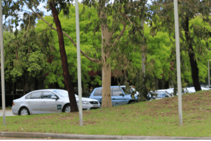
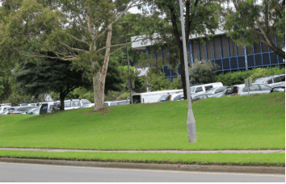
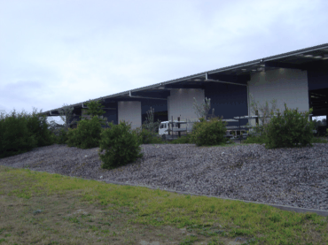
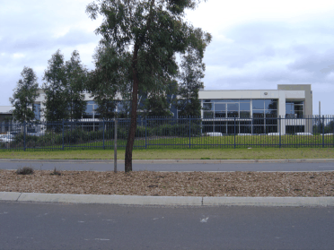

### 7.3  Car Parking and Access

#### Car Parking

#### and Access

#### Objectives:

■ To ensure that all required car parking and related vehicle manoeuvring is accommodated on site. ■ To maintain the free flow and safe movement of traffic into and out of the site. ■ To ensure that on site car parking does not detract from the visual character of

> [Picture on page 7: a picture, saved as a picture (images/vol-1-part-07-industrial-development-page-7-9.gif, 150 dpi).]

> [Picture on page 7: a picture, saved as a picture (images/vol-1-part-07-industrial-development-page-7-10.gif, 150 dpi).]

the streetscape.

#### 7.3.1 General Requirements

#### Design Requirements

a)	 Off street parking  and loading shall be designed in accordance with Australian Standard AS 2890.1 and 2  (as amended), except as otherwise provided by this Plan.

b)	 For that part of the gross floor area occupied by office areas, lunch rooms and any associated office storage areas, car parking shall be provided at a rate of one space per 35sqm.

c)	 For that part of the gross floor area occupied by uses other than office areas, lunch rooms and any associated office storage areas, car parking rates shall be provided in accordance with the following:

i)	 a minimum of two (2) spaces (per unit), plus

Figure 7.3.1 Examples of landscaping incorporated into car parking within industrial areas.

ii)	 one space for every 100sqm of gross floor area for buildings up to 2000 square metres; plus

#### Note:

iii)	one space per 250sqm for that part of the building  exceeding 2000 square metres in  gross floor area.

d)	 Despite clause 7.3.1 c) ii), any proposed

Apart from offices, car parking rates for all proposed commercial uses within industrial zones shall comply with the requirements under Table 6.4.2.1.

factory unit development (regardless of the overall combined floor area), shall provide parking at a rate of one space per 100 sqm.

e)	 In addition to clauses 7.3.1 (b) & (c), one car parking space shall be provided

for every 300sqm of outdoor storage space.

#### Car Parking

#### and Access

f) Mezzanine areas that are exclusively used for storage purposes shall be excluded from the calculation of total gross floor area for the purpose of calculating the required number of car parking spaces, providing that the mezzanine areas:

i)	 are not divided into smaller spaces by internal walls; and

ii)	 have no external windows.

g)	 In addition to clause 7.3.1 (c), motor vehicle industries shall provide a minimum of three (3) car parking spaces per work bay/hoist.

h)	 Sufficient space shall be provided on site so that no vehicle shall be required to make more than a three-point movement to exit the site in a forward direction.

> [Picture on page 8: a picture, saved as a picture (images/vol-1-part-07-industrial-development-page-8-24.gif, 150 dpi).]

> [Picture on page 8: a picture, saved as a picture (images/vol-1-part-07-industrial-development-page-8-25.gif, 150 dpi).]

Figure 7.3.2 Examples of loading bays provided for individual units and separate from car parking and landscaped areas.

i) No car parking spaces shall be designed in  a stacked configuration.

j) No required car parking spaces shall be created as a separate strata or Torrens title allotment.

k)	 Each site shall have a:

i)	 maximum of one ingress and one egress for heavy vehicles (combined or separated).

ii)	 each site may have an additional ingress/egress for cars (and other light vehicles).

l) A minimum of 10% of the required car parking spaces, including disabled spaces, shall be located within close proximity to the main pedestrian entry to the building.

m)	 Electric vehicle charging stations must be located behind the building line. Note: Council may consider the use of mechanical turntables as part of the car parking arrangements.

#### 7.3.2 Loading and Unloading
