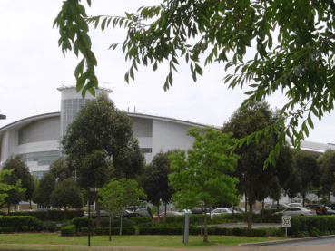

### 7.4 Landscaping

#### Landscaping

#### Objectives:

■ To encourage the planting of native and low water consumption plants and trees. ■ To enhance the existing streetscape and promote a scale and density of planting that softens the visual impact of buildings from public places and adjoining non-

> [Picture on page 10: a picture, saved as a picture (images/vol-1-part-07-industrial-development-page-10-7.gif, 150 dpi).]

industrial lands.

#### Design Requirements

a)	 A detailed landscape plan and report shall be prepared by a suitably qualified person and submitted with all development applications for the industrial development.

b)	 Landscaping shall be provided to a minimum depth of 50% of the following required setback area located:

i)	 along the full width of each street frontage (other than vehicle driveways); and

Figure 7.4.1 - An Example of  well landscaped industrial development.

ii)	 along the full width of setbacks from

#### Note:

adjoining open space, residential and/or commercial areas.

c)	 The first three (3) metres of all

Refer to Section 2.5 Landscaping of Part 2 of Volume 1 of the Plan for additional requirements on Landscaping.

required street front landscaped area (as measured from the street boundary) shall be planted of advanced canopy trees that are:

i)	 a minimum of two (2) metres in height with  a minimum 400 litre pot size at the time of planting;

ii)	 of native species; and

iii)	planted /placed  every 10 metres.

d)	 Side boundary landscaping of a minimum of one (1) metre width shall be provided between the street boundary and the building line.
