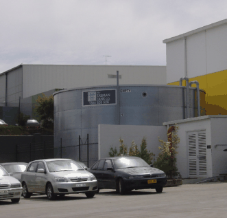

### 7.7 Environmental Management

#### Environmental

#### Management

#### Objective:

■ To ensure that appropriate environmental management measures are implemented to prevent air, stormwater and noise pollution.

> [Picture on page 13: a picture, saved as a picture (images/vol-1-part-07-industrial-development-page-13-7.gif, 150 dpi).]

#### 7.7.1 Liquid Storage

#### Design Requirements

a)	 The storage and handling of flammable and combustible liquids shall be in accordance with Australian Standard 1940 - The Storage and Handling of Flammable and Combustible Liquids and the Environment Protection Authority publication, “Bunding and Spill Management” (as amended).

b)	 All above ground  liquid storage facilities, including waste shall be in a covered bunded area that is constructed of impervious materials.

c)	 Above ground tanks shall be contained in a bunded area that:

i)	 is at least 110% of the volume of the

Figure 7.7.1 -  An example of liquid storage tank.

tank or the largest tank,  where a group of tanks are enclosed; and

ii)	 walls shall be at least 250mm in height.

d)	 The bunded area of drum storage facilities shall be able to contain 25% of the total volume of all drums and shall have a minimum capacity of at least 400L. Walls shall be at least 250mm in height. Note: Some liquid storage requires a  licence from WorkCover. Further enquiries, refer to www.workcover.nsw.gov.au.

#### 7.7.2 Air Quality

#### Design Requirements

a)	 Any development that is likely to or capable of generating levels of air emissions exceeding the requirements

#### Environmental

of the Protection of the Environment Operations Act 1997 shall demonstrate appropriate measures to mitigate against air pollution.

#### Management

#### 7.7.3 Noise

#### Design Requirements:

a)	 Any development that is likely to or capable of generating levels of noise exceeding the requirements of the Industrial Noise Policy (published by the Office of Environment and Heritage) shall demonstrate appropriate measures to mitigate against noise pollution. Note: In addition to the requirements of this Plan, SEPP 33 Hazardous and Offensive Development specifies standards for environmental management of certain industrial development.

#### 7.7.4 Stormwater and Drainage

#### Design Requirements

a)	 All activities with the potential to pollute the stormwater system from a system failure  shall be carried out within a covered and bunded area sited, designed and constructed to Council’s satisfaction.

b)	 Liquid waste and waste water shall either be:

i)	 recycled on site;

ii)	 treated and discharged to the sewer in accordance with a trade waste licence issued by Sydney Water; or

iii)	collected, stored in a covered, bunded area and collected by the Office of Environment and Heritage; and

iv)	discharged to a licensed waste management facility.

c)	 Development shall not result in water run-off causing flooding or erosion on adjacent properties.

#### Multi Unit

#### Complexes

d)	 Stormwater run-off shall be appropriately channelled into a stormwater drain in accordance with Council’s Engineering Design Guide for Development available at Council’s website at www.campbeltown.nsw.gov. au

e)	 Where  applicable, the development shall incorporate the creation of an appropriate easement to manage stormwater in accordance with Council’s Engineering Design Guide for Development available at Council’s website at www.campbeltown.nsw.gov. au.
