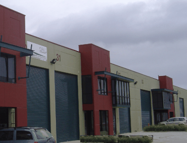

### 7.9 Industrial Unit/s

#### Residential

#### Interface

#### Objectives:

■ Ensure that the design of industrial units provide sufficient facilities to ensure the orderly development and relationship of a number of industrial activities on

> [Picture on page 16: a picture, saved as a picture (images/vol-1-part-07-industrial-development-page-16-7.gif, 150 dpi).]

the site.

#### Design Requirements

a)	 Each industrial unit proposed on land zoned IN1 General Industrial under the CLEP  shall have a minimum LFA of 400 square metres.

b)	 Each industrial units proposed on land zoned IN2 Light Industrial under the CLEP  shall have a minimum LFA of 100 square metres.

Figure 7.9.1 -  An example of a multi-unit complex with individual loading/ parking for each unit.
