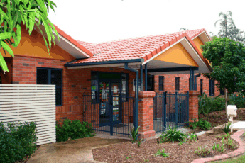

### 8.3 8.3.2 Site Requirements

#### 8.3.2 Site Requirements

#### Design Requirements

#### Building Form

#### and Character

a)

a)	 Council may consider a proposal for a Centre-based

Council may consider a proposal for a Centre-based Child Care Facility within an existing building on

Child Care Facility within an existing building on sites within

sites within areas zoned B3, B4 or B5 that do not necessarily meet the site width requirement.

#### 8.3.3 Streetscape

#### 8.3.3 Streetscape

#### Design Requirements

a)

a)	 The design of new purpose built buildings (including

The design of new purpose built buildings (including facade treatments, building massing, roof design and

facade treatments, building massing, roof design and entrance features, setbacks and landscaping) shall

entrance features, setbacks and landscaping) shall complement the scale of surrounding  development,

complement the scale of surrounding  development, character and qualities of the desired streetscape.

character and qualities of the desired streetscape. b)

b)	 Notwithstanding Clause 8.3.1 a) viii) new buildings

Notwithstanding Clause 8.3.1 a) viii) new buildings on corner sites shall incorporate facade treatments

on corner sites shall incorporate facade treatments that address both street frontages and achieve

that address both street frontages and achieve positive articulation in building design.

positive articulation in building design. c)

c)	 Clothes lines and  air conditioning units shall be

Clothes lines and  air conditioning units shall be screened and not visible by the public  when viewed

screened and not visible by the public  when viewed from a public area.

from a public area. d)

d)	 The built form,  design and layout of all outdoor play

The built form,  design and layout of all outdoor play areas shall relate to the natural land form and setting

areas shall relate to the natural land form and setting to ensure that the amenity (visual and acoustic

to ensure that the amenity (visual and acoustic privacy) of adjoining properties is protected.

privacy) of adjoining properties is protected.

#### 8.3.4 Fencing

#### 8.3.4 Fencing

#### Design Requirements

a)

a)	 Fencing along the primary and secondary street

Fencing along the primary and secondary street boundaries shall:

boundaries shall: i)

i)	 not be constructed of bonded sheet metal;

not be constructed of bonded sheet metal; ii)

ii)	 not be higher than 1.2 metres;

not be higher than 1.2 metres; iii)

iii)	be articulated, incorporate landscape treatments

be articulated, incorporate landscape treatments and complement the design and finish of the

and complement the design and finish of the development.

development.

b)

b)	 Fencing to the rear and side boundaries shall be:

Fencing to the rear and side boundaries shall be: i)

i)	 located behind the primary and secondary street

located behind the primary and secondary street setbacks; and

setbacks; and ii)

ii)	 a maximum of 2.1 metres in height (excluding

a maximum of 2.1 metres in height (excluding retaining walls).

retaining walls).

c)

c)	 Bonded sheet metal fencing shall only be permitted

Bonded sheet metal fencing shall only be permitted

where all of the following criteria have been

where all of the following criteria have been met:

met: i)

i)	 the fence is located behind a 1.5  metre

the fence is located behind a 1.5  metre wide landscaped buffer; and

wide landscaped buffer; and

#### Building Form

#### and Character

ii)

ii)	 the fence is located behind the building

the fence is located behind the building line of all street frontages.

line of all street frontages.

#### 8.3.5 Visual and Acoustic Privacy

#### 8.3.5 Visual and Acoustic Privacy

#### Design Requirements

a)	 An acoustic report prepared by a suitably qualified person shall be submitted with  all Centre-based Child Care Facility development applications demonstrating :

i)	 that the noise levels generated from the Centre-based Child Care Facility, when measured over a 15 minute period, does not exceed the background noise by more than 5 dBA;

> [Picture on page 6: a picture, saved as a picture (images/vol-1-part-08-centre-based-child-care-facilities-page-6-29.gif, 150 dpi).]

Figure 8.3.2 – An example of a Centre-based Child Care Facility located within a residential area that is of appropriate scale and character.

ii)	 that the noise levels comply with the requirement of the Protection of The Environment  Operations Act 1997; and

iii)	illustrating ways to minimise the impacts of noise on adjoining properties.

b)	 Direct views to and from neighbouring and surrounding properties shall be minimised through:

i)	 appropriate building design and  location of outdoor play areas; and

ii)	 the use of fencing and landscaping buffers.

#### 8.3.6 Waste Management

#### Design Requirements

a)	 A waste management plan shall be submitted for all Centre-based Child Care Facility developments including information w9ith regard to the storage and disposal of used nappies, general waste and recycling.

b)	 The development shall make provision for an enclosed onsite waste and recycling storage area that provides adequate space to accommodate the size and number of bins proposed, and volume of waste and recycling generated at the centre.

c)	 Waste storage, collection areas and service/

delivery areas shall be screened from public view  and located to minimise adverse impacts on adjoining properties.

d)	 The waste collection area shall be located and

#### Building Form

#### and Character

designed to minimise safety hazards for any person within the site or within the adjacent private/public areas.

e)	 The waste storage area shall:

i)	 be no more than 30 metres from the point of collection;

ii)	 contain a hose connection;

iii)	have an impervious floor that is connected to the sewer;

iv)	be adequately ventilated;

v)	 incorporate appropriate design and construction materials (including colours and finishes) which complement the development;

vi)	be appropriately screened from public view by a visual barrier of at least 1.5m high;

vii)	provide an opening sufficient to allow egress of the maximum sized bin to be used at the development; and

viii)	Be positioned to ensure that the path for wheeling bins between the waste storage area(s) and the collection point is free of steps and kerbs and has a maximum gradient of 1V:8H.

f) All premises shall produce evidence of a collection contract with a licensed waste and recycling collection contractor, if requested by Council.

g)	 The development must be designed in such a way that an Australian Standard heavy rigid vehicle can provide waste collection services to the development. If on-site servicing is required, the site plan and layout shall consider how heavy rigid vehicles can access and move around the development, and make appropriate provisions for this to occur safely. h)

h)	 All waste and recycling generated from the business

All waste and recycling generated from the business is to be kept within an appropriate storage receptacle

is to be kept within an appropriate storage receptacle on the premises. Waste is not to be stored or placed

on the premises. Waste is not to be stored or placed outside of a waste storage receptacle or in such a

outside of a waste storage receptacle or in such a manner that it will become a litter, odour or health

manner that it will become a litter, odour or health nuisance.

nuisance.

#### 8.3.7 Additional Requirements - Residential

#### 8.3.7 Additional Requirements - Residential Zones

#### Zones

#### Design Requirements

a)	 A  maximum of 50 children shall occupy a Centre-

#### Building Form

#### and Character

based Child Care Facility on any single allotment.

b)	 The Centre-based Child Care Facility shall be wholly located on the ground floor of the building ( excluding offices and storage rooms).

c)	 Centre-based Child Care Facilities shall be setback a minimum of:

i)	 5.5 metres from the primary street boundary;

ii)	 	5 metres from the rear boundary;

iii)		3.0 metres from the side boundary; and

iv)	3 metres from any secondary street boundary.

d)	 Where a proposal comprises a Centre-based Child Care Facility and a  residential dwelling, the proposal shall meet the following:

– an open space area shall be provided for the exclusive use of the residential dwelling, and shall comply with the section 3.6.1.5 of Part 3, Volume 1 of the Plan;

– the dwelling shall be separated from the Centre-based Child Care Facility;

– separate  kitchen, toilet and  laundry facilities shall be provided for the exclusive use of the Centre-based Child Care Facility.

#### 8.3.8 Additional Requirements - Rural and

#### 8.3.8 Additional Requirements - Rural and Environmental Protection Zones

#### Environmental Protection Zones

#### Design Requirements

a)

a)	 A  maximum of 50 children shall occupy a Centre-

A  maximum of 50 children shall occupy a Centre-based Child Care Facility on any single allotment.

based Child Care Facility on any single allotment. b)

b)	 The Centre-based Child Care Facility shall be

The Centre-based Child Care Facility shall be wholly located on the ground floor of the building.

wholly located on the ground floor of the building. c)

c)	 Centre-based Child Care Facilities shall be

Centre-based Child Care Facilities shall be setback a minimum of:

setback a minimum of: i)

i)	 20 metres from the primary street boundary;

20 metres from the primary street boundary; ii)

ii)	 	10 metres from the rear boundary;

10 metres from the rear boundary; iii)

iii)	10 metres from the side boundary; and

10 metres from the side boundary; and iv)

iv)	20 metres from any secondary street boundary.

20 metres from any secondary street boundary.
