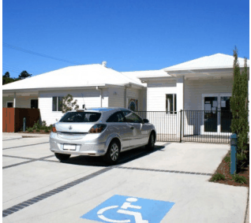

### 8.4 Car Parking and Access

#### Car Parking

Objectives:

#### and Access

■ Provide adequate on-site car parking for staff and visitors that is convenient, secure and safe having regard to the traffic generated by the development. ■ Ensure efficient and safe vehicular and pedestrian movements to all areas and aspects of a child care development. ■ Ensure that the location and design of driveways and parking areas, waste access and collection areas are practical, easily maintained, convenient, safe and suitably landscaped. ■ Provide safe convenient access for vehicles and  pedestrians whilst minimising

> [Picture on page 9: a picture, saved as a picture (images/vol-1-part-08-centre-based-child-care-facilities-page-9-13.gif, 150 dpi).]

conflict between them.

#### 8.4.1 Car Parking and Access

#### 8.4.1 Car Parking and Access

#### Design Requirements

a)	 Car parking areas shall be setback a minimum of 3 metres from the front boundary and any secondary boundary.

b)	 A minimum of one (1) on site car parking space shall be provided for every four (4) children approved to attend the Centre-based Child Care Facility.

c)	 Off street parking and loading shall be designed in accordance with Australian Standards 2890.1 and 2 (as amended), except as otherwise provided by this Plan.

Figure 8.4.1 – Stacked configuration of car parking spaces  as shown in this photos will not be included in the parking calculations.

d)	 No required car parking space shall be designed in a stacked configuration.

e)	 Parking spaces that are stacked will not be considered for the purpose of parking calculations.

f) Pedestrian access shall be separated from vehicular access with clearly defined paths to and from the building.

g)	 Where a child care centre site is proposed to be situated on a main collector road, pedestrian safety measures on adjoining roads (e.g. pedestrian crossings and refuges etc.) may be required to be installed at no cost to Council.

h)	 The vehicular and pedestrian access points to/from the centre must be adequately lit

(during operating hours) and appropriately signposted.

#### Car Parking

#### and Access

i) Each site shall have a maximum of one ingress and one egress  driveway.

j) The minimum width of a driveway shall be: i)

i)	 three (3) metres for one way traffic

three (3) metres for one way traffic movement; and

movement; and

ii)	 six (6) metres for two way traffic movement. iii)

iii)	Driveways shall be located a minimum

Driveways shall be located a minimum distance of six (6) metres from the tangent

distance of six (6) metres from the tangent point of any unsignalled intersection.

point of any unsignalled intersection.

Note: In circumstances where an intersection is controlled by lights, a roundabout or the like, applicants are requested to contact Council for specific requirements, as the location of the driveway may vary. k)

k)	 Sufficient space shall be provided on site so

Sufficient space shall be provided on site so that no vehicle shall be required to make

that no vehicle shall be required to make more than a three-point turn to exit the site

more than a three-point turn to exit the site in a forward direction. Significant reverse

in a forward direction. Significant reverse movements for vehicles within child care

movements for vehicles within child care centres shall not be permitted.

centres shall not be permitted. l)

l) The car parking area shall be suitably line

The car parking area shall be suitably line marked and delineated by appropriate

marked and delineated by appropriate signage and pavement line marking. This

signage and pavement line marking. This shall include the line-marking and signposting

shall include the line-marking and signposting of disabled car parking spaces, staff parking

of disabled car parking spaces, staff parking arrangements, emergency and service vehicle

arrangements, emergency and service vehicle parking bays.

parking bays. m)

m)	 Development applications Centre-based

Development applications Centre-based Child Care Facilities catering for 20 or more

Child Care Facilities catering for 20 or more children shall include a  Traffic Impact

children shall include a  Traffic Impact Statement, prepared by a suitably qualified

Statement, prepared by a suitably qualified person addressing the following criteria:

person addressing the following criteria: i)

i)	 the existing traffic environment;

the existing traffic environment; ii)

ii)	 anticipated traffic generation from the

anticipated traffic generation from the proposed development;

proposed development; iii)

iii)	the potential cumulative impact on the

the potential cumulative impact on the locality;

locality; iv)

iv)	the need for local traffic improvements in

the need for local traffic improvements in the locality;

the locality; v)

v)	 traffic egress/ingress; and

traffic egress/ingress; and

#### Car Parking

vi)

vi)	sight distance and other relevant safety

sight distance and other relevant safety issues including vehicular/pedestrian

issues including vehicular/pedestrian movements.

movements.

#### and Access

n)

n)	 Any fencing on site shall be designed to be of

Any fencing on site shall be designed to be of appropriate height and shall not obstruct sight

appropriate height and shall not obstruct sight distances between pedestrians and vehicles.

distances between pedestrians and vehicles.

#### 8.4.2 Access for People with Disabilities

#### 8.4.2 Access for People with Disabilities

#### Design Requirements

a)

a)	 Centre-based Child Care Facilities shall comply

Centre-based Child Care Facilities shall comply with the minimum access requirements

with the minimum access requirements contained within  the BCA, the Disability

contained within  the BCA, the Disability (Access to Premises — Buildings) Standards

(Access to Premises — Buildings) Standards 2010 and

2010 and Australian Standard 1428 – Design

Australian Standard 1428 – Design

for Access and Mobility

for Access and Mobility (as amended).

(as amended).

#### 8.4.3 Emergency Evacuation

#### 8.4.3 Emergency Evacuation

#### Design Requirements

a)

a)	 Development applications for Centre-based

Development applications for Centre-based Child Care Facilities catering for 20 or more

Child Care Facilities catering for 20 or more children shall include an Emergency Evacuation

children shall include an Emergency Evacuation Plan prepared by a suitably qualified person

Plan prepared by a suitably qualified person in accordance with

in accordance with Australian Standard

Australian Standard

3745 Emergency Control Organization and

3745 Emergency Control Organization and Procedures for Buildings, Structures and

Procedures for Buildings, Structures and Workplaces

Workplaces (as amended), addressing:

(as amended), addressing:

i)

i)	 the mobility of children and how this is to

the mobility of children and how this is to be accommodated during an evacuation;

be accommodated during an evacuation; ii)

ii)	 the location of a safe congregation area,

the location of a safe congregation area, away from the evacuated building, busy

away from the evacuated building, busy roads, other hazards and the evacuation

roads, other hazards and the evacuation points of other residents or tenants within

points of other residents or tenants within the building or surrounding buildings;

the building or surrounding buildings; iii)

iii)	where the Centre-based Child Care Facility

where the Centre-based Child Care Facility is part of a larger building or complex,

is part of a larger building or complex, that the emergency evacuation plan for

that the emergency evacuation plan for the Centre-based Child Care Facility

the Centre-based Child Care Facility is complementary and consistent with

is complementary and consistent with other emergency evacuation plans for the

other emergency evacuation plans for the complex; and

complex; and iv)

iv)	the supervision of children during

the supervision of children during an evacuation and at the safe congregation area, giving regard to the capacity of the Centre-based Child Care Facility and its approved child:staff ratios.
