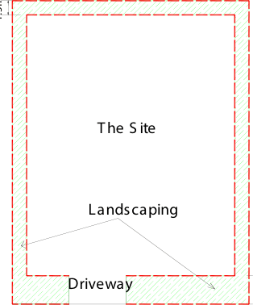
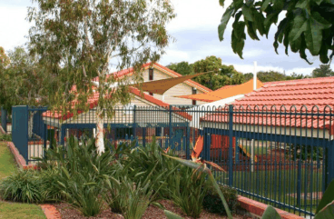

### 8.5 Landscaping

#### Landscaping

Objectives: ■ To encourage the planting of native and low water consumption plants and trees. ■ To enhance the existing streetscape and promote a scale and density of planting that softens the visual impact of buildings, while maintaining opportunities for passive surveillance. ■ Ensure that to minimise the risk of personal injuries the appropriate species of plants are selected for the landscaping of Centre-based Child Care Facilities.

R ear Boundary

> [Picture on page 12: a picture, saved as a picture (images/vol-1-part-08-centre-based-child-care-facilities-page-12-12.gif, 150 dpi).]
> Words printed on the picture (title and legend, copied from the PDF):
> The S ite
> Landscaping
> Driveway

#### Design Requirements

1.5m

a)

a)	 Landscaping shall be provided to a

Landscaping shall be provided to a minimum of a:

minimum of a: i)

i)	 3 metre wide strip along the primary

3 metre wide strip along the primary and secondary street frontage (other

and secondary street frontage (other than vehicle driveways); and

than vehicle driveways); and ii)

ii)	 1.5 metre wide strip along the full

1.5 metre wide strip along the full length of side and rear setbacks.

length of side and rear setbacks.

b)

b)	 Native mature trees on site shall be

Native mature trees on site shall be retained.

retained.

3.0m

Primary S treet

Figure 8.5.1 – Illustration of the minimum required area to be landscaped.

> [Picture on page 12: a picture, saved as a picture (images/vol-1-part-08-centre-based-child-care-facilities-page-12-41.gif, 150 dpi).]

c)

c)	 Development applications  for Centre-

Development applications  for Centre-based Child Care Facilities shall include

based Child Care Facilities shall include a  Landscape Plan and report, prepared

a  Landscape Plan and report, prepared by a suitably qualified person addressing

by a suitably qualified person addressing the following:

the following: i)

i)	 species, location and mature height

species, location and mature height of proposed planting;

of proposed planting; ii)

ii)	 location of play equipment;

location of play equipment; iii)

iii)	separation from car parking spaces

separation from car parking spaces and driveway areas;

and driveway areas; iv)

iv)	fencing height and materials; and

fencing height and materials; and v)

v)	 surfaces (sand, grass or the like).

surfaces (sand, grass or the like).

Figure 8.5.2 – Landscaping used for shading and screening.

d)

d)	 All existing vegetation on the site and

All existing vegetation on the site and on adjoining sites shall be assessed to

on adjoining sites shall be assessed to ensure that the plants:

ensure that the plants:

#### Note:

i)

i)	 are not toxic or dangerous (refer to

are not toxic or dangerous (refer to Appendix 7 for a list of Unsuitable

Appendix 7 for a list of Unsuitable Plant Species); and

Plant Species); and

Refer to Section 2.5 Landscaping of Part 2 of Volume 1 of the Plan for additional requirements on Landscaping.

ii)

ii)	 do not impose a safety hazard such

do not impose a safety hazard such

as   personal injury from falling

as   personal injury from falling branches and seeds, poisoning and/

branches and seeds, poisoning and/ or choking.

or choking.

#### Play Areas
