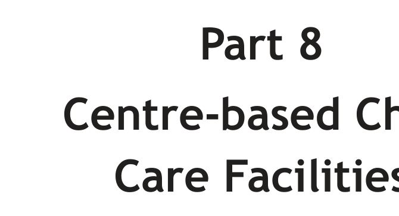

# Campbelltown Sustainable City Development Control Plan 2015 - Part 8 Centre-based Child Care Facilities

> This chapter is split into 8 section file(s), one per numbered heading, in the order they appear in the PDF.

Source PDF: [part-8-childcare-centres-amendment-21-sept2024.pdf](https://planfortomorrow.sharepoint.com/sites/Planfortomorrow/Shared%20Documents/00%20NSW-Planning-Resources/dcp/campbelltown-sustainable-city-development-control-plan-2015/vol-1-part-08-centre-based-child-care-facilities/part-8-childcare-centres-amendment-21-sept2024.pdf)

> [Picture on page 1: a picture, saved as a picture (images/vol-1-part-08-centre-based-child-care-facilities-page-1-1.gif, 150 dpi).]

<!-- sections -->
## Sections

1. [8.1 Application](01-8-1-application.md)
2. [8.2 Licence Requirement](02-8-2-licence-requirement.md)
3. [8.3 Building Form and Character](03-8-3-building-form-and-character.md)
4. [8.3 8.3.2 Site Requirements](04-8-3-8-3-2-site-requirements.md)
5. [8.4 Car Parking and Access](05-8-4-car-parking-and-access.md)
6. [8.5 Landscaping](06-8-5-landscaping.md)
7. [8.6 Play Areas](07-8-6-play-areas.md)
8. [8.7 Advertising Signs](08-8-7-advertising-signs.md)
