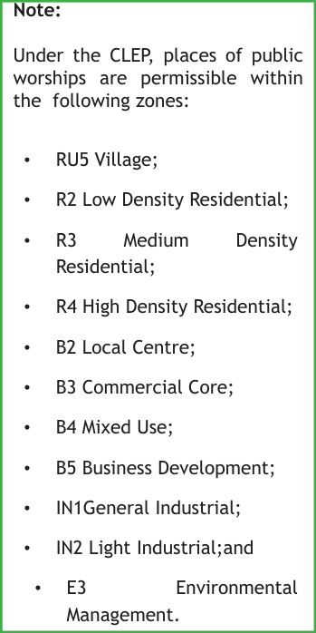

### 10.2 General Design Requirements

#### Objectives:

■ Ensure that places of public worship are appropriately located and designed to minimise any adverse effects (high noise levels, traffic impacts, overshadowing, privacy and access) on  the amenity of surrounding land uses. ■ Ensure that the scale, bulk and height of places of public worship are compatible with the predominant character of surrounding developments.

> [Picture on page 2: a map, saved as a picture (images/vol-1-part-10-places-of-public-worship-page-2-12.gif, 150 dpi); the street names and other small labels are on the picture.]
> Words printed on the picture (title and legend, copied from the PDF):
> worships are permissible within
> the  following zones:
> • RU5 Village;
> • R2 Low Density Residential;
> • R3 Medium Density
> • B2 Local Centre;
> • B3 Commercial Core;
> • B4 Mixed Use;
> • B5 Business Development;
> • IN2 Light Industrial;and
> • E3 Environmental

#### Note:

#### 10.2.1 Locality Requirements

a)	 Development applications for a newly Under the CLEP, places of public proposed place of public worship or additions and alterations to an existing place of public worship shall be accompanied by a report addressing the suitability of the site, street, neighbourhood and locality  for the scale and intensity of the proposed development.

b)	 Places of public worship shall not be • R4 High Density Residential; located within a 150 metre radius (as measured from the point of the main entry of the  proposed place of public worship) of a brothel, or any sex-services premises or restricted premises.

c)	 Places of public worship on urban land • IN1General Industrial; shall be located a minimum of 250 metres (as measured from the point of the main entry of the  proposed place of public worship) of  any other approved place of public worship development, in order to minimise potential traffic generation, noise or amenity impacts upon the surrounding locality.

d)	 Newly proposed places of public worship located on land within a residential

#### Note:

Contact Council’s Customer Service Centre (02 4645 4000) to find out if the proposed public worship place is within close proximity to a sex service premise.

zone shall have a maximum capacity of 100  people at any one time.

### General Design

#### 10.2.2 Height

### Requirements

a)	 Spires and similar structures shall only be permitted if  in Council’s opinion the proposed structure:

i)	 is of appropriate height, bulk and scale; and

ii)	 does not result in overshadowing of private open space and living rooms of adjacent residential development or the residential component of a mixed use development.

#### 10.2.3 Acoustic and Privacy Amenity

a)	 An acoustic report prepared by a suitably qualified person shall be submitted with all place of public worship development applications demonstrating :

i)	 that the noise levels generated from the place of public worship, when measured over a 15 minute period, does not exceed the background noise by more than 5 dBA at the property boundary;

ii)	 that the noise levels comply with the requirement of the Protection of The Environment  Operations Act 1997; and

iii)	ways to minimise the impacts of noise on adjoining properties.

b)

b)	 Despite Clause 10.3.3.a) above, an

Despite Clause 10.3.3.a) above, an acoustic report for proposed places

acoustic report for proposed places of public worship within industrial

of public worship within industrial zones shall only be required where

zones shall only be required where the proposal is located within 150

the proposal is located within 150 metres  from  land where residential

metres  from  land where residential development is a permissible land use.

development is a permissible land use. Note: Choice of fencing material should be considered and addressed as part of the acoustic report.

c)	 On-site noise generating sources including, but not limited to:

i)	 plant rooms and equipment;

ii)	 power supply generators;

### General Design

iii)	 air conditioning units;

### Requirements

iv)	 pool pumps; and

v)	 recreation areas; shall be designed and located to ensure that the noise levels generated by such facilities do not exceed 5dBa above background levels at the property boundary.

d)	 The use  of external amplified sound including public address systems, amplified bells and amplified calls for prayers by places of public worship is prohibited.

e)	 Direct views to and from neighbouring and surrounding properties shall be minimised by means including:

i)	 appropriate building design and location of gathering areas; and

ii)	 the use of appropriate screening, fencing and landscaping.

#### 10.2.4 Streetscape

#### Design Requirements

a)	 The design of new purpose built buildings (including  facade  treatments, building massing, roof design and entrance features, setbacks and landscaping) shall complement the scale of surrounding development, character and qualities of the desired streetscape.

b)	 New buildings on corner sites shall incorporate facade treatments that address both street frontages and achieve positive articulation in building design.

c)	 Air conditioning units and water tanks shall be screened and not visible when viewed from a public area.

d)	 Off street car parking areas shall be screened by means of landscaping.

#### 10.2.5 Fencing

#### Design Requirements

### General Design

a)	 Fencing along the primary and secondary

### Requirements

street boundaries shall:

i)	 not be constructed of bonded sheet metal;

ii)	 not be higher than 1.2 metres;

iii)	be articulated, incorporate landscape treatments and complement the design and finish of the development.

b)	 Fencing to the rear and side boundaries shall:

i)	 be located behind the primary and secondary street setbacks; and

ii)	 be a maximum of 2.1 metres in height (excluding retaining walls).

c)	 Despite Clause 10.2.5 b)  above, fencing, where applicable, shall be designed to ensure that the privacy of adjacent residential developments is maintained.

d)	 Bonded sheet metal fencing shall only be permitted where all of the following criteria have been met:

i)	 the fence is located behind a 1.5 metre deep landscaped buffer; and

ii)	 the fence is located behind the building line of all street frontages.

#### 10.2.6 Places of public worship on land located within residential zones

a)	 Newly proposed places of public worship (whether a newly proposed building is proposed to be built or a change of use of  an existing building) located on land within residential zones shall not be located on a site that:

i)	 has an area  less than 1,500 sqm;

ii)	 is within a no through road;

iii)	has principal vehicular access to a

### General Design

road where the  carriageway is less than 6.5 metres; and

### Requirements

iv)	has a width less than 20 metres ( measured at the front building line).

b)	 For newly proposed places of public worship within residential zones, the Indoor assembly  area shall have a maximum total  floor area of 160sqm. For the purpose of this clause, assembly area means the total floor space area of all buildings on the site excluding the areas of offices, library, kitchens, toilets, changing rooms and residential accommodation.

c)	 Any area that is immediately adjacent to the assembly area and not fully separated from the assembly area by walls, shall be included in the calculations of the assembly area including open access corridors and areas between aisles.

d)	 Buildings and structures comprising places of public worship shall be setback a minimum of:

i)	 3 metres from any side boundary;

ii)	 5.5 metres from the primary street boundary; and

iii)	10 metres from the rear boundary; and

iv)	5 metres from the secondary street boundary.

e)	 Places of public worship shall not result in loss of solar access that would exceed the minimum requirements specified in clause 3.6 Solar Access.

f) Places of public worship  shall  have appropriate regard to the impact on solar access to useable private open space, windows of living areas, solar collectors and clothes drying areas of adjoining and nearby residential development.

g)	 The operation hours of newly proposed places of public worship within

residential zones shall be determined on individual merit.

### Car Parking

#### 10.2.7 Places of public worship located

#### 10.2.7 Places of public worship located on land within business zones

on land within business zones

### &

### Access

a)	 Places of public worship located on land  within business zones shall comply with the setbacks and building envelope requirements specified in Part 6 Commercial Development of this Plan.

b)	 Places of public worship shall not result in loss of solar access that exceeds the minimum requirements specified in Part 5 Residential Apartment Buildings and Mixed-Use Development under Clause

5.4.5 Solar Access of the Plan.

#### 10.2.8  Places of public worship located

#### 10.2.8  Places of public worship located on land within Industrial zones

on land within Industrial zones

a)	 Places of public worship located on

#### Note:

Refer to Clause 4.1D   Minimum lot sizes for certain land uses in certain environment protection zones of the CLEP.

land within industrial zones shall comply with the setbacks and building envelope requirements specified in Part 7 Industrial Development of this Plan.

#### 10.2.9 Places of public worship on

#### 10.2.9 Places of public worship on land zoned for rural or environmental

land zoned for rural or environmental protection purposes.

protection purposes.

a)	 Despite any other provisions of this Part, building and structures comprising places of public worship located on land zoned for rural or environmental protection purposes shall be set back a minimum of:

i)	 20 metres from the primary street boundary;

ii)	 10 metres from the rear boundary;

iii)	10 metres from a side boundary; and

iv)	20 metres from any secondary street boundary.

b)	 Places of public worship shall only be permitted where it is serviced by a sealed road.
