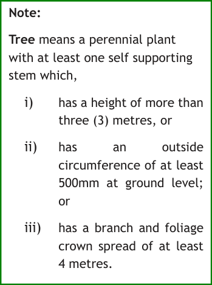
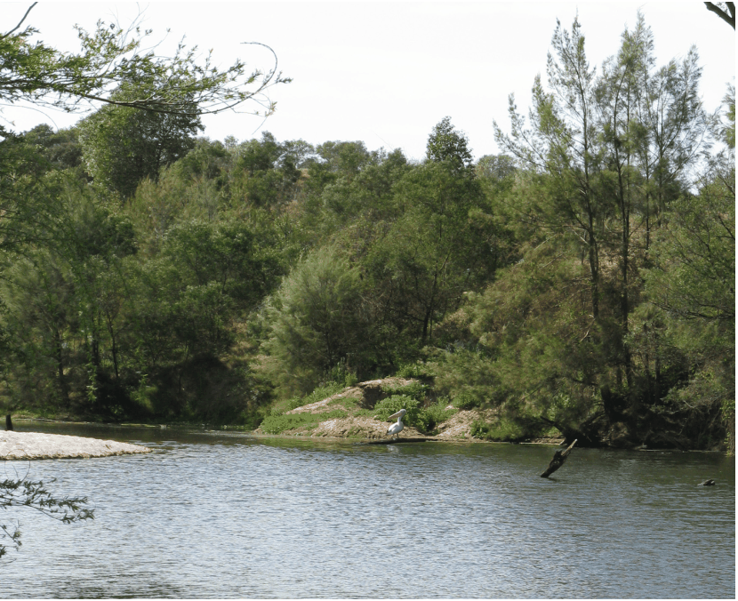

## Part 11 Vegetation and

### Wildlife

### Management

### 11.1 Application

### Application

This Part of the Plan sets out controls relating to: The management of native vegetation and wildlife habitat (native flora and native

1\. fauna); The protection/preservation of hollow-bearing trees; and

2\. Permits  and development applications for vegetation management.

3\. This part shall be read in conjunction with ( but not limited to) Clause 5.9 Preservation of trees and vegetation (Clause 5.9) of the CLEP. Trees and other vegetation are defined under Section 1.4  Dictionary of Volume 1 of the Plan and included in the notes below.

> [Picture on page 2: a picture, saved as a picture (images/vol-1-part-11-vegetation-and-wildlife-management-page-2-14.gif, 150 dpi).]
> Words printed on the picture (title and legend, copied from the PDF):
> i)
> i) has a height of more than
> ii)
> ii) has an outside
> iii)
> iii) has a branch and foliage

#### Note:

Other Vegetation means any plant life not defined by this Part as a tree and includes any sapling, shrub, scrub, understorey plants, ground cover (being any type of herbaceous vegetation) and plants occurring in a wetland that:

– Provides habitat or likely habitat for threatened species, populations and endangered ecological communities as defined within the Threatened Species Conservation Act; or

– Is located within a riparian zone or within 40 metres of the top bank of a creek, river, watercourse, wetland, stream or other aquatic habitat; and

– Is located on land owned by Council or under its care, control and management; and

– Forms part of native vegetation.

#### Note:

Tree means a perennial plant with at least one self supporting stem which,

has a height of more than three (3) metres, or

three (3) metres, or has an outside circumference of at least

circumference of at least 500mm at ground level;

500mm at ground level; or

or

has a branch and foliage crown spread of at least

crown spread of at least 4 metres.

4 metres.

Note:

For definitions of terms used in this part, refer to Section 1.4 Dictionary  of Part 1, Volume 1  of the Plan and the Dictionary under the  CLEP.

#### Note:

Management Native vegetation (as defined under the CLEP) has the same meaning as in the

Native Vegetation Act 2003. Note. The term is defined as follows:

of

### Native

### Vegetation

Meaning of “native vegetation”

Meaning of “native vegetation”

### &

### Wildlife

(1) Native vegetation means any of the following types of indigenous

(1) Native vegetation means any of the following types of indigenous vegetation:

vegetation:

### Habitat

(a)  trees (including any sapling or shrub, or any scrub);

(a)  trees (including any sapling or shrub, or any scrub);

(b)  understorey plants,

(b)  understorey plants,

(c)  groundcover (being any type of herbaceous vegetation),

(c)  groundcover (being any type of herbaceous vegetation),

(d)  plants occurring in a wetland.

(2)  Vegetation is indigenous if it is of a species of vegetation, or if it comprises

Vegetation is indigenous if it is of a species of vegetation, or if it comprises species of vegetation, that existed in the State before European settlement.

species of vegetation, that existed in the State before European settlement.

(3) Native vegetation does not include any mangroves, seagrasses or any

Native vegetation does not include any mangroves, seagrasses or any other type of marine vegetation to which section 205 of the Fisheries

other type of marine vegetation to which section 205 of the Fisheries Management Act 1994 applies.

Management Act 1994 applies.

> [Picture on page 3: a picture, saved as a picture (images/vol-1-part-11-vegetation-and-wildlife-management-page-3-34.gif, 150 dpi).]

Figure 11.1.1 - Native fauna and native flora- Campbelltown LGA.
