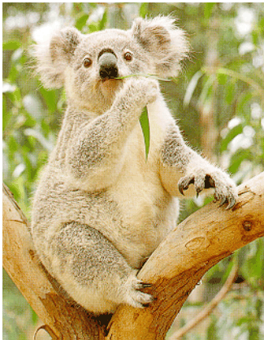
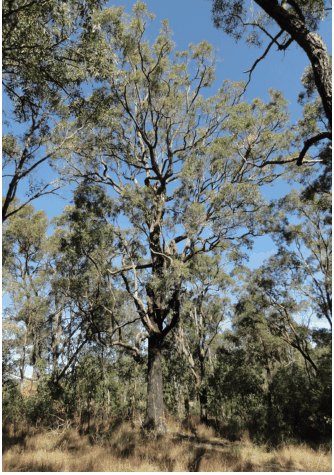
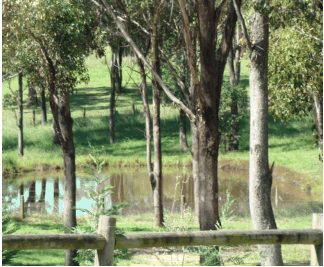
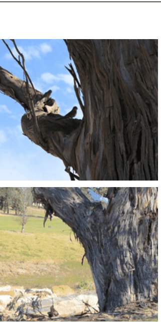
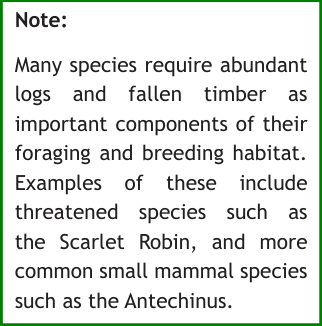
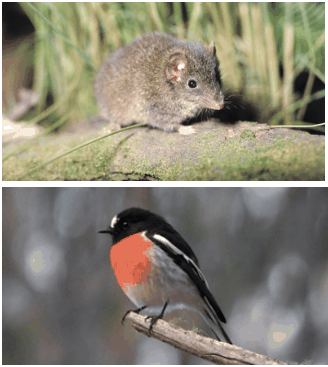

### 11.2 Management of Native Vegetation and Wildlife Habitat

### Application

#### Objectives:

Protect and conserve the City’s biodiversity through the retention of native

#### ■

vegetation. Maintain, enhance and/or establish corridors, which enable existing plant and

#### ■

animal communities to survive and range in their natural habitat. Protect habitat resources including hollow-bearing trees and  hollow logs within

#### ■

Campbelltown LGA. Provide appropriate measures to compensate for the loss of hollow-bearing trees

> [Picture on page 4: a picture, saved as a picture (images/vol-1-part-11-vegetation-and-wildlife-management-page-4-14.gif, 150 dpi).]

#### ■

within the LGA.

#### 11.2.1 Management of  Native Vegetation and  Wildlife Habitat

a)	 For sites containing native vegetation and/or fauna habitat:

i) the  development  shall  be sited, designed  and  managed to  avoid any negative impact on biodiversity where possible;

ii) where an impact  on biodiversity cannot be avoided and no reasonable alternative is available the proposed development shall be sited, designed, constructed and managed in a manner that minimises the impact on native biodiversity and maintains habitat connectivity as much as practicable;

iii) any impact on biodiversity shall be essential  for  the development and limited to the extent necessary to facilitate the safe and orderly use of the land for the purpose of the development;

iv) arrangements must be put into place to ensure that the biodiversity values on site will be proactively managed to mitigate the impacts.

v) in circumstances where impacts on biodiversity cannot be avoided,

Figure 11.2.1 - The protection of native animals is essential for maintaining natural ecosystems within Campbelltown LGA.

#### Note:

Habitat resources means specific ecosystem elements that provide valuable foraging substrates and shelter sites that are important to the survival of a range of species. Habitat resources are considered to be a limiting factor as they are in short supply across the landscape. Examples include hollow-bearing trees, hollow logs and bush rock.

### Management

a Biodiversity Statement shall be prepared and submitted with the DA to demonstrate how Clause

11.2.1 a) ii) and iv) above have been addressed.

of

### Native

### Vegetation

### &

### Wildlife

### Habitat

Note: For requirements relating to a Biodiversity Statement Refer to Appendix 1. (Note: This statement can be incorporated into a Native Flora and Native Fauna Assessment Report).

b)	 A Native Flora and Native Fauna Assessment Report prepared in accordance with the Office of Environment and Heritage’s Threatened Species Survey and Assessment Guidelines and Field Survey Methods is required to be lodged with the development application where one or more of the following criteria is met:

i) the site contains:

– native vegetation; and

– sensitive environmental areas likely to contain important habitat resources for native fauna (although these may not be vegetated) such as riparian areas, rivers, creeks, wetlands or swamps, rocky outcrops, caves and cliffs;

> [Picture on page 5: a picture, saved as a picture (images/vol-1-part-11-vegetation-and-wildlife-management-page-5-37.gif, 150 dpi).]

> [Picture on page 5: a picture, saved as a picture (images/vol-1-part-11-vegetation-and-wildlife-management-page-5-38.gif, 150 dpi).]

Figure 11.2.2 - The conservation of native vegetation is a key to ensuring the protection of biodiversity.

ii) there are proposed direct or indirect impacts on native vegetation or other native fauna habitats;

Note:

iii) there is a potential impact on threatened species, populations ecological communities or their habitats either directly or indirectly.

Refer to Clause 7.5 of the CLEP for requirements relating to bush rock.

Note: Office of Environment and Heritage’s Threatened Species Survey and Assessment Guidelines and Field Survey Methods are available on the Office of Environment and Heritage’s website.

Note: Council may vary the survey and

reporting requirements outlined under Clause 11.2.1 b) in circumstances where sufficient information and justification are provided.

c)	 As part of the Native Flora and Native Fauna Assessment, an Assessment of Significance shall be undertaken for each threatened species, population and ecological community which is likely to be directly or indirectly impacted, by the proposal.  All Assessments of Significance must be undertaken in accordance with the Threatened Species Guidelines – The Assessment of Significance (DECC 2007).  These guidelines are available on the Office of Environment and Heritage’s website.

d)	 Koala Habitat assessments undertaken as part of 11.2.1 b) above shall meet the requirements of SEPP 44 and Council’s Guidelines for Koala Habitat Assessments (Refer to Appendix 4 of Volume 1 of the Plan).

#### 11.2.2 Protection of Hollow-bearing Trees and Hollow Logs

a)	 All hollow-bearing  trees  shall  be retained, where practical.

b)	 Notwithstanding  Section  11.3.1 Exemptions of this Part, in certain circumstances, Council may consent to the removal of a hollow- bearing tree providing that:

i) The   applicant   can   demonstrate to the satisfaction of Council that the development cannot be sited in a manner that would enable the hollow bearing tree to be retained. (Note: reduced development yields will not be considered as satisfactory reason for the removal of hollow bearing trees).

ii) Prior to granting consent for the removal of a hollow bearing tree the tree should be surveyed and a strategy for removal (timing

#### Note:

### Management

of

### Native

### Vegetation

### &

### Wildlife

### Habitat

A Native Flora and Native

Fauna Assessment Report may

be required for the removal of

5 trees or more whether the

proposal is lodged to Council

under Part 11 Vegetation and

Wildlife Management or as part

of a DA involving construction

works.

#### Note:

Hollow-bearing trees means trees

where cavities have formed in the

trunk or branches of a live or dead

tree. Such hollows are usually

more characteristic of older,

mature to over-mature trees but

may form in earlier growth stages

depending on tree species. Hollow-

bearing trees provide wildlife with

foraging, shelter, roosting and

nesting habitat and some species

are considered to be hollow-

dependent in that they require

hollows as a key component of

their habitat either on a daily or

seasonal basis. The loss of hollow-

bearing trees is listed as a key

threatening process under state

and commonwealth threatened

species legislation.

Hollow logs means terrestrial

woody habitat that includes the

accumulation of senescent trees,

hollow-forming tree limbs and

branches on the ground. Hollow

logs provide wildlife with foraging,

shelter, roosting and nesting

habitat, and some species require

the presence of woody habitat as

a key limiting resource to their

survival in an area.

### Permits

and methodology) that minimises impacts on native wildlife must be prepared and submitted to Council for approval.

c)	 Where  Council  approves the  removal

for

### Vegetation

### Management

of  a hollow-bearing tree:

i) the removal of the hollow bearing trees shall be offset by the installation of nesting boxes. The size of the nest box is to reflect the size and dimensions of the hollow removed.   Alternatively, the tree hollow could be appropriately mounted on one of the retained trees in a manner where it will not pose a risk to life or property;

ii) replacement ratios of nest boxes shall be at a minimum of 2:1 (nest boxes: hollows lost);and

iii) all nesting boxes and hollows shall be mounted at least 5 metres above the ground.

#### Note:

Hollow bearing trees are elements of forest structure that are essential for the conservation of hollow dependent fauna.

> [Picture on page 7: a picture, saved as a picture (images/vol-1-part-11-vegetation-and-wildlife-management-page-7-33.gif, 150 dpi).]

Figure 11.2.3 - Examples of hollow-bearing trees.

> [Picture on page 7: a picture, saved as a picture (images/vol-1-part-11-vegetation-and-wildlife-management-page-7-36.gif, 150 dpi).]

#### Note:

Many species require abundant logs and fallen timber as important components of their foraging and breeding habitat. Examples of these include threatened species such as the Scarlet Robin, and more common small mammal species such as the Antechinus.

> [Picture on page 7: a picture, saved as a picture (images/vol-1-part-11-vegetation-and-wildlife-management-page-7-47.gif, 150 dpi).]

Figure 11.2.4 - Examples of an Antechinus and a Scarlet Robin.
