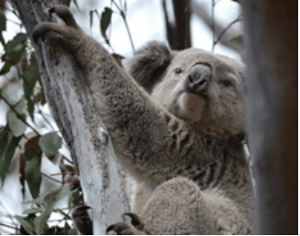

### 11.3 Permits and Development Applications for Vegetation

#### Management

### Management

#### Objectives:

of

### Native

### Vegetation

■ Preserve the biodiversity, ecology, microclimate and landscape amenity of the City of Campbelltown through the conservation of trees and other vegetation.

### &

### Wildlife

■ Minimise the risk of injury to people and damage to property from trees through a formal assessment process.

### Habitat

■ Provide a consistent framework to assess applications for the removal or pruning of trees and other vegetation and make clear the assessment criteria which Council will consider in determining applications for vegetation management works. ■ Ensure that trees and other vegetation of high ecological significance and habitat value are preserved across the LGA. ■ To ensure sufficient compensatory replanting or offsets are specified and undertaken as a component of the approval process for tree and vegetation removal permits.

This section declares vegetation to be protected under Part 3 of State Environmental

This section declares vegetation to be protected under Part 3 of State Environmental Planning Policy (Vegetation in Non-Rural Areas) 2017 (the Vegetation SEPP).

Planning Policy (Vegetation in Non-Rural Areas) 2017 (the Vegetation SEPP). This section should be read in conjunction with Council’s Guide to Tree Clearing on Private Land and Guide to Tree Clearing on Public Land.

#### 11.3.1 Introduction

This section should be read in conjunction with Council’s Guide to Tree Clearing on Private Land and Guide to Tree Clearing on Public Land.

a)

a)	 The provisions within this Section

#### The provisions within this Section of the DCP apply to clearing works

of the DCP apply to clearing works within the Campbelltown LGA

within the Campbelltown LGA unless the works:

unless the works:

i) Are permitted under another part of the EP&A Act or an Environmental Planning Instrument or Act, or

ii) Require development consent because a permit cannot be issued under the Vegetation.

#### 11.3.2 Interpretation

a)

a)	 In this section words have the following meanings:

#### In this section words have the following meanings:

| Clear (This term is defined in the Vegetation SEPP.) | Means to: a) a) cut cut down, down, fell, fell, uproot, uproot, kill, kill, poison, poison, ringbark, ringbark, burn burn or or otherwis otherwis destroy destroy the the vegetation, vegetation, or or b) lop or otherwise remove a substantial part of the vegetation |
|---|---|
| Community Land | Has the same meaning as in the Local Government Act, 1993. |
| Declared Tree | Means a tree that has been declared under section 11.3.4 of this plan. |
| Declared Vegetation | Means vegetation that has been declared under section 11.3.3 of this plan. |
| Native Vegetation | Means any vegetation that is native to New South Wales. |
| Tree | Means a plant that meets one or more of the following criteria: a) a) Has Has a a height height greater greater than than 3m, 3m, b) b) Has Has a a circumference circumference greater greater than than 0.5m 0.5m when when c) c) measured measured 1m 1m from from ground ground level, level, or or d) d) Has Has a a branch branch spread spread greater greater than than 4m. 4m. |
| Vegetation | Means any plant and includes a tree and includes plants that are dead but does not include marine plants. |
| Vegetation SEPP | Means State Environmental Planning Policy (Vegetation in Non-Rural Areas) 2017. |

### Permits

for

### Vegetation

### Management

#### 11.3.3 Declared Vegetation

The following vegetation is declared vegetation under this DCP section: a)

a)	 Vegetation that is wholly or partially

Vegetation that is wholly or partially located within the mapped extent of a

located within the mapped extent of a heritage item or heritage conservation

heritage item or heritage conservation area in any environmental planning

area in any environmental planning instrument;

instrument;

b)

b)	 Vegetation that form part of an Aboriginal

Vegetation that form part of an Aboriginal object or is within an Aboriginal place

object or is within an Aboriginal place of heritage significance;

of heritage significance; c)

c)	 Trees that are listed in any Significant

Trees that are listed in any Significant Tree Register of Council;

Tree Register of Council; d)

d)	 Trees that are required to be retained or

Trees that are required to be retained or planted as a condition of a development

planted as a condition of a development consent issued on or after 1 January

consent issued on or after 1 January 2010;

2010;

e)

e)	 Vegetation that is core or potential

Vegetation that is core or potential koala habitat identified under Council’s

koala habitat identified under Council’s Koala Plan of Management;

Koala Plan of Management; f)

f) Vegetation that is or contains

Vegetation that is or contains threatened flora species;

threatened flora species; g)

g)	 Vegetation that is part of an endangered

Vegetation that is part of an endangered ecological community;

ecological community; h)

h)	 Vegetation that is occupied by native

Vegetation that is occupied by native fauna;

fauna;

i)

i) Hollow bearing trees;and

Hollow bearing trees;and j)

j) Vegetation on land with a slope greater

Vegetation on land with a slope greater than 20%.

than 20%.

### Permits

Note:

for

### Vegetation

### Management

Under State Environmental Planning Policy (Exempt and Complying Development Codes), a protected tree means a tree that requires a separate permit or development consent for pruning or removal, but does not include a tree that may be removed without development consent under (that SEPP).

Accordingly, declared vegetation and declared trees under this DCP are

are

protected trees under that SEPP.

protected trees under that SEPP.

Note:

Clause 7 of the Vegetation SEPP provides that “a person must not clear vegetaion in any nonrural area of the State (including Campbelltown) to which Part 3 applies without the authority conferred by a permit granted by the Council under that Part.”

#### 11.3.4 Declared Trees

### Permits

### Vegetation

### Management

All trees that are not declared vegetation are declared trees under this DCP section in accordance with Part 3 of the Vegetation SEPP. However, a tree is not a declared tree if it is wholly or partially within the minimum trimming clearances of any overhead power line as identified by the applicable network operator(s) under the Electricity Supply Act, 1995.

#### 11.3.5 Declared Vegetation Exemptions

A vegetation permit is not required for clearing that is:

a)

a)	 in accordance with a development

in accordance with a development consent;

consent;

b)

b)	 for the reasonable maintenance of

for the reasonable maintenance of existing landscaped areas (eg hedge

existing landscaped areas (eg hedge trimming) excluding the removal of

trimming) excluding the removal of trees,or

trees,or

c)

c)	 undertaken by, or at the direction

undertaken by, or at the direction of,an emergency services agency as

of,an emergency services agency as part of their functions under the State

part of their functions under the State Emergency and Rescue Management Act

Emergency and Rescue Management Act 1989 or any regulation or plan made

1989 or any regulation or plan made under that Act.

under that Act. d)

d)	 undertaken by or on behalf of Council in

undertaken by or on behalf of Council in realtion to vegetation that is wholly or

realtion to vegetation that is wholly or partially on community land.

partially on community land.

#### 11.3.6 Declared Tree Exemptions

A tree permit is not required for clearing that is:

a)

a)	 in accordance with a development

in accordance with a development consent;

consent;

b)

b)	 for the reasonable maintenance of

for the reasonable maintenance of existing landscaped areas (eg hedge

existing landscaped areas (eg hedge trimming) excluding the removal of

trimming) excluding the removal of trees,or

trees,or

c)

c)	 undertaken by, or at the direction

undertaken by, or at the direction of,an emergency services agency as

of,an emergency services agency as part of their functions under the State

part of their functions under the State Emergency and Rescue Management Act

Emergency and Rescue Management Act

Note:

Under the Vegetation SEPP a permit is not required in the following circumstances: 1)

1\) An authority to clear vegetation

An authority to clear vegetation is not required under this Policy

is not required under this Policy if it is clearing of a kind that is

if it is clearing of a kind that is authorised under section 60O

authorised under section 60O of the Local Land Services Act

of the Local Land Services Act 2013 (Clearing authorised under

2013 (Clearing authorised under other legislation) or under Part

other legislation) or under Part 5B (Private native forestry) of

5B (Private native forestry) of that Act. This subclause does

that Act. This subclause does not apply to clearing merely

not apply to clearing merely because it is a part of or

because it is a part of or ancillary to the carrying out of

ancillary to the carrying out of exempt development.

exempt development. 2)

2\) An authority is not require

An authority is not require under this Policy for the

under this Policy for the removal of vegetation that the

removal of vegetation that the council or Native Vegetation

council or Native Vegetation Panel is satisfified is dying or

Panel is satisfified is dying or dead and is not required as the

dead and is not required as the habitat of native animals.

habitat of native animals. 3)

3\) An authority is not required

An authority is not required under this Policy for the

under this Policy for the removal of vegetation that the

removal of vegetation that the council is satisfified is a risk to

council is satisfified is a risk to human life or property.

human life or property.

Note:

The Vegetation SEPP requires that a permit be obtained from the Native Vegetation Panel for certain ecologically signifificant vegetation. The exemptions in this DCP do not apply in these cases.

Note:

Council has internal procedures to ensure that the objectives of this DCP section are acheived on community land.

1989 or any regulation or plan made under

1989 or any regulation or plan made under that Act.

that Act.

### Permits

### Vegetation

### Management

d)

d)	 undertaken by or on behalf of Council in

undertaken by or on behalf of Council in realtion to trees that is wholly or partially on

realtion to trees that is wholly or partially on community land;

community land; e)

e)	 Clearing of any of the species listed on

Clearing of any of the species listed on Council’s Exempt Species List subject to the

Council’s Exempt Species List subject to the following conditions:

following conditions: i)

i) Council being provided with a report from

Council being provided with a report from a suitably qualifified arborist identifying

a suitably qualifified arborist identifying the species of the tree(s) at least fifive

the species of the tree(s) at least fifive business days prior to its removal, and

business days prior to its removal, and

ii)

ii) The clearing does not disturb the soil

The clearing does not disturb the soil profifile and leaves roots intact in the

profifile and leaves roots intact in the ground.

ground.

f)

f) Pruning a tree if:

Pruning a tree if: i)

i) For trees and shrubs greater than 5m in

For trees and shrubs greater than 5m in height:

height:

– Pruning is undertaken by a suitably qualifified arborist in accordance with

qualifified arborist in accordance with Australian Standard AS4373-2007 Pruning

Australian Standard AS4373-2007 Pruning of amenity trees and no more than 10

of amenity trees and no more than 10 percent of the canopy cover is pruned

percent of the canopy cover is pruned annually, and

annually, and

– The pruning specifification prepared

The pruning specifification prepared under Australian Standard AS4373-2007

under Australian Standard AS4373-2007 is held by the landholder for a period of

is held by the landholder for a period of two years, or

two years, or

ii)

ii) For pruning of individual branches from

For pruning of individual branches from any

any other tree less than 5m in height that overhangs a dwelling, formal driveway or path, where:

– The pruning is to remove the overhanging branches,

– The branches removed are less than 100mm in diameter at the fifinal cut, and

– The fifinal cut is at branch collar or appropriate growth point.

f) Clearing a tree that is within three (3) metres

f) Clearing a tree that is within three (3) metres of a

of a i)

i) building that is Class 1 to 9 under the

building that is Class 1 to 9 under the Building Code

Building Code of Australia. The distance

### Permits

is measured from the foundation wall of the building to the centre of thetrunk of the tree.

#### 11.3.7 Tree Permits

for

### Vegetation

### Management a)

a)	 Council may issue a tree permit under this

Council may issue a tree permit under this clause. A tree permit may authorise the

clause. A tree permit may authorise the clearing of up to 4 declared trees. A tree

clearing of up to 4 declared trees. A tree permit may not be considered or issued if

permit may not be considered or issued if another tree permit has approved the removal

another tree permit has approved the removal of one or more trees on the subject lot in

of one or more trees on the subject lot in the preceding 2 years. For the avoidance of

the preceding 2 years. For the avoidance of doubt, this provision prevents the approval of

doubt, this provision prevents the approval of more than one tree permit concurrently.

more than one tree permit concurrently. Note: This provision is intended to limit the total number of trees that can be removed under the tree permit assessment process in any 2 year period.

#### 11.3.8 Vegetation Permits

a)

a)	 Council may issue a vegetation permit under

Council may issue a vegetation permit under this clause. A vegetation permit may authorise

this clause. A vegetation permit may authorise the clearing of declared trees and/or declared

the clearing of declared trees and/or declared vegetation but not if the works could be

vegetation but not if the works could be considered under a tree permit.

considered under a tree permit.

#### 11.3.9 Applying for a Tree Permit or Vegetation Permit

a)

a)	 An application for a Tree Permit or Vegetation

An application for a Tree Permit or Vegetation Permit must be made using Council’s form

Permit must be made using Council’s form and must be accompanied by the relevant fee

and must be accompanied by the relevant fee and supporting information identifiedon that

and supporting information identifiedon that form.

form.

#### 11.3.10 Assessment of Permits

#### 11.3.10 Assessment of Permits

#### 11.3.10.1 Matters that must be considered

#### 11.3.10.1 Matters that must be considered as part of the assessment of a Tree Permit or

as part of the assessment of a Tree Permit or

#### Vegetation Permit

#### Vegetation Permit

#### Planning

a)

a)	 Whether the proposed works are consistent

Whether the proposed works are consistent with the objectives of the zone in which the

with the objectives of the zone in which the works are being proposed;

works are being proposed; b)

b)	 In the case of trees in Council’s Significant

In the case of trees in Council’s Significant Tree Register, why the tree was included on

Tree Register, why the tree was included on

#### Note:

Under the Vegetation SEPP a Vegetation Permit cannot be issued in relation to land that is or forms part of a heritage item or that is within a heritage conservation area, or that is or forms part of an Aboriginal object or that is within an Aboriginal place of heritage signifificance, unless the council is satisfified that the proposed activity: is of a minor nature or is for the maintenance of the heritage item, Aboriginal object, Aboriginal place of heritage signifificance or heritage conservation area, and would not adversely affffect the heritage signifificance of the heritage item, Aboriginal object, Aboriginal place of heritage signifificance or heritage conservation area. If the vegetation works do not meet these requirements a development application will be required.

#### Note:

Certain clearing is permitted under the Rural Fires Act, 1997, with or without approval under that Act. Clearing undertaken under that Act does not require a permit under this DCP section. Council will not issue tree permits for clearing for bushfifire hazard reduction. Council will not declare a tree to be a risk to human life or property under the Vegetation SEPP if the only danger posed by the tree is one of bushfifire hazard.

that register;

that register;

### Permits

c)

c)	 In the case of trees required by a development

In the case of trees required by a development consent to be planted or retained, the planning

consent to be planted or retained, the planning intent of the consent and its conditions.

intent of the consent and its conditions.

for

### Vegetation

### Management

d)

d)	 For a heritage listed tree or vegetation located

For a heritage listed tree or vegetation located on the grounds of a heritage listed property or in

on the grounds of a heritage listed property or in a heritage conservation area:

a heritage conservation area: i)

i) The impact that the proposed works will

The impact that the proposed works will have on the heritage significance of the

have on the heritage significance of the item and its curtilage and amenity and the

item and its curtilage and amenity and the landscape setting of the surrounding area;

landscape setting of the surrounding area; and

and

ii)

ii) The risk the tree poses to any heritage

The risk the tree poses to any heritage structure.

structure.

#### Environmental Impact

e)	 Biodiversity matters including impacts on:

e)	 Biodiversity matters including impacts on: i)

i) Endangered ecological communities,

Endangered ecological communities,

ii)

ii) Threatened plant species,

Threatened plant species,

iii)

iii) Habitat and food supply for threatened

Habitat and food supply for threatened fauna, and

fauna, and

iv)

iv) Preferred koala food trees and whether the

Preferred koala food trees and whether the permit relates to an area of koala habitat.

permit relates to an area of koala habitat.

v)

v) The management or removal of weed

The management or removal of weed species.

species.

vi)

vi) The visual prominence and landscape

The visual prominence and landscape significance of the vegetation.

significance of the vegetation.

vii)

vii)	 The contribution the vegetation provides

The contribution the vegetation provides to the canopy cover, amenity, environment

to the canopy cover, amenity, environment and

and

viii)

viii)	 landscape of the immediate surrounding

landscape of the immediate surrounding area.

area.

ix)

ix) The health, structural condition, growing

The health, structural condition, growing environment of the vegetation.

environment of the vegetation.

x)

x) The cumulative impacts of vegetation

The cumulative impacts of vegetation clearing applications.

clearing applications.

#### Risk

#### Risk

f) In the case of trees, the species, age and lifespan

f) In the case of trees, the species, age and lifespan of the tree.

of the tree. g)

g)	 Potential risks to the surrounding built

Potential risks to the surrounding built

| 11.3 | environment environment by by considering considering whether whether the the |
|---|---|
| Permits | vegetation vegetation is: is: |
| for | i) i) Causing Causing signifificant signifificant damage damage to to any any |
| Vegetation | structure structure or or infrastructure, infrastructure, or or |
| Management | ii) ii) Reducing Reducing solar solar access access by by excessive excessive shadowing shadowing of of living living areas. areas. h) h) The The risks risks of of retaining retaining the the vegetation vegetation in in relation relation to to limb limb drop drop and and trunk trunk failure failure having having regard regard to: to: i) i) The The proximity proximity of of any any building, building, ii) ii) The The likelihood likelihood that that pedestrians pedestrians or or vehicles vehicles will will use use the the land land surrounding surrounding the the tree, tree, iii) iii) The The likelihood likelihood of of limb limb drop drop or or trunk trunk failure, failure, and and iv) iv) The The size size of of the the vegetation. vegetation. i) i) The The risks risks of of retaining retaining the the vegetation vegetation in in relation relation to: to: i) i) Public Public health health matters, matters, ii) ii) Blocking Blocking or or choking choking a a floodway, floodway, iii) iii) The The health health of of any any vulnerable vulnerable person, person, where where specific specific evidence evidence is is provided provided by by an an expert expert in in the the relevant relevant medical medical field field and and a a direct direct link link between between the the ailment ailment and and the the species species is is reasonably reasonably established, established, and and iv) iv) raffic raffic safety. safety. j) j) The The slope slope of of the the land land and and whether whether tree tree removal removal will will result result in in slope slope instability, instability, sediment sediment and and erosion erosion issues. issues. Alternatives and Mitigation k) k) The The opportunities opportunities to to retain retain vegetation vegetation through through the the installation installation of of a a root root barricade barricade or or other other infrastructure infrastructure solutions. solutions. l) l) Whether Whether the the works works proposed proposed are are the the best best way way to to achieve achieve the the stated stated objective objective of of the the application. application. m) m) The The opportunity opportunity for for replacement replacement planting planting and and improved improved landscaping landscaping and and environmental environmental outcomes. outcomes. |

#### 11.3.10.1

#### 11.3.10.1 Matters that shall not be considered to justify a tree or vegetation permit

### Permits

a)

a)	 Removal or pruning of vegetation due to leaf,

Removal or pruning of vegetation due to leaf, stick, fruit or bark drop;

stick, fruit or bark drop; b)

b)	 Removal of a tree for minor shading;

Removal of a tree for minor shading;

for

### Vegetation

### Management

c)

c)	 A perception of risk of vegetation failing that

A perception of risk of vegetation failing that is not substantiated by expert evidence;

is not substantiated by expert evidence; d)

d)	 Improvement to views;

Improvement to views; e)

e)	 Wildlife droppings on cars, buildings or

Wildlife droppings on cars, buildings or infrastructure;

infrastructure; f)

f) Impacts on property values;

Impacts on property values; g)

g)	 Improvement to street lighting on private

Improvement to street lighting on private property;

property; h)

h)	 Removal to improve solar access to solar

Removal to improve solar access to solar panels. While Campbelltown City Council

panels. While Campbelltown City Council promotes the use of solar energy, Council

promotes the use of solar energy, Council does not support the removal of sound healthy

does not support the removal of sound healthy trees solely to improve access to solar energy

trees solely to improve access to solar energy collectors;

collectors; i)

i) To enable other development to proceed as

To enable other development to proceed as complying development.

complying development.

#### 11.3.11 Permit Conditions

#### 11.3.11 Permit Conditions

a)

a)	 Without limiting Council’s powers, conditions

Without limiting Council’s powers, conditions will generally be imposed on tree and

will generally be imposed on tree and vegetation permits to require:

vegetation permits to require: ii)

ii) The works to be undertaken within a

The works to be undertaken within a specifified time frame;

specifified time frame;

iii)

iii) Compensatory planting to replace

Compensatory planting to replace removed vegetation or payment of a

removed vegetation or payment of a fee in lieu of planting (refer to Council’s

fee in lieu of planting (refer to Council’s Tree Offset Policy);

Tree Offset Policy);

iv)

iv) Pruning to be undertaken by a suitably

Pruning to be undertaken by a suitably qualified and experienced arborist to an

qualified and experienced arborist to an approved standard;

approved standard;

v)

v) Management of waste;

Management of waste;

vi)

vi) Hours of works;

Hours of works;

vii)

vii)	 Securing the site;

Securing the site;

viii)

viii)	 Management of impacted fauna;

Management of impacted fauna;

ix)

ix) Replacement of nesting opportunities.

Replacement of nesting opportunities.

11.4 11.4    Design requirements for developments in koala habitat on

#### lots less than 1 hectare

#### Design

#### requirements

#### Objectives:

for

#### developments

#### in koala

■ To assist in the effective implementation of the Campbelltown Comprehensive Koala Plan of Management (CKPoM) for development within koala habitat

#### habitat

■ To facilitate development sympathetic to the local koala population, in order to minimize the impacts of development on koalas and their habitat.

> [Picture on page 17: a picture, saved as a picture (images/vol-1-part-11-vegetation-and-wildlife-management-page-17-14.gif, 150 dpi).]

#### 11.4.1 Management of koala habitat

a)

a)	 Development applications for properties

Development applications for properties less than one hectare that contain koala

less than one hectare that contain koala habitat, are required to address key risks

habitat, are required to address key risks and indirect impacts to koalas and their

and indirect impacts to koalas and their habitat, and demonstrate consistency

habitat, and demonstrate consistency with the following management

with the following management measures:

measures:

i) be designed and located in such a way as to avoid any adverse impacts to Preferred Koala Food Trees ((P)KFTs) and/ or shelter trees

ii) ensure fencing of residential lots:

– supports the free movement of koalas in E2 zones, and doesn’t create an impediment and/or risk to koala movement

– effectively excludes koalas in R2 zones, except for where these properties are located adjacent to a Council Reserve

iii) confine domestic dogs (greater than 10kg) to a dog-proof yard, or verandah, during peak koala activity levels, between 6pm and 6am; to reduce incidents of dog attacks on koalas

iv) design swimming pools with a graduated shallow edge, or fitted with a permanent flotation device; to prevent koalas from drowning

Figure 11.4.1 - The protection of koala habitat is essential to provide for the long-term maintenance of a viable, free-ranging koala population in the Campbelltown LGA (Koala “Mr Nymboida” in Ruse. Photo courtesy of Carla-Maree Simmons).

v) implement site-specific koala protection measures on the development site; to mitigate construction impacts on koalas

vi) vi) establish Tree Protection Zones

(TPZ) around any koala trees within the site area and preclusion of any development activities within the TPZ to protect koalas from disturbance

#### Design

#### requirements

vii)	 require replacement tree plantings and

for

#### developments

#### in koala

#### habitat

maintenance there of, in accordance with the applicable Diameter at Breast Height (DBH) ratio (or monetary equivalent) for every individual (P)KFT or shelter tree that is removed; to compensate for any loss of habitat:

– Small (DBH<100mm) 1:10

– Medium (DBH>100<300mm) 1:15

– Large (DBH>300mm) 1:20

#### Note:

Development controls for lots greater than or equal to 1 hectare are contained

Development controls for lots greater than or equal to 1 hectare are contained in the Campbelltown Comprehensive Plan of Management 2018. Many koala

in the Campbelltown Comprehensive Plan of Management 2018. Many koala populations in NSW now survive in fragmented and isolated habitat, while

populations in NSW now survive in fragmented and isolated habitat, while some areas in which koalas remain more common are increasingly subject to

some areas in which koalas remain more common are increasingly subject to ongoing pressures, in particular clearing for agriculture, logging and urban

ongoing pressures, in particular clearing for agriculture, logging and urban expansion.

expansion. Campbelltown has one of the last, disease-free koala populations in the

Campbelltown has one of the last, disease-free koala populations in the Sydney region. Therefore it is important to put in place design measures

Sydney region. Therefore it is important to put in place design measures that support the harmonious co-existence of the community with koalas.

that support the harmonious co-existence of the community with koalas.
