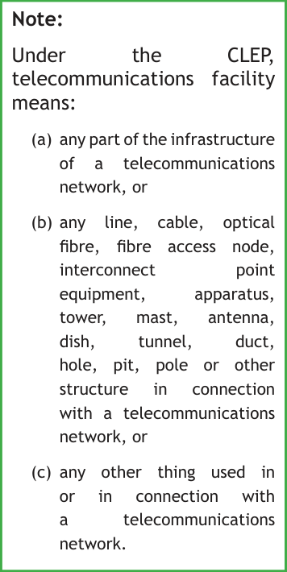
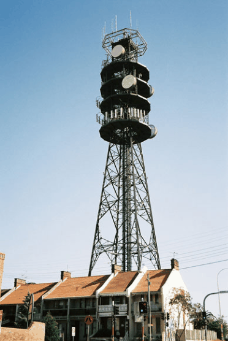

### 12.3 General Requirements

a)

a)	 A network masterplan shall be provided

A network masterplan shall be provided by the applicant showing the proposal

by the applicant showing the proposal in the context of all other similar

in the context of all other similar infrastructure types in order to identify

infrastructure types in order to identify opportunities for co-location or sharing

opportunities for co-location or sharing of facilities

of facilities. b)

b)	 The applicant shall demonstrate that

The applicant shall demonstrate that co-location opportunities have been

co-location opportunities have been adequately pursued where new stand

dequately pursued where new stand

> [Picture on page 3: a picture, saved as a picture (images/vol-1-part-12-telecommunications-facilities-page-3-1.gif, 150 dpi).]
> Words printed on the picture (title and legend, copied from the PDF):
> (a)
> (b)
> (c)

#### Note:

alone telecommunication facilities are

alone telecommunication facilities are proposed. This shall include information

proposed. This shall include information to demonstrate:

to demonstrate:

#### General

#### Requirments

Under the CLEP,

#### telecommunications facility

#### means:

i)

i)	 The possibility of sharing equipment,

The possibility of sharing equipment, via the use of combiners or similar

via the use of combiners or similar technology;

technology;

(a)	any part of the infrastructure

any part of the infrastructure of a telecommunications

of a telecommunications network, or

network, or

ii)

ii)	 Existing towers and poles or other

Existing towers and poles or other appropriate structures should be

appropriate structures should be investigated for appropriateness for

investigated for appropriateness for the sharing of antennas.

the sharing of antennas.

c)

c)	 Transmitting roof top antennas and

Transmitting roof top antennas and towers should preferably be located in

towers should preferably be located in industrial or business zones, rather than

industrial or business zones, rather than residential zones or areas that include

residential zones or areas that include dwellings.

dwellings.

(b)	any line, cable, optical

any line, cable, optical fibre, fibre access node,

fibre, fibre access node, interconnect point

interconnect point equipment, apparatus,

equipment, apparatus, tower, mast, antenna,

tower, mast, antenna, dish, tunnel, duct,

dish, tunnel, duct, hole, pit, pole or other

hole, pit, pole or other structure in connection

structure in connection with a telecommunications

with a telecommunications network, or

network, or

d)

d)	 Telecommunication facilities are to be

Telecommunication facilities are to be sited to avoid locations which are visually

sited to avoid locations which are visually prominent in the landscape, particularly

prominent in the landscape, particularly when viewed from the public domain.

when viewed from the public domain.

(c)	 any other thing used in

any other thing used in or in connection with

or in connection with a telecommunications

a telecommunications network.

network.

> [Picture on page 3: a picture, saved as a picture (images/vol-1-part-12-telecommunications-facilities-page-3-84.gif, 150 dpi).]

e)

e)	 For new towers a photomontage of the

For new towers a photomontage of the proposal must be submitted to assist

proposal must be submitted to assist with the assessment of visual impact.

with the assessment of visual impact. f)

f) The applicant must demonstrate that

The applicant must demonstrate that all reasonable measures to reduce the

all reasonable measures to reduce the visual impact of the proposal have been

visual impact of the proposal have been examined, including:

examined, including: i)

i)	 Co-location and use of existing

Co-location and use of existing structures;

structures; ii)

ii)	 Innovative design to harmonise with

Innovative design to harmonise with the existing setting;

the existing setting; iii)

iii)	Use of vegetation for screening;

Use of vegetation for screening; iv)

iv)	Use of materials and finishes consistent

Use of materials and finishes consistent with surroundings; and

with surroundings; and v)

v)	 Compact and slim line construction

Compact and slim line construction techniques.

techniques.

g)

g)	 No advertising signs shall be permitted

No advertising signs shall be permitted on any telecommunication facilities in:

on any telecommunication facilities in: i)

i)	 Industrial areas;

Industrial areas; ii)

ii)	 Rural areas; and

Rural areas; and iii)

iii)	Low-use open space.

Low-use open space.

Figure 12.3.1 - An example of the negative visual impact of a tower on neighbouring houses.
