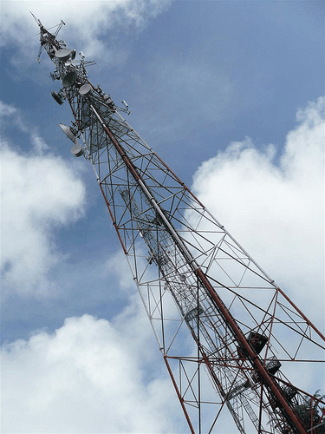

### 12.4 Electromagnetic Radiation

#### Electromagnetic

#### Radiation

a)

a)	 The applicant in selecting a site for

The applicant in selecting a site for telecommunication facilities, shall

telecommunication facilities, shall demonstrate to Council that a precautionary

demonstrate to Council that a precautionary approach has been adopted with respect to

approach has been adopted with respect to minimising electromagnetic radiation (EMR)

minimising electromagnetic radiation (EMR) exposures to sensitive land uses

exposures to sensitive land uses such as residential areas, schools, child care centres, hospitals, aged care accommodation or areas regularly frequented by groups of children.

b)	 Where possible, EMR emitting telecommunication facilities, including mobile base stations, shall be located in the following land use areas: i)

i)	 Industrial areas;

Industrial areas; ii)

ii)	 Rural areas; and

Rural areas; and iii)

iii)	Low-use open space.

Low-use open space.

> [Picture on page 4: a picture, saved as a picture (images/vol-1-part-12-telecommunications-facilities-page-4-33.gif, 150 dpi).]

Figure 12.4.1  - An example of a telecommunication facility tower.

c)

c)	 Where telecommunication facilities are

Where telecommunication facilities are proposed within 300 metres of a sensitive land

proposed within 300 metres of a sensitive land use, the applicant shall demonstrate that no

use, the applicant shall demonstrate that no viable alternative sites are available.

viable alternative sites are available. d)

d)	 For all EMR emitting telecommunication

For all EMR emitting telecommunication facilities, documentary evidence is required

facilities, documentary evidence is required from a suitably qualified person which analyses

from a suitably qualified person which analyses the cumulative effect of the proposal and

the cumulative effect of the proposal and demonstrates compliance with the relevant

demonstrates compliance with the relevant Australian exposure standard.

Australian exposure standard.

e)	 Development applications for telecommunication facilities shall include measures to restrict public access.  Approaches to the facility must contain appropriate signs warning of EMR and provide contact details for the site owner and / or site manager.
