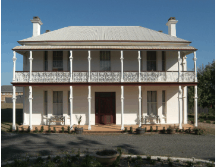

### 12.6 Heritage

a)	 No telecommunication facilities shall be permitted where the heritage significance of a heritage item may be adversely impacted.

b)	 Where a telecommunication facility is proposed on a site occupied by or in the vicinity of a listed heritage item, a Heritage Impact Statement shall be prepared and submitted to Council.

> [Picture on page 5: a picture, saved as a picture (images/vol-1-part-12-telecommunications-facilities-page-5-26.gif, 150 dpi).]

Figure 12.6.1 - An example of a heritage listed building.

Note: A Heritage Impact Statement  must be prepared by a suitably qualified person in accordance with the document “Statements of Heritage Impact” published by the NSW Heritage Branch and available for view at:www.environment.nsw.gov.au

### This page is intentionally

### left blank.
