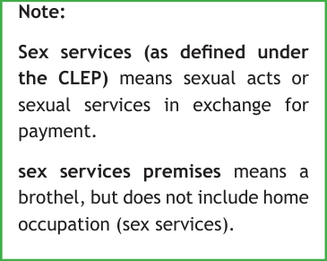

## Part 13 Sex Industry

### Premises

### 13.1 Application

#### Application

This part sets out controls relating to sex services premises within the City of Campbelltown. This part should be read in conjunction with the relevant LEP / IDO applying to the site to determine the zoning of the land and the permissibility of any proposed sex industry premises. This plan applies to all sex industry premises.

#### Note:

For the purpose of this part, sex industry premises means sex restricted premises or sex services premises as defined under the CLEP.

#### Objectives:

■ To ensure sex industry premises are appropriately located so as to minimise any potential adverse social or economic impacts upon the surrounding locality; ■ To control the location of sex industry premises to avoid a concentration of these facilities in a particular location and to minimise any cumulative impacts; ■ To identify relevant public health and safety standards for sex industry workers and their clients; and ■ To provide appropriate locational restrictions for any sex industry premises to ensure such premises are located at a reasonable distance away from residential

> [Picture on page 2: a picture, saved as a picture (images/vol-1-part-13-sex-industry-premises-page-2-20.gif, 150 dpi).]

areas and other sensitive land uses.

#### Note:

#### Note: Sex services (as defined under

the CLEP) means sexual acts or sexual services in exchange for payment. sex services premises means a brothel, but does not include home occupation (sex services).

Restricted premises (as defined under the CLEP) means premises that, due to their nature, restrict access to patrons or customers over 18 years of age, and includes sex shops and similar premises, but does not include a pub, hotel or motel accommodation, home occupation (sex services) or sex services premises.
