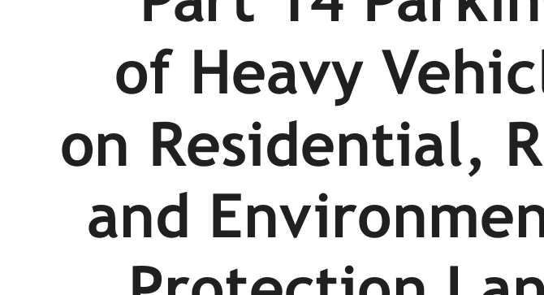

## Part 14 Parking

> [Picture on page 1: a picture, saved as a picture (images/vol-1-part-14-parking-of-heavy-vehicles-on-residential-rural-page-1-2.gif, 150 dpi).]

### of Heavy Vehicles

### on Residential, Rural

### and Environmental

### Protection Land
