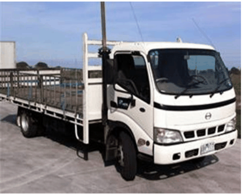
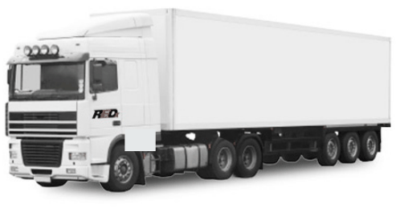

### 14.3 14.3 Number of Heavy Vehicles - Permissibility by Zoning and Site

#### Area

Number of

#### Heavy Vehicles

Objectives:

#### -

#### Permissibility

■ To regulate the number of  heavy vehicles parked within  areas zoned for residential, environmental protection and rural purposes within Campbelltown Local Government Area.

by

#### Zone

■ To maintain the amenity and scenic quality of residential, environmentaly sensitive and rural areas within Campbelltown Local Government Area.

> [Picture on page 3: a picture, saved as a picture (images/vol-1-part-14-parking-of-heavy-vehicles-on-residential-rural-page-3-15.gif, 150 dpi).]

#### Design Requirements

a)

a)	 The maximum number of heavy vehicles

The maximum number of heavy vehicles able to be parked on an allotment shall

able to be parked on an allotment shall be in accordance with Table 14.3.1.

be in accordance with Table 14.3.1. b)

b)	 Council may consider development

Council may consider development applications to park heavy vehicles on

applications to park heavy vehicles on private land that does not comply  with

private land that does not comply  with the requirements of this Plan on their

the requirements of this Plan on their individual merits.

individual merits.

c)	 Notwithstanding any other provision

Figure 14.3.1 An example of a Heavy Vehicle Type 1

> [Picture on page 3: a picture, saved as a picture (images/vol-1-part-14-parking-of-heavy-vehicles-on-residential-rural-page-3-38.gif, 150 dpi).]

of this Plan, heavy vehicles shall not be permitted to be parked on allotments that consists of strata titled development, attached dwellings, semi detached dwellings, dual occupancies (attached and detached), multi dwellings and residential flat buildings developments within areas zoned R2,

R3 and R4.

Figure 14.3.2 An example of a Heavy Vehicle Type 2

Table 14.3.1 Maximum number of heavy vehicles and their combinations that are permissible on an allotment per site area and zoning.

| Zoning and | Maximum Number of | Options | Heavy | Heavy |
|---|---|---|---|---|
| site area Site | heavy vehicles per |  | Vehicle Type | Vehicle Type |
| Area | allotment |  | 1 | 2 |
| R2,R3,R4, R5 | 1 |  | 1 | 0 |
| E3 E4, RU2 |  | Option 1 | 1 | 0 |
| for a site with an area of 1 | 1 | or |  |  |
| hectare or |  | Option 2 | 0 | 1 |
| less |  |  |  |  |
| E3, E4, RU2 |  | Option 1 | 2 | 0 |
| for a site with an area greater than | 2 | or |  |  |
| 1 hectare and |  | Option 2 | 1 | 1 |
| less than 5 |  |  |  |  |
| hectares |  |  |  |  |
| RU2 and E3 | 3 | Option 1 | 0 | 2 |
| For a site |  |  |  |  |
| with an area |  | or |  |  |
| greater than |  | Option 2 | 2 | 1 |
| 5 hectares |  | or |  |  |
|  |  | Option 3 | 3 | 0 |
| Notes: |  |  |  |  |

Number of

#### Heavy

#### Vehicles -

#### Permissibility

by

#### Zone

a)

a)	 Despite the note in Table 14.2.1, Each Type 1 heavy vehicle on land zoned rural

Despite the note in Table 14.2.1, Each Type 1 heavy vehicle on land zoned rural or an environmental zone may have a maximum of one associated trailer  of

or an environmental zone may have a maximum of one associated trailer  of which the total vehicle combination shall not exceed 19.0 metres in length.

which the total vehicle combination shall not exceed 19.0 metres in length. b)

b)	 Each prime mover of a Type 2 vehicle shall have a maximum of two associated

Each prime mover of a Type 2 vehicle shall have a maximum of two associated trailers providing the total length in combination does not exceed 26.0 metres.

trailers providing the total length in combination does not exceed 26.0 metres. c)

c)	 For the purpose of point b) above, a  B-Double constitutes two trailers.

For the purpose of point b) above, a  B-Double constitutes two trailers.

d)	 Despite the above points, a), b) & c) trailers shall not be permitted on residential zones.
