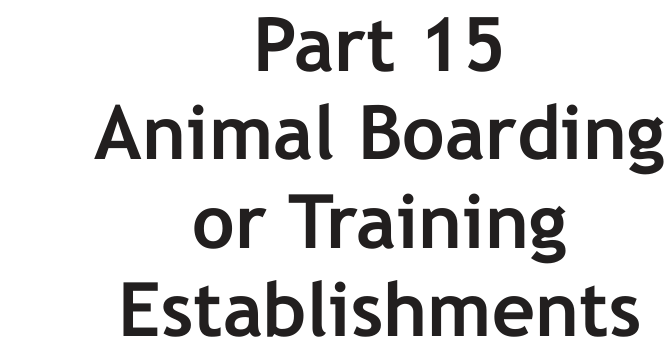

# Campbelltown Sustainable City Development Control Plan 2015 - Part 15 Animal Boarding or Training Establishments

> This chapter is split into 2 section file(s), one per numbered heading, in the order they appear in the PDF.

Source PDF: [part-15-animal-boarding-and-training-establishments-amendment-21-sept2024.pdf](part-15-animal-boarding-and-training-establishments-amendment-21-sept2024.pdf)

> [Picture on page 1: a picture, saved as a picture (images/vol-1-part-15-animal-boarding-or-training-establishments-page-1-1.gif, 150 dpi).]

<!-- sections -->
## Sections

1. [15.1 Application](01-15-1-application.md)
2. [15.2 General Requirements for Animal Boarding or Training](02-15-2-general-requirements-for-animal-boarding.md)
