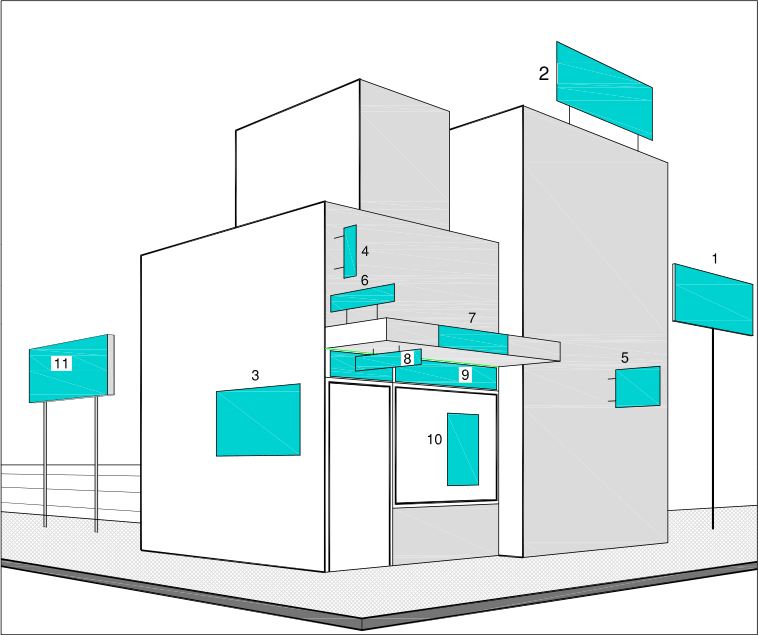
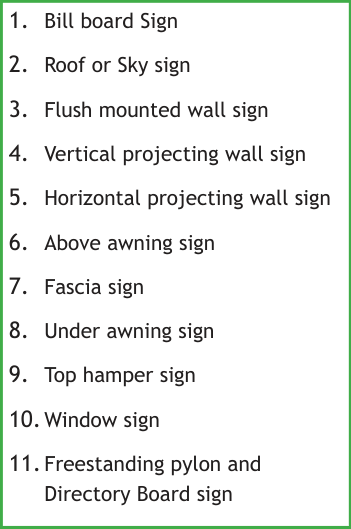

### 16.2 16.2 Types of Signs and Definitions

#### Types of Signs

Some of the signage types referred to in this section are shown in Figure 16.3.1 below.

#### &

#### Definitions

#### Note:

Advertisement has the same meaning as in the Environmental Protection & Assessment Act 1979: a sign, notice, device or representation in the nature of an advertisement visible from any public place or public reserve or from any navigable water. Advertising structure has the same meaning as in the Environmental Protection & Assessment Act 1979: a structure used or to be used principally for the display of an advertisement.

> [Picture on page 3: a picture, saved as a picture (images/vol-1-part-16-advertising-and-signage-page-3-20.gif, 150 dpi).]

Figure 16.3.1 - Types of signs

> [Picture on page 3: a map, saved as a picture (images/vol-1-part-16-advertising-and-signage-page-3-22.gif, 150 dpi); the street names and other small labels are on the picture.]
> Words printed on the picture (title and legend, copied from the PDF):
> 1\.	 Bill board Sign
> Bill board Sign
> 2\.	 Roof or Sky sign
> 3\.	 Flush mounted wall sign
> 4\.	 Vertical projecting wall sign
> 5\.	 Horizontal projecting wall sign
> 6\.	 Above awning sign
> 7\.	 Fascia sign
> 8\.	 Under awning sign
> 9\.	 Top hamper sign
> 10\.	Window sign
> 11\.	Freestanding pylon and
> Directory Board sign

#### Note:

The following definitions shall apply for the purpose of this Part:

#### Types of Signs

#### &

#### Definitions

#### ‘A’ Frame Sign ( also known as a sandwich

board ) means a portable, freestanding sign consisting of either two advertising boards supporting each other in an ‘A’ configuration, or one advertising board supported by one or more posts in an ‘A’ configuration.

Building identification sign (as defined under the CLEP) means a sign that identifies or names a building and that may include the name of a building, the street name and number of a building, and a logo or other symbol but does

other symbol but does

not include general advertising of

not include general advertising of products, goods or services.

products, goods or services.

#### Note:

Above awning sign means a sign that is located above an awning or veranda, attached to the awning and/or wall, but is contained entirely below the roofline and not protruding beyond the extent of the awning or veranda (but does not include a projecting wall sign).

Business identification sign ( as defined under the CLEP) means a sign: (a)

(a)	that indicates:

that indicates: i)

i)	the name of the person or

the name of the person or business, and

business, and

Banner or flag sign means a piece of fabric supported on one or two sides by poles or ties and allowed to move freely, but not including national, state, regional or aboriginal flags.

ii)

ii)	 the nature of the business

the nature of the business carried on by the person

carried on by the person at the premises or place

at the premises or place at which the sign is

at which the sign is displayed, and

displayed, and

Billboard sign means an advertisement supported by one or more columns or post which stands independent of any building and/or structure and which does not relate to the use of the site to which it is attached.

(b)

(b)	that may include the address

that may include the address of the premises or place and

of the premises or place and a logo or other symbol that

a logo or other symbol that identifies the business,

identifies the business,

Bunting means a string of lightweight coloured material or plastic secured at both ends but allowed to move freely. Building identification sign has the same meaning as in the CLEP (see note).

but that does not contain any advertising relating to a person who does not carry on business at the premises or place.

Business identification sign as the same meaning as in the CLEP (see note). Canopy fascia sign means a sign that is  located on the fascia of the structure erected over the pumps at a petrol station. Corporate identification means building colour, decoration, symbols, logos and the like that attach a building use with a readily identifiable corporate brand Day time  means the time between sunrise and sun set, excluding twilight periods. Digital Signs - Any sign that uses digital technology to display bright, high quality

#### Note:

#### Types of Signs

#### &

#### Definitions

electronic images which are uploaded and changed using a computer and modem via a secure network. A central feature of these devices is the use of Light Emitting Diode (LED) technology allowing luminance to be controlled and adjusted automatically and includes Electronic Static Displays (ESDs), Variable Message Signs (VMS) and Dynamic Electronic Displays (DEDs) Dwell duration means the period of time that content on a sign remains static without any movement.

Illuminance has the same meaning as contained in AS/NZS 1158- 2005: the physical measure of illumination. It is the luminous flux arriving at a surface divided by the area of the illuminated surface. Unit: lux (lx). The term includes ‘Horizontal illuminance’ (the value of illuminance on a designated horizontal plane at ground level) and ‘Vertical illuminance’ (the value of illuminance on a designated vertical plane at a height of 1.5m above ground level. Where the vertical illuminance is considered in the situation of potentially obtrusive light at a property boundary it is referred to as environmental vertical illuminance).

Dynamic Electronic Displays (DEDs) means any sign that displays animations, videos, flashing images, and have active display changes. DEDs signs,  either permanent or portable, including any signs which contain any portion of video and/or animated content, that face a road reserve and are visible to road users are prohibited. DEDs are a type of digital signs.

Luminance has the same meaning as contained in AS/NZS 1158- 2005: the physical quantity corresponding to the brightness of a surface (e.g. a lamp, luminaire or reflecting material such as the road surface) when viewed from a specified direction. Unit: candela per square metre (cd/ sqm).

Electronic Static Displays (ESDs)  means signs that display static images only, which are presented successively at set intervals. They do not contain or imply motion such as vertical or horizontal scrolling, fade, dissolve or animation within the message itself and do not have any movement of any part of the advertising structure or surrounds. ESDs are a type of digital signs.

#### Note:

Fascia sign means a sign that is attached flush to the existing fascia of the awning of

the existing fascia of the awning of

a building

a building, which does not project above, below or beyond the awning of a building over a footpath.

A digital sign and/or an illuminated sign may take the form of any permissible sign under this plan (i.e fascia sign or a wall sign) and shall comply with all the relevant development controls under this part of the Plan.

Flashing sign means a sign that is illuminated at frequent intervals of  3 seconds or less by either an internal or external light, and whether or not included in any other type of sign. Flush mounted wall sign  means a flat

flat

mounted or painted sign attached to the

mounted or painted sign attached to the exterior

exterior front or side wall of a building and does not project more than 100mm from the wall surface.

#### Types of Signs

#### Freestanding pylon and Directory Board sign

means a sign which is supported by one or more columns, uprights or braces fixed to the ground and which is not directly attached to any building or other structure.

#### &

#### Definitions

General advertising means signage that does not relate to the use of the land/building to which it is attached. Illuminated sign means any sign illuminated by an artificial sources such as  fluorescent and/or incandescent bulbs. Inflatable sign means a sign that is located on an inflatable structure such as a balloon or blimp being of a temporary nature and used for the purpose of displaying information about a business, product, local event and/or attraction. Moving sign means a sign that is  capable of moving by any source of power, whether or not included in any other class of sign. Portable or movable signs means an advertisement attached to the body of a vehicle or trailer which is principally designed for placement in a publicly viewable location. Poster sign means a temporary sign that is usually in the form of a paper or lightweight cardboard or foam core board ‘poster’ used for the purposes of displaying information about a local event or attraction. Projecting wall sign is a sign that projects from

projects from

the exterior wall of an existing building

the exterior wall of an existing building but not protruding beyond the roadside edge of the awning or above the roofline of a building. Roof or sky sign means a sign that is erected on or above the parapet of a building that is wholly or partly supported by the building. Signage means any sign, notice, device, representation or advertisement that advertises or promotes any goods, services or events and any structure or vessel that is principally designed for, or that is used for, the display of signage, and includes any of the following: i)

i)	 an advertising structure,

an advertising structure, ii)

ii)	 a building identification sign,

a building identification sign,

iii)

iii)	a business identification sign,

a business identification sign,

#### Types of Signs

but does not include a traffic sign or traffic control facilities.

#### &

#### Definitions

Temporary sign means a sign  which is used to promote an event, celebration etc organised by a community group, not for profit organisation or government body (including Council) that has a limited time of display. Top hamper sign means a sign that is attached to the transom of a doorway or display window of a building. Twilight means the time between sunrise and dawn in the morning and sunset and dusk in the evening. Under awning sign means a sign that is suspended

suspended

below the existing awning of a building

below the existing awning of a building Variable Message Sign (VMS) means a sign that display electronic text messages and have the capacity  for graphical displays. VMS are a type of digital signs. Wall sign  means a flat mounted or painted sign

flat mounted or painted sign

attached to the exterior

attached to the exterior front or side wall of a building and does not project more than 100mm from the wall surface. Window sign means a sign that is  painted or displayed inside a window of a building.
