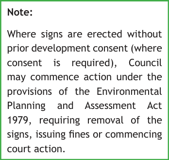
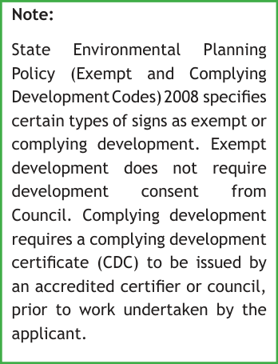

### 16.3 Relationship to other Environmental Planning Instruments,

#### Australian Standards, State Polices and Guidelines.

> [Picture on page 8: a picture, saved as a picture (images/vol-1-part-16-advertising-and-signage-page-8-3.gif, 150 dpi).]

#### Relationship

#### to other

#### Environmental

#### Note:

#### 16.3.1 State Environmental planning Policy No 64 - Advertising and Signage (SEPP 64)

#### Planning

#### Instruments

a)

a)	 Development applications for all forms

Development applications for all forms of signage shall comply with SEPP 64.

of signage shall comply with SEPP 64.

16.3.2 State Environmental Planning Policy (Exempt and Complying Development Codes) 2008

Where signs are erected without prior development consent (where consent is required), Council may commence action under the provisions of the Environmental Planning and Assessment Act 1979, requiring removal of the signs, issuing fines or commencing court action.

> [Picture on page 8: a picture, saved as a picture (images/vol-1-part-16-advertising-and-signage-page-8-30.gif, 150 dpi).]

#### Note:

a)

a)	 Development controls under this part

Development controls under this part shall apply to signs and advertisement

shall apply to signs and advertisement that are not considered exempt or

that are not considered exempt or complying development under  State

complying development under  State Environmental Planning Policy (Exempt

Environmental Planning Policy (Exempt and Complying Development Codes)

and Complying Development Codes) 2008.

2008.

#### 16.3.3 Transport Corridor Outdoor Advertising and Signage Guidelines

a)

a)	 This Guideline is required to be

This Guideline is required to be considered where signage is proposed

considered where signage is proposed to be located on Transport Corridor

to be located on Transport Corridor land as identified under SEPP 64.

land as identified under SEPP 64.

#### 16.3.4 Australian Standards (AS)

State Environmental Planning Policy (Exempt and Complying Development Codes) 2008  specifies certain types of signs as exempt or complying development. Exempt development does not require development consent from Council. Complying development requires a complying development certificate (CDC) to be issued by an accredited certifier or council, prior to work undertaken by the applicant.

a)

a)	 Some AS contain provisions relating

Some AS contain provisions relating to the construction and external

to the construction and external illumination devices  for signage that

illumination devices  for signage that need to be complied with. The relevant

need to be complied with. The relevant AS  include:

AS  include:

#### Note:

i)

i)	 AS 4282 - Control of the Obtrusive

AS 4282 - Control of the Obtrusive Effects of Outdoor Lighting;

Effects of Outdoor Lighting; ii)

ii)	 AS/NZS 1170.0:2002, Structural

AS/NZS 1170.0:2002, Structural Design Actions, Part 0:General

Design Actions, Part 0:General Principles;

Principles;

Signs that may fall outside the type of signs defined under Section
