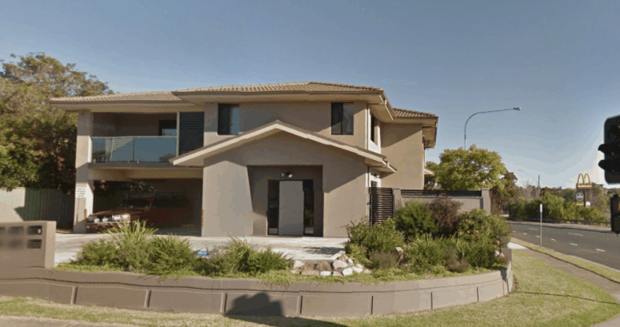

## Part 17 Boarding Houses and Co-Living

### Housing

### 17.1 Application

#### Application

This Part of the Plan sets out development controls relating to boarding house and co-living housing including newly proposed boarding houses and co-living housing or the conversion or adaptation of an existing building to either of these land uses within the Campbelltown LGA. Note: All boarding house and co-living housing developments shall be subject to annual fire safety and compliance inspections by Council. The Boarding House Act 2012 (BH Act) sets out registration requirements and occupancy principles for ‘registrable boarding houses’ (as defined under the  BH Act) to ensure delivery of quality accommodation services and protection of the wellbeing and living amenity of residents. The BH Act is available for view the NSW legislation website at: www.legislation.nsw.gov.au

#### Note:

#### Note:

Under the CLEP, and the ARH SEPP boarding houses are permissible within the  following zones:

•	• R3 Medium Density Residential;

R3 Medium Density Residential;

This Part  shall  be read in conjunction with the provisions of the State Environmental Planning Policy (Housing) 2021 (Housing SEPP).

•	• R4 High Density Residential;

R4 High Density Residential;

•	• B1 Neighbourhood Centre

B1 Neighbourhood Centre

#### Building Code of Australia

•	• B2 Local Centre; and

B2 Local Centre; and

•	• B4 Mixed Use;

B4 Mixed Use;

Boarding houses may be classified as Class 1b or Class 3 under the BCA, depending on the number of residents. Class 3 buildings are subject to more stringent fire safety requirements. For further information refer to the BCA.

> [Picture on page 2: a picture, saved as a picture (images/vol-1-part-17-boarding-houses-and-co-living-housing-page-2-42.gif, 150 dpi).]

Fig 17.1 A boarding house in Campbelltown
