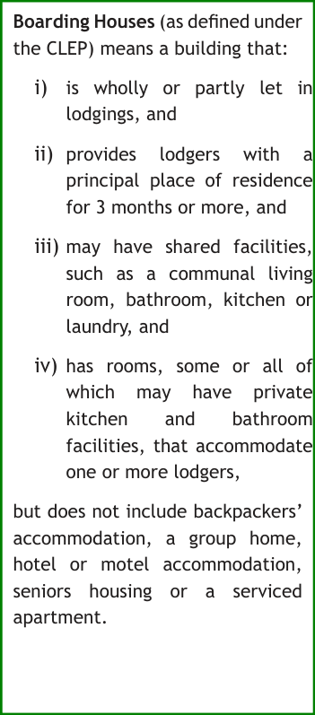

### 17.2 17.2 General Requirements for Boarding Houses and Co-Living

#### Housing

#### General

#### Requirements

Objectives:

#### for Boarding

Houses and

#### Co-Living

■ Ensure that boarding house and co-living housing developments are of  high quality design and consistent with the desired future character of the locality;

#### Housing

■ Ensure that boarding houses and co-living housing developments do not adversely impact on the residential amenity of adjoining residents. ■ Provide appropriate levels of amenity (internal and external) for residents within boarding houses and co-living housing. ■ Ensure that boarding house and co-living housing developments are designed to provide sufficient communal facilities for the occupants in terms of communal indoor and outdoor areas, kitchen and laundry facilities.

#### Note

#### 17.2.1 Site and Size Requirements

#### 17.2.1 Site and Size Requirements

For the purpose of this Part:

a)	 Boarding houses located within land zoned R2 Low Density Residential zone

R2 Low Density Residential zone

under the CELP or

under the CELP or  land zoned Zone 2(b)

land zoned Zone 2(b)

Residential B Zone under LEP 2002 shall

Residential B Zone under LEP 2002 shall have a maximum of 12 boarding rooms.

have a maximum of 12 boarding rooms.

Low and medium density residential areas shall be taken to mean any land zoned R2 Low Density Residential, R3 Medium Density Residential, under the CLEP, or where relevant, any land zoned Zone 2(b) Residential B Zone under LEP 2002.

b)

b)	 Any sites proposing the construction of

Any sites proposing the construction of a boarding house or co-living housing

a boarding house or co-living housing development must have a minimum

development must have a minimum road frontage of 15 metres and a

road frontage of 15 metres and a minimum site area which meets the

minimum site area which meets the following requirements, for both land

following requirements, for both land uses, in the R3 (Medium Density) and

uses, in the R3 (Medium Density) and

R4 (High Density) zones: -

R4 (High Density) zones: -i)

i)	 R3 – Minimum lot size of   800 sqm;

R3 – Minimum lot size of   800 sqm; ii)

ii)	 R4 – Minimum lot size of    1,200 sqm.

R4 – Minimum lot size of    1,200 sqm.

High density residential areas  shall be taken to mean  any land zoned

R4 High Density Residential under the CLEP, or where relevant any land where residential apartment buildings are permissible under LEP 2002.

c)	 No boarding house or co-living housing development is permitted to be erected on a battle-axe allotment.

d)	 No boarding house or co-living housing

Local and neighbourhood centres shall be taken to mean any land zoned B1 Neighbourhood Centre or

B2 Local Centre under the CLEP or where relevant areas zoned Zone 3(c) Neighbourhood Business Zone under LEP 2002.

development shall be permitted on properties where any part of the allotment is within 50 metres of the commencement of the head of a cul-de-sac to which vehicular access  to the site is obtained.

e)	 No Boarding house or ‘co-living housing’ development shall be permitted on any

Mixed use areas shall be taken to mean any land zoned B4  Mixed Use under the CLEP, or where relevant areas zoned Zone 10 (a) Regional Comprehensive Centre Zone under LEP 2002.

streets/roads etc. that are unable provide on-street parking.

> [Picture on page 4: a picture, saved as a picture (images/vol-1-part-17-boarding-houses-and-co-living-housing-page-4-3.gif, 150 dpi).]
> Words printed on the picture (title and legend, copied from the PDF):
> i)
> i)	 is wholly or partly let in
> ii)
> ii)	 provides lodgers with a
> iii)
> iii)	may have shared facilities,
> iv)
> iv)	has rooms, some or all of

Boarding Houses (as defined under the CLEP) means a building that:

#### General

#### Requirements

#### for Boarding

is wholly or partly let in lodgings, and

lodgings, and

Houses and

#### Co-Living

#### Housing

f)

f) Boarding houses or ‘co-living

Boarding houses or ‘co-living housing’ development within local,

housing’ development within local, neighbourhood centres and mixed use

neighbourhood centres and mixed use areas are not permitted to be located

areas are not permitted to be located at the ground floor level.

at the ground floor level.

provides lodgers with a principal place of residence

principal place of residence for 3 months or more, and

for 3 months or more, and

#### 17.2.2 Streetscape

#### 17.2.2 Streetscape

#### Design Requirements

may have shared facilities, such as a communal living

such as a communal living room, bathroom, kitchen or

room, bathroom, kitchen or laundry, and

laundry, and

Development consent will not be granted to any new ‘boarding house’ and /or ‘co-living housing’ development unless Council is satisfied that: -

has rooms, some or all of which may have private

which may have private kitchen and bathroom

kitchen and bathroom facilities, that accommodate

facilities, that accommodate one or more lodgers,

one or more lodgers,

a)

a)	 the design of the ‘boarding house’ or

the design of the ‘boarding house’ or ‘co-living housing’ development will

‘co-living housing’ development will be compatible with –

be compatible with – i)

i)	 the desirable elements of the

the desirable elements of the character of the local area, or

character of the local area, or

but does not include backpackers’ accommodation, a group home, hotel or motel accommodation, seniors housing or a serviced apartment.

ii)

ii)	 for precincts undergoing

for precincts undergoing transition—the desired future

transition—the desired future character of the precinct.

character of the precinct.

b)

b)	 The design of new purpose built

The design of new purpose built buildings (including facade

buildings (including facade treatments, building massing, roof

treatments, building massing, roof design and entrance features,

design and entrance features, setbacks and landscaping) shall

setbacks and landscaping) shall complement the scale of the

complement the scale of the surrounding  development.

surrounding  development. c)

c)	 New buildings on corner sites shall

New buildings on corner sites shall incorporate facade treatments that

incorporate facade treatments that address both street frontages and

address both street frontages and achieve positive articulation in

achieve positive articulation in building design.

building design. d)

d)	 Clothes lines and  air conditioning

Clothes lines and  air conditioning units shall be screened and not visible

units shall be screened and not visible by the public  when viewed from a

by the public  when viewed from a public area.

public area.

#### 17.2.3 Setbacks - Low and medium

#### 17.2.3 Setbacks - Low and medium density Residential Areas

density Residential Areas a)

a)	 All boarding house and co-housing

All boarding house and co-housing living developments shall be set back

living developments shall be set back a minimum of:

a minimum of:

i)

i)	 5.5 metres from the primary street

5.5 metres from the primary street boundary;

boundary;

#### General

#### Requirements

#### for Boarding

ii)

ii)	 3 metres from the secondary street

3 metres from the secondary street boundary;

boundary;

Houses and

#### Co-Living

iii)

iii)	0.9 metres from any side boundary at the

0.9 metres from any side boundary at the ground level;

ground level;

#### Housing

iv)

iv)	1.5 metres from any side boundary for all

1.5 metres from any side boundary for all levels above the ground level;

levels above the ground level; v)

v)	 5 metres from the rear boundary at the

5 metres from the rear boundary at the ground level;  and

ground level;  and vi)

vi)	10 metres from the rear boundary for

10 metres from the rear boundary for all levels above ground level within

all levels above ground level within land

land

zoned Zone 2(b) Residential B Zone under

zoned Zone 2(b) Residential B Zone under LEP 2002 or land zoned R2 under the CLEP.

LEP 2002 or land zoned R2 under the CLEP. vii)

vii)	 6.5 metres from the rear boundary for all

6.5 metres from the rear boundary for all levels above ground level within

levels above ground level within land zoned

land zoned

R3 under the CLEP.

R3 under the CLEP.

b)

b)	 Notwithstanding  17.2.3 a)  i) and ii), any

Notwithstanding  17.2.3 a)  i) and ii), any garage shall be setback a minimum of 6 metres

garage shall be setback a minimum of 6 metres from any street boundary.

from any street boundary.

c)	 Any ‘boarding house’ or ‘co-living housing’ development which is constructed to at least 3 storeys in height must demonstrate compliance with the minimum building separation distances specified in the Department of Planning and Environment’s ‘Apartment Design Guide’.

#### 17.2.4 Setbacks - (High density residential

#### 17.2.4 Setbacks - (High density residential areas)

areas)

a)	 Boarding house and co-living housing developments  within high density residential areas shall be setback a minimum of:

i)	 5.5 metres from any street boundary; and

ii)	 6 metres from any other boundary.

#### 17.2.5 Setbacks - (Local and neighbourhood

#### 17.2.5 Setbacks - (Local and neighbourhood centres

centres a)

a)	 Boarding house and co-living housing

Boarding house and co-living housing developments located on land within

developments located on land within neighbourhood and local centres shall be

neighbourhood and local centres shall be setback a minimum of:

setback a minimum of:

i)

i)	 3 metres from the primary street boundary;

3 metres from the primary street boundary;

#### General

#### Requirements

ii)

ii)	 3 metres from the secondary street

3 metres from the secondary street boundary;

boundary;

#### for Boarding

Houses and

#### Co-Living

iii)

iii)	3 metres from any side boundary where

3 metres from any side boundary where it adjoins residential properties or public

it adjoins residential properties or public open space;

open space;

#### Housing

iv)

iv)	0.9 metres from the side boundary in any

0.9 metres from the side boundary in any other case;

other case; v)

v)	 6 metres from the rear boundary where

6 metres from the rear boundary where it adjoins residential properties or public

it adjoins residential properties or public open space;

open space; vi)

vi)	 3 metres  from the rear boundary in any

3 metres  from the rear boundary in any other case.

other case.

b)

b)	 Despite clause 17.2.5 a) iv) above, boarding

Despite clause 17.2.5 a) iv) above, boarding house

house and co-living housing developments

and co-living housing developments

shall be permitted to be built on the side

shall be permitted to be built on the side boundary where in Council’s opinion the

boundary where in Council’s opinion the proposed development is considered as a

proposed development is considered as a continuation of an adjacent development

continuation of an adjacent development within the same section of the streetscape.

within the same section of the streetscape. c)

c)	 Despite clause 17.2.5 a) vi), reduced rear

Despite clause 17.2.5 a) vi), reduced rear setbacks shall be considered on merits.

setbacks shall be considered on merits.

#### 17.2.6 Setbacks - (Mixed Use areas)

#### 17.2.6 Setbacks - (Mixed Use areas)

a)	 Boarding house or co-living development within mixed use areas shall be setback a minimum of:

i)	 zero metres from any street boundary; and

ii)	 6 metres from any other boundary.

#### 17.2.7 Shared facilities

#### 17.2.7 Shared facilities

Development consent will not be granted unless

Development consent will not be granted unless Council is satisfied that: -

Council is satisfied that: -a)

a)	 No ‘boarding house’ or ‘co-living housing’

No ‘boarding house’ or ‘co-living housing’ room shall be occupied by more than 2 adults

room shall be occupied by more than 2 adults or have a gross floor area, excluding an area,

or have a gross floor area, excluding an area, if any, used for the purposes of private kitchen

if any, used for the purposes of private kitchen or bathroom facilities, which does not exceed

or bathroom facilities, which does not exceed more than 25m2 and is not less than—

more than 25m2 and is not less than— i)

i)	 12sqm for a private room intended to be

12sqm for a private room intended to be used by a single occupant, or

used by a single occupant, or ii)

ii)	 otherwise— 16sqm

otherwise— 16sqm

| 17.2 | b) b) | Adequate Adequate bathroom, bathroom, kitchen kitchen and and laundry laundry |
|---|---|---|
| General |  | facilities facilities shall shall be be provided provided within within the the ‘boarding ‘boarding house’ house’ or or ‘co-living ‘co-living housing’ housing’ development development for for |
| Requirements |  | the the use use of of each each resident, resident, in in the the following following |
| for Boarding |  | manner. manner. |
| Houses and Co-Living Housing | c) c) d) d) e) e) f) f) g) g) 17.2.8 17.2.8 Indoor Indoor Communal Communal living living areas areas a) a) | Where Where shared shared bathroom bathroom facilities facilities are are proposed, proposed, they they shall shall be be provided provided at at the the following following rates: rates: i) i) A A minimum minimum of of 1 1 bath bath or or shower shower for for each each 10 10 occupants occupants or or part part thereof;and thereof;and ii) ii) in in addition, addition, one one accessible accessible toilet toilet and and one one accessible accessible shower shower where where the the number number of of residents residents exceeds exceeds 5 5 or or more;and more;and iii) iii) a a closet closet pan pan and and a a washbasin washbasin with with hot hot and and cold cold running running water water for for each each toilet toilet provided; provided; and and Where Where the the number number of of residents residents is is 5 5 or or less, less, the the common common toilet/shower toilet/shower shall shall also also be be accessible accessible for for people people with with disabilities. disabilities. Toilets Toilets shall shall be be able able to to be be accessed accessed separately separately from from the the shower, shower, so so that that toilet toilet and and the the shower shower may may be be used used by by two two separate separate people people at at the the same same time. time. Where Where communal communal kitchen kitchen facilities facilities are are proposed, proposed, they they shall shall be be provided provided at at the the following following rates: rates: i) i) a a minimum minimum area area of of 8sqm 8sqm for for up up to to 10 10 occupants occupants and and 1sqm 1sqm additional additional area area for for every every 2 2 occupants occupants thereof. thereof. Laundry Laundry and and clothes clothes drying drying facilities facilities are are to to be be provided provided at at a a rate rate of: of: i) i) 1 1 washing washing machine machine and and washing washing tub tub for for every every 10 10 occupants occupants or or part part thereof; thereof; plus plus ii) ii) 1 1 clothes clothes dryer dryer for for every every 10 10 occupants occupants or or part part thereof thereof and; and; iii) iii) 1 1 fixed fixed clothesline clothesline of of at at least least 30 30 metres metres for for every every 10 10 occupants occupants or or part part thereof. thereof. Indoor Indoor communal communal living living areas areas for for a a boarding boarding house house or or co-living co-living housing housing development development containing containing 6 6 boarding boarding rooms rooms shall shall be be – – |

i)

i)	 a total of at least 30sqm of communal

a total of at least 30sqm of communal living area, and

living area, and

#### General

#### Requirements

#### for Boarding

ii)

ii)	 minimum dimensions of 3m for each

minimum dimensions of 3m for each communal living area,

communal living area,

Houses and

#### Co-Living

#### Housing

b)

b)	 Indoor communal living areas for a boarding

Indoor communal living areas for a boarding house or co-living housing development

house or co-living housing development containing more than 6 boarding rooms shall

containing more than 6 boarding rooms shall be-

be-i)

i)	 a total of at least 30sqm of communal

a total of at least 30sqm of communal living area plus at least a further 2sqm for

living area plus at least a further 2sqm for each boarding room in excess of 6 boarding

each boarding room in excess of 6 boarding rooms, and

rooms, and ii)

ii)	 minimum dimensions of 3m for each

minimum dimensions of 3m for each communal living area.

communal living area.

c)

c)	 Co-living housing developments shall also

Co-living housing developments shall also provide an appropriate workspace for the

provide an appropriate workspace for the manager, either within the communal living

manager, either within the communal living area or in a separately designated area.

area or in a separately designated area.

#### 17.2.9 Solar Access

#### 17.2.9 Solar Access

a)

a)	 A minimum 3 hours of direct solar access

A minimum 3 hours of direct solar access shall be provided into at least one (1) of the

shall be provided into at least one (1) of the proposed communal living areas between

proposed communal living areas between 9:00am and 3:00pm on 21 June.

9:00am and 3:00pm on 21 June. b)

b)	 Dwellings on adjoining properties are to

Dwellings on adjoining properties are to receive a minimum of 3 hours sunlight in

receive a minimum of 3 hours sunlight in habitable rooms and in at least 50% of the

habitable rooms and in at least 50% of the private open space between 9:00am and

private open space between 9:00am and 3:00pm on 21 June. a) A minimum 3 hours

3:00pm on 21 June. a) A minimum 3 hours of direct solar access shall be provided into

of direct solar access shall be provided into at least one (1) of the proposed communal

at least one (1) of the proposed communal living areas between 9:00am and 3:00pm on

living areas between 9:00am and 3:00pm on 21 June.

21 June. c)

c)	 Where existing adjoining development

Where existing adjoining development currently receives less sunlight than this

currently receives less sunlight than this requirement, this should not be unreasonably

requirement, this should not be unreasonably reduced. In order to demonstrate what can be

reduced. In order to demonstrate what can be achieved, shadow diagrams may be required

achieved, shadow diagrams may be required with the development application.

with the development application.

#### 17.2.10 Site Services Boarding Houses and

#### 17.2.10 Site Services Boarding Houses and Co-Living Housing

#### Co-Living Housing

a)

a)	 The location, design and construction of

The location, design and construction of utility services shall satisfy requirements of

utility services shall satisfy requirements of

the relevant servicing authority and Council.

the relevant servicing authority and Council.

#### General

#### Requirements

#### for Boarding

Houses and

b)

b)	 Adequate provision shall be made available

Adequate provision shall be made available for all essential services (i.e water, sewerage,

for all essential services (i.e water, sewerage, electricity, gas, telephone, internet and

electricity, gas, telephone, internet and stormwater drainage).

stormwater drainage).

#### Co-Living

c)

c)	 All site services shall be placed underground.

All site services shall be placed underground.

#### Housing

d)

d)	 All communication dishes, antennae and

All communication dishes, antennae and the like shall be located to minimise visual

the like shall be located to minimise visual prominence.

prominence.

#### 17.2.11 Visual Privacy

#### 17.2.11 Visual Privacy

a)

a)	 No window of a habitable room or balcony

No window of a habitable room or balcony shall directly face a window of another

shall directly face a window of another habitable room, balcony or private open

habitable room, balcony or private open space of another dwelling located within 6

space of another dwelling located within 6 metres of the proposed window or balcony

metres of the proposed window or balcony unless appropriately screened.

unless appropriately screened. b)

b)	 Notwithstanding Clause 3.4.3.2 a) any window

Notwithstanding Clause 3.4.3.2 a) any window of a living room located on an upper level

of a living room located on an upper level shall:

shall: i)

i)	 be offset by 2 metres to limit views

be offset by 2 metres to limit views between windows and balconies; or

between windows and balconies; or ii)

ii)	 have a sill height 1.7 metres above the

have a sill height 1.7 metres above the floor level; or

floor level; or iii)

iii)	be splayed to avoid direct views  between

be splayed to avoid direct views  between windows; or

windows; or iv)

iv)	have fixed translucent glazing in any part

have fixed translucent glazing in any part of the window within 1.7 metres of the

of the window within 1.7 metres of the floor level.

floor level.

c)

c)	 Notwithstanding 17.2.11 a), a balcony will only

Notwithstanding 17.2.11 a), a balcony will only be considered where the private open space

be considered where the private open space area of any adjacent dwelling is screened

area of any adjacent dwelling is screened from view.

from view.

#### 17.2.12 Signage

#### 17.2.12 Signage

a)

a)	 Signage shall be limited to a maximum of 1

Signage shall be limited to a maximum of 1 sign per building, detailing only the name and

sign per building, detailing only the name and address of the premises and contact details of

address of the premises and contact details of the managing agent.

the managing agent. b)

b)	 Signage must be affixed to the front elevation

Signage must be affixed to the front elevation and not to the fence.

and not to the fence. c)

c)	 The sign shall have a maximum area of 0.25sqm

The sign shall have a maximum area of 0.25sqm

and a maximum height of 0.5 metres.

and a maximum height of 0.5 metres. d)

d)	 Signage shall be non-illuminated.

Signage shall be non-illuminated.

#### General

#### Requirements

#### 17.2.12 Private Open Space

#### 17.2.12 Private Open Space

#### for Boarding

Houses and

#### Co-Living

#### Housing

a)

a)	 A minimum of one communal private open

A minimum of one communal private open space area shall be provided for use by all

space area shall be provided for use by all lodgers which is at least 20% of the total site

lodgers which is at least 20% of the total site area in size, with a minimum dimension in

area in size, with a minimum dimension in each direction of 3m.

each direction of 3m. b)

b)	 A minimum of one communal private open

A minimum of one communal private open space area of 20 m

space area of 20 m2 with a minimum dimension

with a minimum dimension

in each direction of 3 m shall to be provided

in each direction of 3 m shall to be provided for use by lodgers.

for use by lodgers. c)

c)	 Where the boarding house or co-living housing

Where the boarding house or co-living housing development is not within walking distance

development is not within walking distance (400 m) to a public park the communal

(400 m) to a public park the communal private open space shall have a minimum area

private open space shall have a minimum area of 30 m

of 30 m2 with a minimum dimension in each

with a minimum dimension in each

direction of 3 m

direction of 3 m2. d)

d)	 The area of the communal private open space

The area of the communal private open space shall be directly adjacent to, and accessible

shall be directly adjacent to, and accessible from, the main indoor communal living area.

from, the main indoor communal living area.
