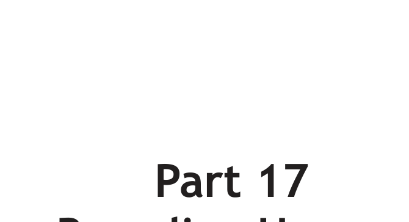

# Campbelltown Sustainable City Development Control Plan 2015 - Part 17 Boarding Houses and Co-Living Housing

> This chapter is split into 6 section file(s), one per numbered heading, in the order they appear in the PDF.

Source PDF: [part-17-boarding-houses-amendment-21-sept2024.pdf](part-17-boarding-houses-amendment-21-sept2024.pdf)

> [Picture on page 1: a picture, saved as a picture (images/vol-1-part-17-boarding-houses-and-co-living-housing-page-1-1.gif, 150 dpi).]

<!-- sections -->
## Sections

1. [17.1 Application](01-17-1-application.md)
2. [17.2 17.2 General Requirements for Boarding Houses and Co-Living](02-17-2-17-2-general-requirements-for-boarding.md)
3. [17.3 17.3 Car Parking and Access](03-17-3-17-3-car-parking-and-access.md)
4. [17.4 17.4 Landscaping](04-17-4-17-4-landscaping.md)
5. [17.5 Waste Management](05-17-5-waste-management.md)
6. [17.6 17.6 Management Plan](06-17-6-17-6-management-plan.md)
